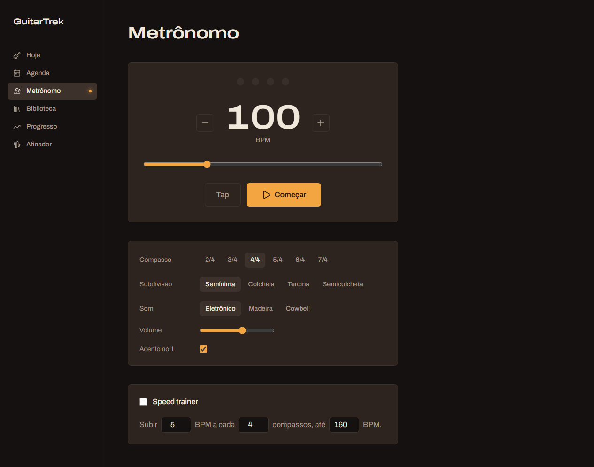
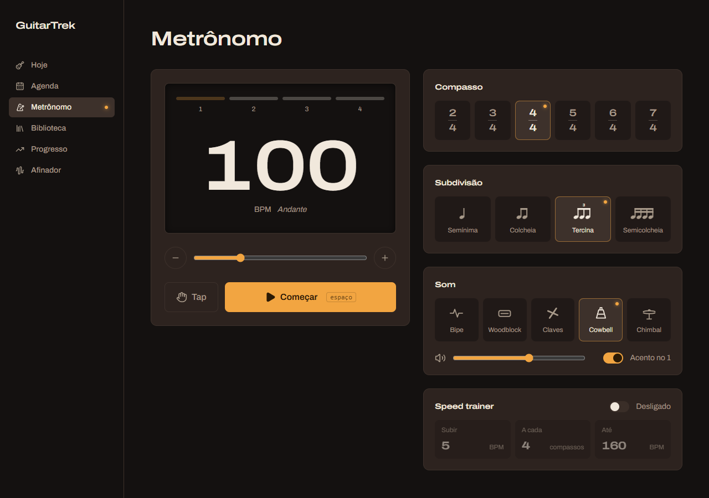

# Aula 03d — Metrônomo (parte 4): visual de painel

> 💡 Abra com **`Ctrl+Shift+V`**. Deixe rodando: `npm run dev --prefix web` e o navegador em http://localhost:5173/metronomo.

## O que vamos fazer

A tela sai do "formulário com botões" e vira **equipamento**: um visor com LEDs, compassos escritos como na partitura, figuras rítmicas desenhadas e um ícone para cada instrumento.

| Antes | Depois |
|---|---|
|  |  |

Você mexe em **um único arquivo**: `web/src/pages/Metronomo.tsx`. É a aula mais "de tela" até agora, então ela é dividida em **9 etapas pequenas**. **Depois de cada etapa a tela funciona e muda um pouco**, então você sempre vê o resultado do que acabou de fazer.

**Pré-requisito:** aula 03c feita (os sons gravados funcionam).

**Já está pronto (eu fiz, é infraestrutura):**
- `web/src/components/IconesMusicais.tsx`: os ícones das figuras rítmicas e dos instrumentos, desenhados em SVG.
- O token `--sombra` em `web/src/index.css`, para a sombra interna do visor.

**Fica para a aula 03e:** o drone e o painel flutuante.

---

## Como ler as instruções desta aula

Toda mudança vem neste formato:

> 📍 **Onde:** o arquivo e a parte dele.
> ❌ **Está assim hoje:** o código atual (para você achar o lugar).
> ✅ **Deixe assim:** o código novo, **completo**.

Onde eu mostro "Deixe assim", você **apaga o bloco antigo inteiro e cola o novo**.

---

## Mini-curso: como ler uma `className`

As aulas anteriores já usaram Tailwind, mas aqui as classes ficam mais longas. Aprenda a **ler** uma, e nenhuma vai parecer mágica.

Uma `className` é uma **lista de instruções separadas por espaço**. Cada palavra faz **uma** coisa pequena:

```tsx
<div className="flex flex-col gap-3 rounded-xl border bg-card p-5">
```

Lendo uma palavra por vez:

| Palavra | Faz o quê |
|---|---|
| `flex` | Os filhos ficam **em fila** (lado a lado). |
| `flex-col` | ...mas em **coluna** (um embaixo do outro). |
| `gap-3` | Espaço de `0,75rem` (12px) **entre** os filhos. |
| `rounded-xl` | Cantos bem arredondados. |
| `border` | Borda fina de 1px. |
| `bg-card` | Cor de fundo = token "card". |
| `p-5` | Espaço **interno** (padding) de `1,25rem` em todos os lados. |

### A tabela de consulta (volte aqui sempre que travar)

**Números:** a escala é de 4 em 4 pixels. `1` = 4px, `2` = 8px, `3` = 12px, `4` = 16px, `5` = 20px, `6` = 24px, `8` = 32px.

| Prefixo/letra | Significa | Exemplo |
|---|---|---|
| `p-` / `px-` / `py-` | padding em tudo / horizontal / vertical | `px-5 py-3` |
| `m-` / `mt-` / `ml-` | margem em tudo / em cima / à esquerda | `mt-2` |
| `gap-` | espaço entre filhos de flex/grid | `gap-4` |
| `size-N` | largura **e** altura iguais | `size-4` (16×16px) |
| `w-` / `h-` | largura / altura | `w-full` (100%), `h-8` |
| `text-` + tamanho | tamanho da letra | `text-xs`, `text-sm`, `text-xl`, `text-8xl` |
| `text-` + cor | cor da letra | `text-muted-foreground` |
| `bg-` | cor de fundo | `bg-primary` |
| `border-` + cor | cor da borda | `border-primary` |
| `rounded-` | arredondamento | `rounded-lg`, `rounded-full` (círculo) |
| `font-` | peso/tipo da letra | `font-semibold`, `font-heading` |
| `items-center` | centraliza os filhos no eixo **cruzado** | |
| `justify-between` | empurra os filhos para as pontas | |

**Prefixos com `:` — "só quando...":**

| Prefixo | Quando vale |
|---|---|
| `hover:` | O mouse está em cima. `hover:bg-accent` = fundo accent **só** no hover. |
| `sm:` / `lg:` | A tela tem **pelo menos** 640px / 1024px de largura. `sm:text-9xl` = letra gigante só em telas a partir de 640px. **Sem prefixo = vale para o celular.** |

**Truques de escrita:**

| Escrita | Significa |
|---|---|
| `bg-primary/50` | A cor `primary` com **50% de opacidade**. |
| `shadow-[0_0_12px_red]` | Colchetes `[...]` = "valor personalizado". Aqui, uma sombra feita à mão (os `_` viram espaços). |
| `` className={`a ${cond ? 'b' : 'c'}`} `` | Crases + `${}` = classes que **mudam** conforme uma condição. É o `$"..."` do C#. |

> 🎯 **Regra desta aula:** quando aparecer uma classe que você não conhece, **procure nesta tabela**. Se não estiver aqui, eu explico logo abaixo do código.

---

## Etapa 1 — Imports e o nome do andamento

Sem mudança visível. Só preparação.

### 1a. Os imports

> 📍 **Onde:** as primeiras 4 linhas de `web/src/pages/Metronomo.tsx`.

❌ **Está assim hoje:**

```tsx
import { Minus, Pause, Play, Plus } from 'lucide-react'
import { SONS, useMetronome } from '@/hooks/useMetronome'
import { motion } from 'motion/react'
import { useEffect, type ReactNode } from 'react'
```

✅ **Deixe assim:**

```tsx
import { Hand, Minus, Pause, Play, Plus, Volume2 } from 'lucide-react'
import { SONS, useMetronome } from '@/hooks/useMetronome'
import { IconeSubdivisao, IconesSom } from '@/components/IconesMusicais'
import { motion } from 'motion/react'
import { useEffect, type ReactNode } from 'react'
```

Entraram `Hand` (mão, para o Tap), `Volume2` (alto-falante) e os ícones musicais que eu já deixei prontos. O VS Code vai deixá-los **apagadinhos** (cinza): é só porque ainda não usamos. Normal.

### 1b. A lista de andamentos

Músicos dão **nomes italianos** às faixas de BPM: 100 BPM é *Andante*, 130 é *Allegro*. Vamos mostrar isso embaixo do número.

> 📍 **Onde:** logo abaixo da lista `SUBDIVISOES` (e acima de `export function Metronomo`).

✅ **Cole:**

```tsx
const ANDAMENTOS = [
    { ate: 60, nome: 'Largo' },
    { ate: 76, nome: 'Adagio' },
    { ate: 108, nome: 'Andante' },
    { ate: 120, nome: 'Moderato' },
    { ate: 156, nome: 'Allegro' },
    { ate: 176, nome: 'Vivace' },
    { ate: 200, nome: 'Presto' },
    { ate: Infinity, nome: 'Prestissimo' },
]
```

Leia assim: "abaixo de 60 é Largo; abaixo de 76 é Adagio; abaixo de 108 é Andante..." A lista está **em ordem crescente**, e o último é `Infinity` (infinito), que é maior que qualquer BPM: garante que sempre sobra uma resposta.

### 1c. Descobrir o nome do BPM atual

> 📍 **Onde:** dentro de `Metronomo()`, logo depois da linha `const { tocando, setTocando } = m`.

✅ **Cole:**

```tsx
    const andamento = ANDAMENTOS.find((a) => m.bpm < a.ate)!.nome
```

| Pedaço | O que faz |
|---|---|
| `ANDAMENTOS.find(...)` | Devolve o **primeiro** item que passa no teste. É o `First()` do LINQ. |
| `(a) => m.bpm < a.ate` | O teste: "o BPM é menor que o limite desta faixa?". Com BPM 100, a primeira faixa que passa é a de 108: Andante. |
| `.nome` | Pega só o nome da faixa encontrada. |
| `!` | "Confie em mim, não é `undefined`." É o `!` do C# com nullable. Seguro aqui por causa do `Infinity`. |

✅ **Confira:** a tela está **igual**. Sem sublinhado vermelho.

---

## Etapa 2 — Os ladrilhos de escolha (`Escolha`)

Os botões de compasso, subdivisão e som vão virar "ladrilhos" com uma **luz piloto** âmbar no canto quando selecionados (igual ao menu lateral do app).

> 📍 **Onde:** no **fim** do `Metronomo.tsx`, a função `Escolha`.

❌ **Está assim hoje:**

```tsx
function Escolha({ ativo, onClick, children }: { ativo: boolean; onClick: () => void; children: ReactNode }) {
    return (
        <button
            onClick={onClick}
            aria-pressed={ativo}
            className={`rounded-md px-3 py-1.5 text-sm font-medium ${ativo ? 'bg-accent text-foreground' : 'text-muted-foreground hover:text-foreground'
                }`}
        >
            {children}
        </button>
    )
}
```

✅ **Apague e deixe assim:**

```tsx
function Escolha({ ativo, onClick, rotulo, children }: { ativo: boolean; onClick: () => void; rotulo?: string; children: ReactNode }) {
    return (
        <button
            onClick={onClick}
            aria-pressed={ativo}
            aria-label={rotulo}
            className={`relative flex flex-col items-center justify-center gap-2 rounded-lg border px-1 py-3 transition-colors ${ativo
                ? 'border-primary/50 bg-accent text-foreground'
                : 'border-transparent bg-background/50 text-muted-foreground hover:border-border hover:text-foreground'
                }`}
        >
            {ativo && <span className="absolute top-1.5 right-1.5 size-1.5 rounded-full bg-primary shadow-[0_0_6px_var(--primary)]" />}
            {children}
        </button>
    )
}
```

### O que é novo

**Prop opcional `rotulo?`**: o `?` quer dizer "pode não vir". É um parâmetro `string? rotulo = null` do C#. Se um uso do `Escolha` não passar `rotulo`, tudo funciona igual.

### Decifrando a `className` (use a tabela de consulta)

A classe tem **duas partes**: a fixa (sempre vale) e a que muda com `ativo`.

**Fixa:**

| Palavra | Faz o quê |
|---|---|
| `relative` | Marca o botão como "ponto de referência" para a luz piloto (ver abaixo). |
| `flex flex-col items-center justify-center` | Conteúdo em coluna (ícone em cima, nome embaixo), centralizado nos dois eixos. |
| `gap-2` | 8px entre o ícone e o nome. |
| `rounded-lg border` | Canto arredondado e borda fina. |
| `px-1 py-3` | Pouco espaço nas laterais, mais em cima/embaixo. |
| `transition-colors` | Mudanças de cor **deslizam** em vez de pular. |

**Quando `ativo` é verdadeiro:** `border-primary/50` (borda âmbar a 50%) e `bg-accent` (fundo de destaque).

**Quando falso:** `border-transparent` (borda invisível, mas **ocupa o mesmo espaço**, então o botão não "pula" ao ser selecionado), `bg-background/50` (fundo da página meio transparente: o ladrilho parece afundado no cartão) e `hover:border-border` (no hover, a borda aparece).

### A luz piloto: `relative` + `absolute`

```tsx
{ativo && <span className="absolute top-1.5 right-1.5 size-1.5 rounded-full bg-primary shadow-[0_0_6px_var(--primary)]" />}
```

- `{ativo && <span/>}`: o `&&` é o "se" do JSX (você viu na aula 01): só desenha a luz se `ativo`.
- `absolute` tira o elemento do fluxo normal e o posiciona **em relação ao pai `relative` mais próximo**. O pai aqui é o botão. Por isso `top-1.5 right-1.5` significa "a 6px do topo e 6px da direita **do botão**".
- `size-1.5 rounded-full bg-primary`: uma bolinha âmbar de 6px.
- `shadow-[0_0_6px_var(--primary)]`: um brilho (sombra sem deslocamento, 6px de espalhamento) na cor `--primary`. Parece um LED aceso.

### O `aria-label={rotulo}`

Quando o botão só mostra um desenho (uma fração "4 sobre 4"), o leitor de tela não sabe o que ler. O `rotulo` dá o nome falado: "4 por 4".

✅ **Confira:** os botões da tela (Compasso, Subdivisão, Som) agora são **ladrilhos**: o selecionado tem borda âmbar e uma luzinha no canto. Ainda estão no layout antigo, e tudo bem.

---

## Etapa 3 — O esqueleto da página: duas colunas

Agora vamos reescrever o `return` da página, que é o grande. Primeiro só o **esqueleto**, vazio. Depois vamos enchendo.

> 📍 **Onde:** na função `Metronomo`, o bloco inteiro do `return ( ... )`. Vai do `return (` até o `)` antes do `}` que fecha a função.

❌ **Está assim hoje:** tudo, de `return (` com `<section className="flex max-w-xl flex-col gap-10">` até o `</section>` e o `)`.

✅ **Apague o `return (...)` inteiro e deixe só isto:**

```tsx
    return (
        <section className="flex max-w-5xl flex-col gap-8">
            <h1 className="text-4xl">Metrônomo</h1>

            <div className="grid items-start gap-6 lg:grid-cols-2">
                {/* Painel principal: visor + transporte */}
                <div className="flex flex-col gap-6 rounded-xl border bg-card p-5 sm:p-6 lg:sticky lg:top-12">
                    {/* Etapas 4 e 5 entram aqui */}
                </div>

                {/* Ajustes */}
                <div className="flex flex-col gap-6">
                    {/* Etapas 6 a 9 entram aqui */}
                </div>
            </div>
        </section>
    )
```

(`{/* ... */}` é um comentário dentro do JSX.)

### O que é novo: `grid`

O `flex` arruma itens numa **fila** (ou coluna). O `grid` arruma numa **tabela**.

- `grid` liga o modo tabela.
- `lg:grid-cols-2` = "a partir de 1024px de tela, **2 colunas** de mesma largura".
- **Sem** o `lg:`, não há `grid-cols`, então fica **uma coluna só**: o painel em cima e os ajustes embaixo. Um código, dois layouts.
- `gap-6` = 24px entre as células.

### O que é novo: `sticky`

`lg:sticky lg:top-12` faz o painel do visor **grudar** a 3rem (48px) do topo quando você rola a página: os ajustes rolam, o visor fica sempre à vista. É o comportamento de um painel de equipamento.

O `items-start` no grid é necessário: sem ele, o grid **estica** o painel até a altura da outra coluna e não sobra espaço para ele "andar".

✅ **Confira:** a tela mostra só o título "Metrônomo" e, em tela larga, uma caixa vazia à esquerda. **É isso mesmo.** Não se assuste com o resto sumido: vamos reconstruir.

---

## Etapa 4 — O visor (LEDs + número gigante)

> 📍 **Onde:** dentro da `<div>` do painel principal, no lugar do comentário `{/* Etapas 4 e 5 entram aqui */}`.

✅ **Cole:**

```tsx
                    <div className="flex flex-col gap-8 rounded-lg border bg-background px-5 pt-6 pb-8 shadow-[inset_0_2px_14px_var(--sombra)]">
                        <div className="flex gap-2">
                            {Array.from({ length: m.tempos }, (_, i) => {
                                const aceso = m.tempoAtual === i
                                return (
                                    <div key={i} className="flex flex-1 flex-col items-center gap-2">
                                        <motion.span
                                            animate={{ opacity: aceso ? 1 : 0.25 }}
                                            transition={{ duration: aceso ? 0 : 0.25 }}
                                            className={`h-1.5 w-full rounded-full bg-current ${i === 0 && m.acento ? 'text-primary' : 'text-foreground'} ${aceso ? 'shadow-[0_0_12px_currentColor]' : ''}`}
                                        />
                                        <span className={`text-xs tabular-nums ${aceso ? 'text-foreground' : 'text-muted-foreground'}`}>
                                            {i + 1}
                                        </span>
                                    </div>
                                )
                            })}
                        </div>

                        <div className="flex flex-col items-center gap-1">
                            <span className="font-heading text-8xl leading-none font-semibold tabular-nums font-stretch-expanded sm:text-9xl">
                                {m.bpm}
                            </span>
                            <span className="text-sm text-muted-foreground">
                                BPM <span className="ml-2 italic">{andamento}</span>
                            </span>
                        </div>
                    </div>
```

Dividido em duas metades. Cole tudo, depois leia.

### Metade 1: a caixa do visor (a `<div>` de fora)

`bg-background` (fundo da página, **mais escuro** que o cartão) + `border` + `shadow-[inset_0_2px_14px_var(--sombra)]`. O `inset` faz a sombra ser **para dentro**, como uma janela afundada no painel, igual ao display de um pedal. O `--sombra` é o token que eu já deixei pronto no `index.css`.

### Metade 2: os LEDs em barra

```tsx
{Array.from({ length: m.tempos }, (_, i) => { ... })}
```

Você já viu o `Array.from` + `map` nas bolinhas da aula 03: ele cria **uma barra para cada tempo** do compasso (`m.tempos` = 4 → 4 barras).

Uma novidade: antes usávamos `(_, i) => ( <JSX/> )` com **parênteses** (devolve direto). Aqui é `(_, i) => { ...; return ( <JSX/> ) }` com **chaves e `return`**. Use chaves quando você precisa **declarar uma variável antes** do JSX (no caso, `aceso`). É uma lambda de várias linhas do C#.

| Pedaço | O que faz |
|---|---|
| `const aceso = m.tempoAtual === i` | `true` se este LED é o tempo que está tocando agora. |
| `flex-1` (na `div` de cada LED) | Todos os LEDs **dividem a largura igualmente**. |
| `animate={{ opacity: aceso ? 1 : 0.25 }}` | Aceso = opaco; apagado = 25% (dá para ver que ele existe, como um LED de verdade). |
| `transition={{ duration: aceso ? 0 : 0.25 }}` | **Acender é instantâneo (`0`)**; apagar leva `0.25s`, deixando um "rastro". É como um LED real parece ao olho. |
| `bg-current` | O fundo da barra = **a cor do texto** dela. |
| `text-primary` / `text-foreground` | A cor do texto da barra (e, por causa do `bg-current`, a cor dela). O tempo 1 é âmbar **só se o acento estiver ligado** (`i === 0 && m.acento`): o visual diz a verdade sobre o som. |
| `shadow-[0_0_12px_currentColor]` | O brilho usa a cor do texto, que é a mesma da barra. LED âmbar brilha âmbar. |
| `tabular-nums` | Todos os dígitos com a mesma largura: "111" e "100" não mudam de tamanho e o número não fica tremendo. |
| `{i + 1}` | O número do tempo embaixo da barra (a contagem do `i` começa em 0, por isso o `+ 1`). |

### Metade 3: o número gigante

- `text-8xl` e `sm:text-9xl`: letra enorme; ainda maior a partir de 640px.
- `leading-none`: tira o espaço extra entre linhas (para o número não "flutuar").
- `font-heading ... font-stretch-expanded`: a fonte de título do app, em largura expandida (a regra de design do projeto).
- `BPM <span ...>{andamento}</span>`: o texto "BPM" e, ao lado, o nome italiano em itálico (`italic`), com `ml-2` (margem de 8px à esquerda para separar).

✅ **Confira:** à esquerda, um visor escuro com 4 barras apagadas, o número **100** gigante e "BPM *Andante*" embaixo.

---

## Etapa 5 — BPM e transporte (slider, Tap, Começar)

> 📍 **Onde:** ainda dentro da `<div>` do painel principal, **logo abaixo** do visor que você colou (depois do `</div>` que o fecha).

✅ **Cole:**

```tsx
                    <div className="flex items-center gap-3">
                        <BotaoRedondo rotulo="Diminuir BPM" onClick={() => m.mudarBpm(m.bpm - 1)}>
                            <Minus className="size-4" />
                        </BotaoRedondo>
                        <input
                            type="range"
                            min={30}
                            max={300}
                            value={m.bpm}
                            onChange={(e) => m.mudarBpm(Number(e.target.value))}
                            aria-label="BPM"
                            className="w-full accent-primary"
                        />
                        <BotaoRedondo rotulo="Aumentar BPM" onClick={() => m.mudarBpm(m.bpm + 1)}>
                            <Plus className="size-4" />
                        </BotaoRedondo>
                    </div>

                    <div className="flex gap-3">
                        <button
                            onClick={m.tap}
                            className="flex items-center gap-2 rounded-lg border px-5 py-3.5 font-medium text-muted-foreground hover:bg-accent hover:text-foreground"
                        >
                            <Hand className="size-5" />
                            Tap
                        </button>
                        <button
                            onClick={() => setTocando(!tocando)}
                            className="flex flex-1 items-center justify-center gap-2 rounded-lg bg-primary py-3.5 font-semibold text-primary-foreground hover:brightness-110"
                        >
                            {tocando ? <Pause className="size-5 fill-current" /> : <Play className="size-5 fill-current" />}
                            {tocando ? 'Parar' : 'Começar'}
                            <kbd className="ml-2 hidden rounded border border-primary-foreground/30 px-1.5 text-xs font-medium opacity-70 sm:inline">
                                espaço
                            </kbd>
                        </button>
                    </div>
```

O VS Code vai sublinhar `BotaoRedondo` de vermelho: ele ainda não existe. Crie agora:

> 📍 **Onde:** no **fim** do arquivo, depois da função `Numero` (ou de qualquer outra).

✅ **Cole:**

```tsx
function BotaoRedondo({ rotulo, onClick, children }: { rotulo: string; onClick: () => void; children: ReactNode }) {
    return (
        <button
            onClick={onClick}
            aria-label={rotulo}
            className="grid size-10 shrink-0 place-items-center rounded-full border text-muted-foreground hover:bg-accent hover:text-foreground"
        >
            {children}
        </button>
    )
}
```

### O que é novo

| Pedaço | O que faz |
|---|---|
| `BotaoRedondo` | Um componente seu, com `children` (você viu na aula 03b): o `<Minus/>` entre as tags vira o conteúdo do botão. |
| `grid place-items-center` | O jeito mais curto de **centralizar uma coisa no meio de uma caixa**. |
| `size-10 shrink-0 rounded-full` | 40×40px, um círculo, que **não encolhe** quando falta espaço. |
| `flex-1` no botão Começar | Ele ocupa **todo o espaço que sobra** na linha (o Tap fica com o tamanho do conteúdo). É a ação principal, então é o maior botão. |
| `fill-current` | Pinta o **interior** do ícone (o lucide vem só com contorno). Play e pause ficam "cheios", com cara de botão de transporte. |
| `hover:brightness-110` | No hover, clareia 10% **a cor que já está lá**. Não precisa de outra cor. |
| `<kbd>` | A tag HTML para "tecla do teclado". Lembra que a barra de espaço funciona. |
| `hidden sm:inline` | No celular (`hidden`) some; a partir de 640px (`sm:inline`) aparece. Celular não tem barra de espaço. |
| `border-primary-foreground/30` | A borda da tecla é a cor do texto do botão a 30%. |

O − e o + ficam nas **pontas do slider** porque os três controlam a mesma coisa.

✅ **Confira (a coluna da esquerda está pronta!):**
1. Slider entre **−** e **+**. Arraste até 130: o nome vira *Allegro*.
2. **Tap** e um **Começar** largo com a tecla "espaço" desenhada.
3. Dê Play: as barras acendem uma a uma com um rastro, e a primeira é **âmbar**.
4. Aperte a barra de espaço: para e começa.

---

## Etapa 6 — O cartão com título (`Grupo`) e o Compasso

A coluna da direita vai ter 4 cartões (Compasso, Subdivisão, Som, Speed trainer), todos com o mesmo formato: um título e um conteúdo. Vamos criar o cartão uma vez e usar 4 vezes.

### 6a. O componente `Grupo`

> 📍 **Onde:** no fim do arquivo.

✅ **Cole:**

```tsx
function Grupo({ titulo, extra, children }: { titulo: string; extra?: ReactNode; children: ReactNode }) {
    return (
        <div className="flex flex-col gap-3 rounded-xl border bg-card p-5">
            <div className="flex min-h-6 items-center justify-between gap-4">
                <h2 className="text-sm font-semibold">{titulo}</h2>
                {extra}
            </div>
            {children}
        </div>
    )
}
```

- `extra?: ReactNode`: uma prop **opcional** (o `?` de novo) que aceita qualquer pedaço de tela. Se não vier, `{extra}` não desenha nada. Vamos usá-la para pôr o interruptor do speed trainer ao lado do título.
- `justify-between`: empurra o título para a esquerda e o `extra` para a direita.
- `min-h-6`: altura mínima de 24px, para o título dos cartões **sem** `extra` ficar com a mesma altura dos que têm.

### 6b. O grupo Compasso

> 📍 **Onde:** na `<div className="flex flex-col gap-6">` da direita, no lugar do comentário `{/* Etapas 6 a 9 entram aqui */}`.

✅ **Cole:**

```tsx
                    <Grupo titulo="Compasso">
                        <div className="grid grid-cols-6 gap-2">
                            {COMPASSOS.map((n) => (
                                <Escolha key={n} ativo={m.tempos === n} onClick={() => m.setTempos(n)} rotulo={`${n} por 4`}>
                                    <span className="flex flex-col items-center font-heading text-lg leading-none font-semibold tabular-nums font-stretch-expanded">
                                        <span>{n}</span>
                                        <span className="my-1 h-px w-4 bg-current opacity-40" />
                                        <span>4</span>
                                    </span>
                                </Escolha>
                            ))}
                        </div>
                    </Grupo>
```

Este bloco você **vai manter**; os próximos grupos entram **abaixo** dele, na mesma coluna. Só mova o comentário `{/* Etapas 6 a 9... */}` para depois dele se quiser (ou apague).

| Pedaço | O que faz |
|---|---|
| `grid grid-cols-6 gap-2` | 6 ladrilhos de mesma largura, sempre alinhados. |
| `rotulo={`${n} por 4`}` | O nome para leitor de tela: "3 por 4". |
| As três `<span>` | Uma **fração**: o número de cima, uma linha e o `4` embaixo. |
| `my-1 h-px w-4 bg-current opacity-40` | A linha: 1px de altura (`h-px`), 16px de largura, da cor do texto (`bg-current`), meio apagada. |

✅ **Confira:** o cartão "Compasso", com 6 frações (2/4 a 7/4). O 4/4 tem borda âmbar e luzinha. Clique no 3/4: o visor passa a ter **3** barras.

---

## Etapa 7 — Subdivisão com figuras desenhadas

> 📍 **Onde:** na coluna da direita, **abaixo** do `</Grupo>` do Compasso.

✅ **Cole:**

```tsx
                    <Grupo titulo="Subdivisão">
                        <div className="grid grid-cols-4 gap-2">
                            {SUBDIVISOES.map((s) => (
                                <Escolha key={s.valor} ativo={m.subdivisao === s.valor} onClick={() => m.setSubdivisao(s.valor)}>
                                    <IconeSubdivisao valor={s.valor} className="h-8 w-auto" />
                                    <span className="text-xs">{s.nome}</span>
                                </Escolha>
                            ))}
                        </div>
                    </Grupo>
```

A grande novidade é o `<IconeSubdivisao>`: um **desenho** de verdade (semínima, colcheias, tercina...), feito em SVG.

### Conceito novo: SVG, um desenho feito de texto

Em vez de pixels, você descreve **formas**:

```html
<svg viewBox="0 0 24 24">
  <rect x="3" y="8" width="18" height="9" rx="2.5" />   <!-- retângulo de cantos arredondados -->
  <path d="M6.5 12.5h11" />                              <!-- uma linha -->
</svg>
```

- `viewBox="0 0 24 24"`: o "papel quadriculado" tem 24 × 24 unidades. O desenho **estica para qualquer tamanho** sem perder qualidade.
- `<path d="...">`: um traço. `M6.5 12.5` = "mova a caneta para o ponto (6,5 ; 12,5)", `h11` = "risque 11 unidades na horizontal".
- `fill="currentColor"` / `stroke="currentColor"`: pinta com **a cor do texto em volta**. Por isso o ícone fica âmbar, cinza ou claro conforme o botão, sem nenhuma cor fixa no código. (Os ícones do lucide funcionam do mesmo jeito.)

👉 **Abra `web/src/components/IconesMusicais.tsx` e dê uma olhada.** Você **não** precisa saber desenhar SVG. Repare só em duas coisas:

1. `IconeSubdivisao` recebe `valor` e desenha **N notas** com um `map` (o mesmo `Array.from` + `map` das barras do visor), ligadas por uma barra (2 barras na semicolcheia, um "3" em cima na tercina).
2. `IconesSom` é um **`Record`** (o dicionário da aula 03c) de **componentes**: `IconesSom['cowbell']` é o desenho do cowbell. A chave é o mesmo `id` dos sons.

`h-8 w-auto`: altura fixa de 32px e largura proporcional (a semicolcheia, com 4 notas, é mais larga que a semínima).

✅ **Confira:** o cartão "Subdivisão" com 4 ladrilhos, cada um com a **figura musical desenhada** em cima do nome. Escolha *Tercina* e dê Play: 3 cliques por tempo.

---

## Etapa 8 — Som, volume e acento

> 📍 **Onde:** na coluna da direita, **abaixo** do `</Grupo>` da Subdivisão.

✅ **Cole:**

```tsx
                    <Grupo titulo="Som">
                        <div className="grid grid-cols-3 gap-2 sm:grid-cols-5">
                            {SONS.map((s) => {
                                const Icone = IconesSom[s.id]
                                return (
                                    <Escolha
                                        key={s.id}
                                        ativo={m.som.id === s.id}
                                        onClick={() => {
                                            m.setSom(s)
                                            m.ouvir(s)
                                        }}
                                    >
                                        <Icone className="size-7" />
                                        <span className="text-xs">{s.nome}</span>
                                    </Escolha>
                                )
                            })}
                        </div>
                        <div className="mt-2 flex flex-wrap items-center gap-x-8 gap-y-4">
                            <label className="flex flex-1 items-center gap-3 text-sm text-muted-foreground">
                                <Volume2 className="size-5 shrink-0" />
                                <input
                                    type="range"
                                    min={0.05}
                                    max={1}
                                    step={0.05}
                                    value={m.volume}
                                    onChange={(e) => m.setVolume(Number(e.target.value))}
                                    aria-label="Volume"
                                    className="w-full min-w-32 accent-primary"
                                />
                            </label>
                            <Interruptor ligado={m.acento} onChange={m.setAcento}>
                                Acento no 1
                            </Interruptor>
                        </div>
                    </Grupo>
```

O VS Code vai sublinhar `Interruptor`. Crie-o:

> 📍 **Onde:** no fim do arquivo.

✅ **Cole:**

```tsx
function Interruptor({ ligado, onChange, children }: { ligado: boolean; onChange: (v: boolean) => void; children: ReactNode }) {
    return (
        <button
            role="switch"
            aria-checked={ligado}
            onClick={() => onChange(!ligado)}
            className="flex items-center gap-3 text-sm text-muted-foreground hover:text-foreground"
        >
            <span className={`flex h-5 w-9 items-center rounded-full p-0.5 transition-colors ${ligado ? 'bg-primary' : 'bg-muted'}`}>
                <span className={`size-4 rounded-full bg-foreground transition-transform ${ligado ? 'translate-x-4 bg-primary-foreground' : ''}`} />
            </span>
            {children}
        </button>
    )
}
```

### O `Interruptor` (o liga/desliga que substitui o checkbox)

- Um interruptor tem **duas peças**: o **trilho** (`span` arredondado, `h-5 w-9`) e a **bolinha** (`span` `size-4` dentro dele).
- **`translate-x-4`** empurra a bolinha 16px para a direita quando `ligado`. Com `transition-transform`, ela **desliza** em vez de pular.
- O trilho fica âmbar (`bg-primary`) ligado, e cinza (`bg-muted`) desligado.
- `role="switch"` + `aria-checked`: avisa o leitor de tela "isto é um interruptor, e está ligado/desligado". Acessibilidade de graça.
- `onChange: (v: boolean) => void`: a prop é uma **função que recebe um `boolean`** (o `Action<bool>` do C#). O clique chama `onChange(!ligado)`: o contrário do atual.

### Explicando o bloco do Som

| Pedaço | O que faz |
|---|---|
| `grid-cols-3 sm:grid-cols-5` | No celular, 3 por linha (5 ficaria apertado); a partir de 640px, os 5 numa linha. |
| `const Icone = IconesSom[s.id]` | Pega o componente de ícone do dicionário e guarda numa variável. |
| `<Icone className="size-7" />` | Usa a variável como se fosse uma tag. ⚠️ O nome **tem que começar com maiúscula**: `<icone />` o React acharia que é uma tag HTML chamada "icone". |
| `m.som.id === s.id` | Compara pelo `id`. (Antes era `m.som === s`, que compara se é **o mesmo objeto**: o `ReferenceEquals` do C#. Comparar pelo `id` é mais seguro.) |
| `onClick={() => { m.setSom(s); m.ouvir(s) }}` | O clique faz **duas** coisas: escolhe o som e **toca uma vez** (o `ouvir` que você criou na aula 03c!). Com chaves, a lambda aceita várias linhas. |
| `onChange={m.setAcento}` | Dá para passar a função direto, sem `(v) => m.setAcento(v)`. O `Interruptor` chama `onChange(true/false)` e o `setAcento` aceita exatamente isso. |
| `<label>` envolvendo o slider | Clicar no ícone de volume também foca o slider. |
| `flex-wrap` + `gap-x-8 gap-y-4` | Em tela estreita, o interruptor "cai" para a linha de baixo em vez de vazar da tela. |

✅ **Confira:**
1. O cartão "Som" com **5 ícones** (bipe, woodblock, claves, cowbell, chimbal).
2. **Clicar num som toca ele uma vez.** 🔔
3. O interruptor do acento **desliza**. Desligado, a primeira barra do visor deixa de ser âmbar.

---

## Etapa 9 — Speed trainer e a faxina

### 9a. O componente `Numero` novo

O campo numérico vai ganhar rótulo e unidade, como o display de um pedal.

> 📍 **Onde:** no fim do arquivo, a função `Numero`.

❌ **Está assim hoje:**

```tsx
function Numero({ rotulo, valor, onChange }: { rotulo: string; valor: number; onChange: (v: number) => void }) {
    return (
        <input
            type="number"
            ...
        />
    )
}
```

✅ **Apague e deixe assim:**

```tsx
function Numero({ rotulo, unidade, valor, onChange }: { rotulo: string; unidade: string; valor: number; onChange: (v: number) => void }) {
    return (
        <label className="flex flex-col gap-1.5 rounded-lg bg-background/50 px-3 py-2.5">
            <span className="text-xs text-muted-foreground">{rotulo}</span>
            <span className="flex flex-wrap items-baseline gap-x-1.5">
                <input
                    type="number"
                    min={1}
                    value={valor}
                    onChange={(e) => onChange(Number(e.target.value))}
                    className="w-16 min-w-0 bg-transparent font-heading text-xl font-semibold tabular-nums font-stretch-expanded text-foreground outline-none"
                />
                <span className="text-xs text-muted-foreground">{unidade}</span>
            </span>
        </label>
    )
}
```

- Envolver tudo em um **`<label>`** liga o texto ao campo: clicar em "Subir" coloca o cursor no número. E dispensa o `aria-label`.
- `bg-transparent outline-none`: o campo some, só o número aparece. A "caixa" visível é o `label`.
- `items-baseline`: o número grande e a unidade pequena se alinham pela **linha de base** do texto, como em "160 BPM" impresso.

### 9b. O grupo Speed trainer

> 📍 **Onde:** na coluna da direita, **abaixo** do `</Grupo>` do Som.

✅ **Cole:**

```tsx
                    <Grupo
                        titulo="Speed trainer"
                        extra={
                            <Interruptor ligado={m.trainer.ativo} onChange={(v) => m.setTrainer({ ...m.trainer, ativo: v })}>
                                {m.trainer.ativo ? 'Ligado' : 'Desligado'}
                            </Interruptor>
                        }
                    >
                        <div className={`grid grid-cols-3 gap-2 ${m.trainer.ativo ? '' : 'opacity-50'}`}>
                            <Numero rotulo="Subir" unidade="BPM" valor={m.trainer.aumento} onChange={(v) => m.setTrainer({ ...m.trainer, aumento: v })} />
                            <Numero rotulo="A cada" unidade="compassos" valor={m.trainer.aCada} onChange={(v) => m.setTrainer({ ...m.trainer, aCada: v })} />
                            <Numero rotulo="Até" unidade="BPM" valor={m.trainer.teto} onChange={(v) => m.setTrainer({ ...m.trainer, teto: v })} />
                        </div>
                    </Grupo>
```

- **JSX dentro de uma prop**: `extra={<Interruptor .../>}`. Um pedaço de tela é um valor como outro qualquer, dá para passá-lo como argumento. Aqui ele aparece ao lado do título "Speed trainer".
- `{ ...m.trainer, ativo: v }`: o spread da aula 03b (o `with` do C#): objeto novo igual ao antigo, trocando só `ativo`.
- `opacity-50` quando desligado: os campos continuam editáveis (dá para configurar antes de ligar), mas ficam "apagados", indicando que não estão valendo.

### 9c. Faxina: apagar o que ficou sem uso

O componente antigo `Ajuste` não é mais usado por ninguém. Procure `function Ajuste` no fim do arquivo e **apague a função inteira** (do `function Ajuste` até o `}` dela).

Se sobrou sublinhado cinza em algum `import`, apague esse nome da lista.

---

## ✅ O que você deve ver (a tela final)

Compare com a imagem "Depois" do começo da aula:

1. **Compasso** com frações; **Subdivisão** com as notas desenhadas; **Som** com 5 ícones. O escolhido tem borda âmbar e luz piloto no canto.
2. Clicar num som toca ele uma vez.
3. O interruptor do acento desliza; desligado, o primeiro LED fica claro em vez de âmbar.
4. O speed trainer, desligado, tem os três campos apagados.
5. **Role a página** num monitor grande: o visor fica parado, os ajustes rolam.
6. **Estreite a janela** (ou `F12` → ícone de celular): vira uma coluna só, com o visor em cima e os sons em 3 por linha.

### Se algo deu errado

| Sintoma | Causa provável |
|---|---|
| Tela toda branca/vazia, erro vermelho no Console | Uma `<tag>` ficou sem fechar (`</div>` faltando) ou sobrou. Veja o arquivo completo abaixo. |
| `'X' is not defined` / sublinhado vermelho num nome com maiúscula | Faltou colar o componente (`Grupo`, `Interruptor`, `BotaoRedondo`) ou o import. |
| O visor não "gruda" ao rolar | Falta `items-start` na `<div className="grid ...">`. |
| Só aparece uma coluna em tela larga | Falta `lg:grid-cols-2` ou a janela tem menos de 1024px. |
| Clicar no som não toca prévia | Falta `m.ouvir(s)` no `onClick`, ou `ouvir` não está no `return` do hook (aula 03c, Passo 5b). |

---

## 🔍 Seu arquivo deve estar assim (compare)

<details><summary>Clique para ver o <code>Metronomo.tsx</code> inteiro</summary>

```tsx
import { Hand, Minus, Pause, Play, Plus, Volume2 } from 'lucide-react'
import { SONS, useMetronome } from '@/hooks/useMetronome'
import { IconeSubdivisao, IconesSom } from '@/components/IconesMusicais'
import { motion } from 'motion/react'
import { useEffect, type ReactNode } from 'react'

const COMPASSOS = [2, 3, 4, 5, 6, 7]
const SUBDIVISOES = [
    { valor: 1, nome: 'Semínima' },
    { valor: 2, nome: 'Colcheia' },
    { valor: 3, nome: 'Tercina' },
    { valor: 4, nome: 'Semicolcheia' },
]
const ANDAMENTOS = [
    { ate: 60, nome: 'Largo' },
    { ate: 76, nome: 'Adagio' },
    { ate: 108, nome: 'Andante' },
    { ate: 120, nome: 'Moderato' },
    { ate: 156, nome: 'Allegro' },
    { ate: 176, nome: 'Vivace' },
    { ate: 200, nome: 'Presto' },
    { ate: Infinity, nome: 'Prestissimo' },
]

export function Metronomo() {

    const m = useMetronome()
    const { tocando, setTocando } = m
    const andamento = ANDAMENTOS.find((a) => m.bpm < a.ate)!.nome

    useEffect(() => {
        function aoTeclar(e: KeyboardEvent) {
            if (e.code === 'Space') {
                e.preventDefault()          // impede a página de rolar
                setTocando(!tocando)
            }
        }
        window.addEventListener('keydown', aoTeclar)
        return () => window.removeEventListener('keydown', aoTeclar)
    }, [tocando, setTocando])

    return (
        <section className="flex max-w-5xl flex-col gap-8">
            <h1 className="text-4xl">Metrônomo</h1>

            <div className="grid items-start gap-6 lg:grid-cols-2">
                {/* Painel principal: visor + transporte */}
                <div className="flex flex-col gap-6 rounded-xl border bg-card p-5 sm:p-6 lg:sticky lg:top-12">
                    <div className="flex flex-col gap-8 rounded-lg border bg-background px-5 pt-6 pb-8 shadow-[inset_0_2px_14px_var(--sombra)]">
                        <div className="flex gap-2">
                            {Array.from({ length: m.tempos }, (_, i) => {
                                const aceso = m.tempoAtual === i
                                return (
                                    <div key={i} className="flex flex-1 flex-col items-center gap-2">
                                        <motion.span
                                            animate={{ opacity: aceso ? 1 : 0.25 }}
                                            transition={{ duration: aceso ? 0 : 0.25 }}
                                            className={`h-1.5 w-full rounded-full bg-current ${i === 0 && m.acento ? 'text-primary' : 'text-foreground'} ${aceso ? 'shadow-[0_0_12px_currentColor]' : ''}`}
                                        />
                                        <span className={`text-xs tabular-nums ${aceso ? 'text-foreground' : 'text-muted-foreground'}`}>
                                            {i + 1}
                                        </span>
                                    </div>
                                )
                            })}
                        </div>

                        <div className="flex flex-col items-center gap-1">
                            <span className="font-heading text-8xl leading-none font-semibold tabular-nums font-stretch-expanded sm:text-9xl">
                                {m.bpm}
                            </span>
                            <span className="text-sm text-muted-foreground">
                                BPM <span className="ml-2 italic">{andamento}</span>
                            </span>
                        </div>
                    </div>

                    <div className="flex items-center gap-3">
                        <BotaoRedondo rotulo="Diminuir BPM" onClick={() => m.mudarBpm(m.bpm - 1)}>
                            <Minus className="size-4" />
                        </BotaoRedondo>
                        <input
                            type="range"
                            min={30}
                            max={300}
                            value={m.bpm}
                            onChange={(e) => m.mudarBpm(Number(e.target.value))}
                            aria-label="BPM"
                            className="w-full accent-primary"
                        />
                        <BotaoRedondo rotulo="Aumentar BPM" onClick={() => m.mudarBpm(m.bpm + 1)}>
                            <Plus className="size-4" />
                        </BotaoRedondo>
                    </div>

                    <div className="flex gap-3">
                        <button
                            onClick={m.tap}
                            className="flex items-center gap-2 rounded-lg border px-5 py-3.5 font-medium text-muted-foreground hover:bg-accent hover:text-foreground"
                        >
                            <Hand className="size-5" />
                            Tap
                        </button>
                        <button
                            onClick={() => setTocando(!tocando)}
                            className="flex flex-1 items-center justify-center gap-2 rounded-lg bg-primary py-3.5 font-semibold text-primary-foreground hover:brightness-110"
                        >
                            {tocando ? <Pause className="size-5 fill-current" /> : <Play className="size-5 fill-current" />}
                            {tocando ? 'Parar' : 'Começar'}
                            <kbd className="ml-2 hidden rounded border border-primary-foreground/30 px-1.5 text-xs font-medium opacity-70 sm:inline">
                                espaço
                            </kbd>
                        </button>
                    </div>
                </div>

                {/* Ajustes */}
                <div className="flex flex-col gap-6">
                    <Grupo titulo="Compasso">
                        <div className="grid grid-cols-6 gap-2">
                            {COMPASSOS.map((n) => (
                                <Escolha key={n} ativo={m.tempos === n} onClick={() => m.setTempos(n)} rotulo={`${n} por 4`}>
                                    <span className="flex flex-col items-center font-heading text-lg leading-none font-semibold tabular-nums font-stretch-expanded">
                                        <span>{n}</span>
                                        <span className="my-1 h-px w-4 bg-current opacity-40" />
                                        <span>4</span>
                                    </span>
                                </Escolha>
                            ))}
                        </div>
                    </Grupo>

                    <Grupo titulo="Subdivisão">
                        <div className="grid grid-cols-4 gap-2">
                            {SUBDIVISOES.map((s) => (
                                <Escolha key={s.valor} ativo={m.subdivisao === s.valor} onClick={() => m.setSubdivisao(s.valor)}>
                                    <IconeSubdivisao valor={s.valor} className="h-8 w-auto" />
                                    <span className="text-xs">{s.nome}</span>
                                </Escolha>
                            ))}
                        </div>
                    </Grupo>

                    <Grupo titulo="Som">
                        <div className="grid grid-cols-3 gap-2 sm:grid-cols-5">
                            {SONS.map((s) => {
                                const Icone = IconesSom[s.id]
                                return (
                                    <Escolha
                                        key={s.id}
                                        ativo={m.som.id === s.id}
                                        onClick={() => {
                                            m.setSom(s)
                                            m.ouvir(s)
                                        }}
                                    >
                                        <Icone className="size-7" />
                                        <span className="text-xs">{s.nome}</span>
                                    </Escolha>
                                )
                            })}
                        </div>
                        <div className="mt-2 flex flex-wrap items-center gap-x-8 gap-y-4">
                            <label className="flex flex-1 items-center gap-3 text-sm text-muted-foreground">
                                <Volume2 className="size-5 shrink-0" />
                                <input
                                    type="range"
                                    min={0.05}
                                    max={1}
                                    step={0.05}
                                    value={m.volume}
                                    onChange={(e) => m.setVolume(Number(e.target.value))}
                                    aria-label="Volume"
                                    className="w-full min-w-32 accent-primary"
                                />
                            </label>
                            <Interruptor ligado={m.acento} onChange={m.setAcento}>
                                Acento no 1
                            </Interruptor>
                        </div>
                    </Grupo>

                    <Grupo
                        titulo="Speed trainer"
                        extra={
                            <Interruptor ligado={m.trainer.ativo} onChange={(v) => m.setTrainer({ ...m.trainer, ativo: v })}>
                                {m.trainer.ativo ? 'Ligado' : 'Desligado'}
                            </Interruptor>
                        }
                    >
                        <div className={`grid grid-cols-3 gap-2 ${m.trainer.ativo ? '' : 'opacity-50'}`}>
                            <Numero rotulo="Subir" unidade="BPM" valor={m.trainer.aumento} onChange={(v) => m.setTrainer({ ...m.trainer, aumento: v })} />
                            <Numero rotulo="A cada" unidade="compassos" valor={m.trainer.aCada} onChange={(v) => m.setTrainer({ ...m.trainer, aCada: v })} />
                            <Numero rotulo="Até" unidade="BPM" valor={m.trainer.teto} onChange={(v) => m.setTrainer({ ...m.trainer, teto: v })} />
                        </div>
                    </Grupo>
                </div>
            </div>
        </section>
    )
}

function Grupo({ titulo, extra, children }: { titulo: string; extra?: ReactNode; children: ReactNode }) {
    return (
        <div className="flex flex-col gap-3 rounded-xl border bg-card p-5">
            <div className="flex min-h-6 items-center justify-between gap-4">
                <h2 className="text-sm font-semibold">{titulo}</h2>
                {extra}
            </div>
            {children}
        </div>
    )
}

function Escolha({ ativo, onClick, rotulo, children }: { ativo: boolean; onClick: () => void; rotulo?: string; children: ReactNode }) {
    return (
        <button
            onClick={onClick}
            aria-pressed={ativo}
            aria-label={rotulo}
            className={`relative flex flex-col items-center justify-center gap-2 rounded-lg border px-1 py-3 transition-colors ${ativo
                ? 'border-primary/50 bg-accent text-foreground'
                : 'border-transparent bg-background/50 text-muted-foreground hover:border-border hover:text-foreground'
                }`}
        >
            {ativo && <span className="absolute top-1.5 right-1.5 size-1.5 rounded-full bg-primary shadow-[0_0_6px_var(--primary)]" />}
            {children}
        </button>
    )
}

function Interruptor({ ligado, onChange, children }: { ligado: boolean; onChange: (v: boolean) => void; children: ReactNode }) {
    return (
        <button
            role="switch"
            aria-checked={ligado}
            onClick={() => onChange(!ligado)}
            className="flex items-center gap-3 text-sm text-muted-foreground hover:text-foreground"
        >
            <span className={`flex h-5 w-9 items-center rounded-full p-0.5 transition-colors ${ligado ? 'bg-primary' : 'bg-muted'}`}>
                <span className={`size-4 rounded-full bg-foreground transition-transform ${ligado ? 'translate-x-4 bg-primary-foreground' : ''}`} />
            </span>
            {children}
        </button>
    )
}

function BotaoRedondo({ rotulo, onClick, children }: { rotulo: string; onClick: () => void; children: ReactNode }) {
    return (
        <button
            onClick={onClick}
            aria-label={rotulo}
            className="grid size-10 shrink-0 place-items-center rounded-full border text-muted-foreground hover:bg-accent hover:text-foreground"
        >
            {children}
        </button>
    )
}

function Numero({ rotulo, unidade, valor, onChange }: { rotulo: string; unidade: string; valor: number; onChange: (v: number) => void }) {
    return (
        <label className="flex flex-col gap-1.5 rounded-lg bg-background/50 px-3 py-2.5">
            <span className="text-xs text-muted-foreground">{rotulo}</span>
            <span className="flex flex-wrap items-baseline gap-x-1.5">
                <input
                    type="number"
                    min={1}
                    value={valor}
                    onChange={(e) => onChange(Number(e.target.value))}
                    className="w-16 min-w-0 bg-transparent font-heading text-xl font-semibold tabular-nums font-stretch-expanded text-foreground outline-none"
                />
                <span className="text-xs text-muted-foreground">{unidade}</span>
            </span>
        </label>
    )
}
```

</details>

---

## 🏋️ Exercícios

### Exercício 1 — Andamento na cor certa 🎨

Faça o nome do andamento (*Andante*, *Allegro*...) ficar **âmbar** quando o speed trainer estiver ligado, como um aviso de "o BPM vai mudar sozinho". Sem cor fixa!

<details><summary>Dica</summary>

Procure o `<span className="ml-2 italic">`. Você já sabe fazer classes que mudam com uma condição (a `` `... ${cond ? 'a' : 'b'}` ``). O token do âmbar é `text-primary`.

</details>

<details><summary>Gabarito</summary>

```tsx
<span className={`ml-2 italic ${m.trainer.ativo ? 'text-primary' : ''}`}>{andamento}</span>
```

`text-primary` é o token do âmbar: se o tema mudar, o aviso muda junto.

</details>

### Exercício 2 — Um compasso a mais 🎼

Adicione o compasso **8/4** (oito tempos). Quantas linhas você muda?

<details><summary>Gabarito</summary>

**Uma**: `const COMPASSOS = [2, 3, 4, 5, 6, 7, 8]`. Mas o `grid-cols-6` só tem 6 colunas, então o 8/4 cai numa segunda linha. Para caber todos numa linha, troque para `grid-cols-7`. (Todo o resto é gerado pelo `map`: é a vantagem de guardar as opções como **dados**.)

</details>

### Exercício 3 — Caça à classe 🔍

Sem testar, diga o que cada uma faz: `lg:sticky`, `border-primary/50`, `hidden sm:inline`, `translate-x-4`.

<details><summary>Gabarito</summary>

- `lg:sticky`: em telas ≥ 1024px, o elemento gruda no topo ao rolar.
- `border-primary/50`: borda da cor `primary` com 50% de opacidade.
- `hidden sm:inline`: escondido no celular; a partir de 640px, aparece.
- `translate-x-4`: desloca o elemento 16px para a direita (a bolinha do interruptor).

</details>

### Exercício 4 — Pergunta rápida 🤔

Por que o LED usa `bg-current` + `text-primary` em vez de `bg-primary` direto?

<details><summary>Resposta</summary>

Porque o brilho `shadow-[0_0_12px_currentColor]` usa a **cor do texto** (`currentColor`), não a cor de fundo. Se o fundo fosse `bg-primary` mas o texto continuasse claro, o LED seria âmbar com brilho **branco**. Pondo a cor no `text-*` e fazendo o fundo copiá-la com `bg-current`, a barra e o brilho ficam sempre da mesma cor, e basta trocar **uma** classe para mudar os dois.

</details>

---

## 📖 Glossário novo

| Termo | Significado |
|---|---|
| **`className` como lista** | Cada palavra é uma instrução pequena. Leia uma por vez. |
| **`hover:` / `sm:` / `lg:`** | "Só quando o mouse está em cima" / "só em telas ≥ 640px" / "≥ 1024px". |
| **`bg-primary/50`** | A cor com 50% de opacidade. |
| **`shadow-[...]`** | Sombra personalizada. `inset` = para dentro; `currentColor` = cor do texto. |
| **`currentColor` / `bg-current`** | "A cor do texto aqui." Faz ícones e luzes seguirem o tema. |
| **Prop opcional `?`** | Uma prop que pode não vir (`string? x` do C#). |
| **`grid` / `grid-cols-N`** | Layout em tabela com N colunas iguais. |
| **`sticky`** | Gruda na tela ao rolar. |
| **`relative` / `absolute`** | O filho `absolute` se posiciona dentro do pai `relative` mais próximo. |
| **SVG** | Desenho descrito em texto, que estica sem perder qualidade. |
| **`find`** | O `First` do LINQ. |
| **`role="switch"`** | Diz ao leitor de tela que o botão é um interruptor. |
| **`<kbd>`** | Tag HTML para "tecla do teclado". |

---

✅ **Terminou?** Me avise. Na **aula 03e**: o **drone** (uma nota contínua para treinar escalas e afinação) e o **painel flutuante**, que deixa o metrônomo acessível em qualquer tela do app.
