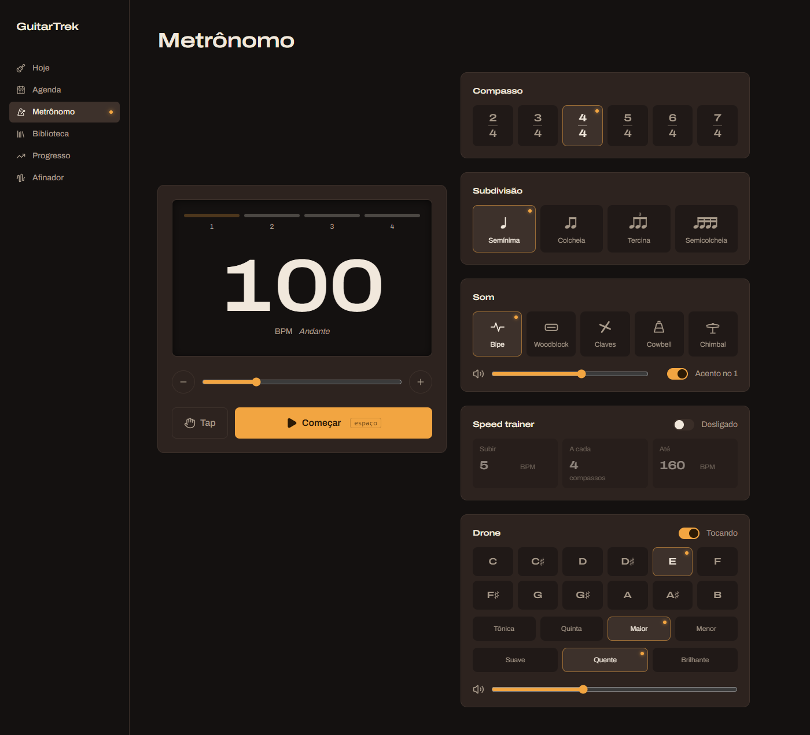

# Aula 03e — Metrônomo (parte 5): o drone

> 💡 Abra com **`Ctrl+Shift+V`**. Deixe rodando: `npm run dev --prefix web` e o navegador em http://localhost:5173/metronomo. **Ligue o som** (fone ajuda: o timbre "Suave" é grave e some em caixinha de notebook).

## O que vamos fazer

Um **drone** é uma nota (ou acorde) que fica soando **sem parar** enquanto você toca por cima. É o "chão" harmônico de quem estuda escalas: com um Mi soando, você ouve na hora se a sua escala de Mi menor está afinada, e que cor cada nota tem em cima dessa tônica.



No fim desta aula, a página do metrônomo ganha um cartão **Drone** com:
- **Tônica**: as 12 notas (C, C♯, D... B).
- **Acorde**: só a tônica, tônica + quinta (o "power chord"), maior ou menor.
- **Timbre**: Suave, Quente ou Brilhante.
- **Volume** e um **liga/desliga**.

Você mexe em **dois arquivos**:
1. `web/src/hooks/useDrone.ts`, um **hook novo** que você cria do zero. É o "motor" do drone.
2. `web/src/pages/Metronomo.tsx`, onde entra o cartão novo.

**Pré-requisito:** aula 03d feita.

**Fica para a aula 03f:** o painel flutuante (metrônomo e drone acessíveis em qualquer tela), o pulso animado e o knob de BPM.

---

## Como ler as instruções desta aula

Igual às anteriores:

> 📍 **Onde:** o arquivo e a parte dele.
> ❌ **Está assim hoje:** o código atual (para você achar o lugar).
> ✅ **Deixe assim / Cole:** o código novo, **completo**.

---

## Conceitos antes do código (leia sem digitar nada)

### Conceito 1 — Nota musical é um número: a frequência

Som é ar vibrando. A **frequência** diz quantas vezes por segundo ele vibra, em **Hz** (hertz). Quanto mais rápido, mais agudo.

O padrão do mundo inteiro é: **o Lá (A) do meio vibra a 440 Hz.** O resto sai de duas regras:

- **Subir uma oitava = dobrar a frequência.** A 440 → A 880 (uma oitava acima) → A 220 (uma abaixo).
- Uma oitava tem **12 semitons** (as 12 casas do braço até repetir a nota). Cada semitom multiplica a frequência pelo mesmo número: a raiz 12 de 2, ≈ 1,0595. Doze multiplicações seguidas dão exatamente 2 (uma oitava).

Para não lidar com "Mi da terceira oitava", a música digital dá **um número para cada nota**: o padrão **MIDI**. O Lá 440 é a nota **69**; cada semitom soma 1. Então:

| Nota | Número MIDI | Frequência |
|---|---|---|
| C3 (Dó grave) | 48 | 130,8 Hz |
| E3 (Mi) | 52 | 164,8 Hz |
| A3 (Lá) | 57 | 220 Hz |
| A4 (Lá 440) | 69 | 440 Hz |

E a fórmula que transforma número em frequência é uma linha:

```ts
440 * 2 ** ((nota - 69) / 12)
```

`**` é "elevado a" (o `Math.Pow` do C#). Leia: "parta de 440 e suba (ou desça) `nota - 69` semitons". Para a nota 57: `(57 - 69) / 12 = -1` → `440 * 2⁻¹ = 220`. Uma oitava abaixo. ✔

### Conceito 2 — Acorde é uma lista de distâncias

Se você sabe a tônica, um acorde é só **quantos semitons acima** fica cada nota dele. Isso se chama **intervalo**:

| Acorde | Intervalos | Em Mi (E) |
|---|---|---|
| Só a tônica | `[0]` | E |
| Quinta (power chord) | `[0, 7]` | E + B |
| Maior | `[0, 4, 7]` | E + G♯ + B |
| Menor | `[0, 3, 7]` | E + G + B |

Guardando o acorde como **dados** (uma lista de números), o código que toca é um só, e vale para qualquer tônica e qualquer acorde. Mesma ideia das listas `COMPASSOS` e `SONS` que você já tem.

### Conceito 3 — O oscilador de novo, agora sem parar

Na aula 03 o clique era um **oscilador** (`OscillatorNode`, um gerador de onda) que tocava 0,05 s e parava. O drone é o mesmo oscilador, mas a gente chama `start()` e **não agenda o `stop()`**: ele toca até mandarmos parar.

O **tipo de onda** muda o timbre:

| `type` | Som | Nome no app |
|---|---|---|
| `'sine'` (senoidal) | Puro, macio, quase um assobio | Suave |
| `'triangle'` (triangular) | Um pouco mais cheio, tipo flauta | Quente |
| `'sawtooth'` (dente de serra) | Cheio de harmônicos, áspero, tipo sintetizador | Brilhante |

### Conceito 4 — O caminho do som do drone

```
oscilador ─┐
oscilador ─┼──▶ filtro ──▶ ganho da voz ──▶ ganho mestre ──▶ 🔊
oscilador ─┘   (tone)     (fade in/out)    (volume)
```

Peça por peça:

- **Um oscilador por nota do acorde.** O acorde maior tem 3 notas, então 3 osciladores, todos ligados no mesmo filtro.
- **Filtro** (`BiquadFilterNode`): é o **knob de Tone** do seu amplificador. Por padrão ele é um *passa-baixa*: deixa passar os graves e corta os agudos acima de uma frequência. Vamos cortar acima de 1500 Hz, para o "Brilhante" não arranhar o ouvido.
- **Ganho da voz** (`GainNode`, que você já conhece): faz o som **entrar e sair suave** (já explico por quê) e divide o volume pelo número de notas.
- **Ganho mestre**: o **volume** que o usuário escolhe no slider. Fica separado para mexer no volume **sem reiniciar** o drone.

### Conceito 5 — Por que "entrar e sair suave": o estalo

Se você corta uma onda no meio (volume vai de 1 para 0 de uma vez), o alto-falante dá um tranco e você ouve um **"tic"** feio. É o mesmo estalo de plugar um cabo com o amp ligado.

A solução é fazer o volume **deslizar** até o valor novo em vez de pular:

```ts
ganho.gain.setTargetAtTime(alvo, quando, suavidade)
```

| Parâmetro | Significado |
|---|---|
| `alvo` | Para onde o volume vai (0 = mudo, 1 = cheio). |
| `quando` | A partir de quando começa a deslizar. Usaremos "agora": `ctx.currentTime`. |
| `suavidade` | Quanto tempo ele leva, mais ou menos. Com `0.1`, em ~0,3 s já chegou. |

### Conceito 6 — Trocar de nota = desligar o drone velho e ligar um novo

Esta é a ideia mais importante da aula. Lembra do **`useEffect` com limpeza** da aula 03? O metrônomo tem um efeito que roda quando `tocando` vira `true` e, na limpeza (`return () => {...}`), desliga o agendador.

O drone usa o mesmo truque, mas com **mais dependências**:

```ts
useEffect(() => {
    // liga os osciladores com a tônica, o acorde e o timbre ATUAIS
    return () => {
        // desliga esses osciladores
    }
}, [tocando, tonica, acorde, timbre])
```

O React lê o array do fim assim: "**toda vez que uma dessas 4 coisas mudar**, rode a limpeza da versão anterior e depois rode o efeito de novo". Então, quando você clica em **A** com o drone em **E**:

1. A limpeza do efeito antigo **desliga o Mi** (com fade out).
2. O efeito roda de novo e **liga o Lá** (com fade in).

Como um sai enquanto o outro entra, você ouve uma **troca suave**, sem buraco e sem estalo. E não precisamos escrever nenhum "se a nota mudou, então...". O React cuida disso.

Em C#, seria como um `IDisposable` que você recria sempre que uma configuração muda:

```csharp
_drone?.Dispose();                           // a limpeza
_drone = new Drone(tonica, acorde, timbre);  // o efeito
```

---

## Passo 1 — O arquivo novo com as listas

> 📍 **Onde:** crie o arquivo `web/src/hooks/useDrone.ts` (clique com o botão direito na pasta `hooks` → *New File*). Ele fica ao lado do `useMetronome.ts`.

✅ **Cole:**

```ts
import { useEffect, useRef, useState } from 'react'

export const NOTAS = ['C', 'C♯', 'D', 'D♯', 'E', 'F', 'F♯', 'G', 'G♯', 'A', 'A♯', 'B']

export const ACORDES = [
    { id: 'tonica', nome: 'Tônica', intervalos: [0] },
    { id: 'quinta', nome: 'Quinta', intervalos: [0, 7] },
    { id: 'maior', nome: 'Maior', intervalos: [0, 4, 7] },
    { id: 'menor', nome: 'Menor', intervalos: [0, 3, 7] },
]

export const TIMBRES: { id: OscillatorType; nome: string }[] = [
    { id: 'sine', nome: 'Suave' },
    { id: 'triangle', nome: 'Quente' },
    { id: 'sawtooth', nome: 'Brilhante' },
]

const DO_GRAVE = 48   // número da nota C3 no padrão MIDI

function frequencia(nota: number) {
    return 440 * 2 ** ((nota - 69) / 12)
}
```

Linha por linha:

| Trecho | O que faz |
|---|---|
| `NOTAS` | As 12 notas em ordem. A **posição** na lista é a distância do Dó: `NOTAS[0]` é C, `NOTAS[4]` é E. O `♯` é o símbolo musical de sustenido (copie e cole, não precisa achar no teclado). |
| `ACORDES` | Cada acorde tem `id` (para comparar), `nome` (para a tela) e `intervalos` (Conceito 2). |
| `TIMBRES: { id: OscillatorType; nome: string }[]` | Aqui **escrevemos o tipo** da lista. `OscillatorType` é um tipo que já vem com o navegador e só aceita `'sine'`, `'square'`, `'sawtooth'`, `'triangle'` ou `'custom'`. É um `enum` do C#, mas feito de textos. Se você digitar `'sinee'`, sublinha de vermelho. |
| `DO_GRAVE = 48` | A nota de partida: C3. Todas as tônicas ficam entre C3 e B3, região média-grave da guitarra. Não tem `export`: só este arquivo usa. |
| `frequencia(nota)` | A fórmula do Conceito 1. |

> ❓ **Por que no `ACORDES` eu não escrevi o tipo, e no `TIMBRES` escrevi?** Sem o tipo, o TypeScript **adivinha** pelo conteúdo. Para `ACORDES` ele adivinha certo. Para `TIMBRES` ele adivinharia `id: string` ("qualquer texto"), e lá na frente o oscilador recusaria, porque quer um `OscillatorType`. Então dizemos explicitamente.

✅ **Confira:** sem sublinhado vermelho. A tela não muda (ninguém usa o arquivo ainda). O VS Code deixa o `import` e algumas coisas **apagadinhas**: é só porque ainda não usamos.

---

## Passo 2 — O hook: estados e a "mesa de som"

> 📍 **Onde:** no **fim** do `useDrone.ts`, depois da função `frequencia`.

✅ **Cole:**

```ts
export function useDrone() {
    const [tocando, setTocando] = useState(false)
    const [tonica, setTonica] = useState(4)   // E (Mi)
    const [acorde, setAcorde] = useState(ACORDES[0])
    const [timbre, setTimbre] = useState(TIMBRES[1])
    const [volume, setVolume] = useState(0.4)

    const audio = useRef<AudioContext | null>(null)
    const mestre = useRef<GainNode | null>(null)

    useEffect(() => {
        const ctx = new AudioContext()
        const ganho = ctx.createGain()
        ganho.connect(ctx.destination)
        audio.current = ctx
        mestre.current = ganho
        return () => {
            ctx.close()
        }
    }, [])

    return { tocando, setTocando, tonica, setTonica, acorde, setAcorde, timbre, setTimbre, volume, setVolume }
}
```

Quase tudo aqui você já viu no `useMetronome`. O que muda:

| Trecho | O que faz |
|---|---|
| `useState(4)` | A tônica é guardada como **número** (a posição em `NOTAS`), não como texto. Começa em 4 = E, a nota mais grave da guitarra. Número é melhor porque entra direto na conta da frequência. |
| `useState(ACORDES[0])` | Guarda o **objeto inteiro** do acorde (com nome e intervalos), como o `som` do metrônomo. |
| `mestre` | Um `useRef` para o **ganho mestre** (o volume). Fica num `ref` pelo mesmo motivo do `audio`: é uma peça da mesa de som, não algo que aparece na tela. |
| `useEffect(..., [])` | Roda **uma vez**, quando o componente aparece. Cria o `AudioContext` e o ganho mestre, e liga o ganho na saída (`ctx.destination`, a caixa de som). A limpeza fecha tudo quando o componente sai da tela. |
| `return { ... }` | O que a página vai poder usar. |

> ❓ **O drone tem um `AudioContext` e o metrônomo tem outro. Pode?** Pode. São duas "mesas de som" ligadas na mesma caixa. Cada hook cuida da sua, e um não depende do outro.

✅ **Confira:** sem sublinhado vermelho.

---

## Passo 3 — O volume

> 📍 **Onde:** dentro de `useDrone`, logo **depois** do `useEffect` do passo 2 e **antes** do `return`.

✅ **Cole:**

```ts
    useEffect(() => {
        const ctx = audio.current
        if (!ctx || !mestre.current) return
        mestre.current.gain.setTargetAtTime(volume, ctx.currentTime, 0.05)
    }, [volume])
```

- `[volume]`: roda toda vez que o volume mudar (e uma vez no começo).
- `if (!ctx || !mestre.current) return`: se a mesa de som ainda não existe, não faz nada. É a guarda de `null` que você já conhece.
- `setTargetAtTime(volume, ...)`: desliza o ganho mestre até o volume novo (Conceito 5). Com `0.05`, é rápido o bastante para parecer instantâneo ao arrastar o slider, sem estalar.

> ❓ **Por que este efeito não tem limpeza?** Porque ele não **liga** nada que precise ser desligado depois. Só ajusta um botão. Limpeza só é necessária quando o efeito deixa algo rodando (um `setInterval`, um oscilador, um evento de teclado).

---

## Passo 4 — O efeito que toca

Este é o coração do drone. Leia o Conceito 6 de novo antes, se precisar.

> 📍 **Onde:** dentro de `useDrone`, logo **depois** do efeito do volume e **antes** do `return`.

✅ **Cole:**

```ts
    useEffect(() => {
        const ctx = audio.current
        const saida = mestre.current
        if (!tocando || !ctx || !saida) return
        ctx.resume()

        const filtro = ctx.createBiquadFilter()
        filtro.frequency.value = 1500

        const ganho = ctx.createGain()
        ganho.gain.value = 0
        ganho.gain.setTargetAtTime(1 / acorde.intervalos.length, ctx.currentTime, 0.1)

        filtro.connect(ganho).connect(saida)

        const osciladores = acorde.intervalos.map((intervalo) => {
            const osc = ctx.createOscillator()
            osc.type = timbre.id
            osc.frequency.value = frequencia(DO_GRAVE + tonica + intervalo)
            osc.connect(filtro)
            osc.start()
            return osc
        })

        return () => {
            ganho.gain.setTargetAtTime(0, ctx.currentTime, 0.1)
            osciladores.forEach((osc) => osc.stop(ctx.currentTime + 0.5))
        }
    }, [tocando, tonica, acorde, timbre])
```

Bloco por bloco:

**1. A guarda e o "acordar"**

```ts
if (!tocando || !ctx || !saida) return
ctx.resume()
```

Se não é para tocar, não faz nada. O `ctx.resume()` é o mesmo do metrônomo: o navegador só deixa sair som depois de um clique do usuário, e o `resume` "acorda" a mesa de som.

**2. O filtro (o knob de Tone)**

```ts
const filtro = ctx.createBiquadFilter()
filtro.frequency.value = 1500
```

Cria o filtro. Ele já nasce como passa-baixa (o padrão), então só dizemos **onde** cortar: 1500 Hz. Experimente depois trocar para `500` (som abafado) ou `5000` (bem mais brilhante).

**3. O ganho da voz, que começa mudo e sobe**

```ts
ganho.gain.value = 0
ganho.gain.setTargetAtTime(1 / acorde.intervalos.length, ctx.currentTime, 0.1)
```

Nasce em 0 (mudo) e desliza até `1 / número de notas`. No acorde maior (3 notas), cada nota fica com 1/3, então a soma dá o mesmo volume de uma nota só. Sem essa divisão, o acorde ficaria 3x mais alto que a tônica sozinha, e passaria do máximo (o som distorce).

**4. Ligando os cabos**

```ts
filtro.connect(ganho).connect(saida)
```

Filtro → ganho da voz → ganho mestre. É o `.connect(...).connect(...)` encadeado que você usou no `tocarAmostra`.

**5. Um oscilador para cada nota do acorde**

```ts
const osciladores = acorde.intervalos.map((intervalo) => {
    const osc = ctx.createOscillator()
    osc.type = timbre.id
    osc.frequency.value = frequencia(DO_GRAVE + tonica + intervalo)
    osc.connect(filtro)
    osc.start()
    return osc
})
```

O `map` passa por cada intervalo (`[0, 4, 7]` no maior) e devolve uma lista nova com o que você retornar. É o `Select` do LINQ. Para cada intervalo:

- cria um oscilador com o timbre escolhido;
- calcula a nota: `48 (C3) + 4 (E) + 4 (terça maior) = 56` → G♯3;
- liga no filtro e manda tocar (`start()` sem horário = agora);
- devolve o oscilador, para a limpeza conseguir desligá-lo depois.

No fim, `osciladores` é uma lista com os 3 osciladores tocando.

**6. A limpeza: fade out e desligar**

```ts
return () => {
    ganho.gain.setTargetAtTime(0, ctx.currentTime, 0.1)
    osciladores.forEach((osc) => osc.stop(ctx.currentTime + 0.5))
}
```

Roda quando você **para** o drone **ou** muda tônica/acorde/timbre (Conceito 6). Primeiro o volume desliza para 0. Depois cada oscilador é agendado para **parar daqui a 0,5 s**, quando o fade já terminou. Se parássemos na hora, ouviríamos o estalo.

> 💡 Repare que a limpeza usa `ganho` e `osciladores` **desta** execução do efeito. Cada vez que o efeito roda, ele cria variáveis novas, e a limpeza "lembra" das suas. Por isso o Mi velho sai enquanto o Lá novo entra: são objetos diferentes. (Isso se chama **closure**, e você já usou sem perceber no agendador do metrônomo.)

**7. As dependências**

```ts
}, [tocando, tonica, acorde, timbre])
```

Mudou qualquer uma das 4 → desliga o drone velho e liga um novo. O `volume` **não** está aqui de propósito: ele tem o efeito próprio (Passo 3) e não precisa reiniciar nada.

✅ **Confira:** sem sublinhado vermelho. A tela ainda não mudou. O hook está pronto, só falta a página usá-lo.

---

## Passo 5 — A página: imports e o hook

> 📍 **Onde:** no topo de `web/src/pages/Metronomo.tsx`.

❌ **Está assim hoje:**

```tsx
import { SONS, useMetronome } from '@/hooks/useMetronome'
```

✅ **Deixe assim** (uma linha nova embaixo):

```tsx
import { SONS, useMetronome } from '@/hooks/useMetronome'
import { ACORDES, NOTAS, TIMBRES, useDrone } from '@/hooks/useDrone'
```

> 📍 **Onde:** dentro de `Metronomo()`, a primeira linha.

❌ **Está assim hoje:**

```tsx
    const m = useMetronome()
```

✅ **Deixe assim:**

```tsx
    const m = useMetronome()
    const drone = useDrone()
```

Chamar o hook "liga" o drone nesta página: agora `drone.tocando`, `drone.setTonica` etc. existem aqui. Diferente do metrônomo (que chamamos de `m` para encurtar), aqui usamos o nome inteiro, `drone`, para ler fácil.

✅ **Confira:** a tela está igual. Sem sublinhado vermelho (o `ACORDES`, `NOTAS` e `TIMBRES` ficam apagadinhos até o próximo passo).

---

## Passo 6 — O cartão do Drone: liga/desliga e as 12 notas

> 📍 **Onde:** no `return` do `Metronomo`, **depois** do `</Grupo>` do **Speed trainer**. É o fim da coluna da direita. Procure este trecho no final do `return`:

❌ **Está assim hoje:**

```tsx
                        </div>
                    </Grupo>
                </div>
            </div>
        </section>
    )
```

✅ **Deixe assim** (o cartão novo entra entre o `</Grupo>` e o `</div>`):

```tsx
                        </div>
                    </Grupo>

                    <Grupo
                        titulo="Drone"
                        extra={
                            <Interruptor ligado={drone.tocando} onChange={drone.setTocando}>
                                {drone.tocando ? 'Tocando' : 'Parado'}
                            </Interruptor>
                        }
                    >
                        <div className="grid grid-cols-6 gap-2">
                            {NOTAS.map((nota, i) => (
                                <Escolha key={nota} ativo={drone.tonica === i} onClick={() => drone.setTonica(i)}>
                                    <span className="font-heading font-semibold font-stretch-expanded">{nota}</span>
                                </Escolha>
                            ))}
                        </div>
                    </Grupo>
                </div>
            </div>
        </section>
    )
```

Quase nada novo: é o mesmo `Grupo` + `Interruptor` do Speed trainer e o mesmo `Escolha` do Compasso. O que vale olhar:

| Trecho | O que faz |
|---|---|
| `onChange={drone.setTocando}` | O `Interruptor` chama `onChange(true)` ou `onChange(false)`. Como `setTocando` já recebe exatamente um booleano, passamos ele **direto**, sem escrever `(v) => drone.setTocando(v)`. As duas formas fazem a mesma coisa. |
| `NOTAS.map((nota, i) => ...)` | O `map` também entrega a **posição** (`i`) como segundo parâmetro. É o `Select((nota, i) => ...)` do LINQ. Precisamos dela porque a tônica é guardada como número. |
| `ativo={drone.tonica === i}` | Acende a luz piloto na nota escolhida. |
| `grid-cols-6` | 6 colunas: as 12 notas ficam em 2 linhas de 6. |

✅ **Confira:** role a página até o fim. Apareceu o cartão **Drone** com as 12 notas e o **E** aceso. Ligue o interruptor: **você ouve um Mi grave e contínuo**. Clique em **A**: a nota troca, sem estalo. Clique em várias notas rápido. Desligue: o som some suave.

> 🎸 Pegue a guitarra, deixe o drone em **E** e toque a corda Mi solta. As duas devem soar como uma nota só. Se ouvir um "wah-wah-wah" lento (batimento), a corda está levemente desafinada.

---

## Passo 7 — Acorde, timbre e volume

> 📍 **Onde:** dentro do cartão do Drone que você acabou de colar, **depois** do `</div>` que fecha as notas e **antes** do `</Grupo>`.

❌ **Está assim hoje:**

```tsx
                            ))}
                        </div>
                    </Grupo>
                </div>
            </div>
        </section>
```

✅ **Deixe assim:**

```tsx
                            ))}
                        </div>
                        <div className="grid grid-cols-4 gap-2">
                            {ACORDES.map((a) => (
                                <Escolha key={a.id} ativo={drone.acorde.id === a.id} onClick={() => drone.setAcorde(a)}>
                                    <span className="text-xs">{a.nome}</span>
                                </Escolha>
                            ))}
                        </div>
                        <div className="grid grid-cols-3 gap-2">
                            {TIMBRES.map((t) => (
                                <Escolha key={t.id} ativo={drone.timbre.id === t.id} onClick={() => drone.setTimbre(t)}>
                                    <span className="text-xs">{t.nome}</span>
                                </Escolha>
                            ))}
                        </div>
                        <label className="mt-2 flex items-center gap-3 text-sm text-muted-foreground">
                            <Volume2 className="size-5 shrink-0" />
                            <input
                                type="range"
                                min={0.05}
                                max={1}
                                step={0.05}
                                value={drone.volume}
                                onChange={(e) => drone.setVolume(Number(e.target.value))}
                                aria-label="Volume do drone"
                                className="w-full accent-primary"
                            />
                        </label>
                    </Grupo>
                </div>
            </div>
        </section>
```

São três peças que você já conhece de cor:

- **Acordes**: o mesmo padrão do `SONS`. Compara pelo `id` (`drone.acorde.id === a.id`) e guarda o objeto inteiro (`setAcorde(a)`).
- **Timbres**: idem.
- **Volume**: cópia do slider de volume do Som, ligado em `drone.volume`. O `aria-label` diz "Volume do drone" para o leitor de tela não confundir com o outro volume.

✅ **Confira:** a tela fica igual à imagem do começo da aula. Com o drone tocando:
- **Quinta**: soa "forte e neutro", nem alegre nem triste. É o power chord.
- **Maior** e **Menor**: ouça a diferença de cor, alegre e triste.
- **Brilhante**: o som enche de harmônicos (lembra um sintetizador).
- **Volume**: muda sem cortar o som.
- Ligue **o metrônomo junto**: os dois tocam ao mesmo tempo, cada um com seu volume.

### Se algo deu errado

| Sintoma | Causa provável |
|---|---|
| Liga, mas não sai som | Volume do sistema, ou o timbre "Suave" numa caixinha de notebook (grave demais). Teste "Brilhante". |
| Estalo ao trocar de nota | Faltou o `setTargetAtTime(0, ...)` na limpeza, ou o `stop` está sem o `+ 0.5`. |
| A nota não troca ao clicar | Confira se `tonica` está no array do fim do efeito: `[tocando, tonica, acorde, timbre]`. |
| Ao trocar de acorde o som fica **cada vez mais alto** | A limpeza não está parando os osciladores velhos. Confira o `osciladores.forEach(...)` e se o `map` tem `return osc`. |
| `Type 'string' is not assignable to type 'OscillatorType'` | Faltou o tipo `{ id: OscillatorType; nome: string }[]` no `TIMBRES`. |

---

## 🔍 Seus arquivos devem estar assim (compare)

<details><summary><code>web/src/hooks/useDrone.ts</code> (arquivo inteiro)</summary>

```ts
import { useEffect, useRef, useState } from 'react'

export const NOTAS = ['C', 'C♯', 'D', 'D♯', 'E', 'F', 'F♯', 'G', 'G♯', 'A', 'A♯', 'B']

export const ACORDES = [
    { id: 'tonica', nome: 'Tônica', intervalos: [0] },
    { id: 'quinta', nome: 'Quinta', intervalos: [0, 7] },
    { id: 'maior', nome: 'Maior', intervalos: [0, 4, 7] },
    { id: 'menor', nome: 'Menor', intervalos: [0, 3, 7] },
]

export const TIMBRES: { id: OscillatorType; nome: string }[] = [
    { id: 'sine', nome: 'Suave' },
    { id: 'triangle', nome: 'Quente' },
    { id: 'sawtooth', nome: 'Brilhante' },
]

const DO_GRAVE = 48   // número da nota C3 no padrão MIDI

function frequencia(nota: number) {
    return 440 * 2 ** ((nota - 69) / 12)
}

export function useDrone() {
    const [tocando, setTocando] = useState(false)
    const [tonica, setTonica] = useState(4)   // E (Mi)
    const [acorde, setAcorde] = useState(ACORDES[0])
    const [timbre, setTimbre] = useState(TIMBRES[1])
    const [volume, setVolume] = useState(0.4)

    const audio = useRef<AudioContext | null>(null)
    const mestre = useRef<GainNode | null>(null)

    useEffect(() => {
        const ctx = new AudioContext()
        const ganho = ctx.createGain()
        ganho.connect(ctx.destination)
        audio.current = ctx
        mestre.current = ganho
        return () => {
            ctx.close()
        }
    }, [])

    useEffect(() => {
        const ctx = audio.current
        if (!ctx || !mestre.current) return
        mestre.current.gain.setTargetAtTime(volume, ctx.currentTime, 0.05)
    }, [volume])

    useEffect(() => {
        const ctx = audio.current
        const saida = mestre.current
        if (!tocando || !ctx || !saida) return
        ctx.resume()

        const filtro = ctx.createBiquadFilter()
        filtro.frequency.value = 1500

        const ganho = ctx.createGain()
        ganho.gain.value = 0
        ganho.gain.setTargetAtTime(1 / acorde.intervalos.length, ctx.currentTime, 0.1)

        filtro.connect(ganho).connect(saida)

        const osciladores = acorde.intervalos.map((intervalo) => {
            const osc = ctx.createOscillator()
            osc.type = timbre.id
            osc.frequency.value = frequencia(DO_GRAVE + tonica + intervalo)
            osc.connect(filtro)
            osc.start()
            return osc
        })

        return () => {
            ganho.gain.setTargetAtTime(0, ctx.currentTime, 0.1)
            osciladores.forEach((osc) => osc.stop(ctx.currentTime + 0.5))
        }
    }, [tocando, tonica, acorde, timbre])

    return { tocando, setTocando, tonica, setTonica, acorde, setAcorde, timbre, setTimbre, volume, setVolume }
}
```

</details>

<details><summary><code>web/src/pages/Metronomo.tsx</code> (só as partes que mudaram)</summary>

Topo:

```tsx
import { Hand, Minus, Pause, Play, Plus, Volume2 } from 'lucide-react'
import { SONS, useMetronome } from '@/hooks/useMetronome'
import { ACORDES, NOTAS, TIMBRES, useDrone } from '@/hooks/useDrone'
import { IconeSubdivisao, IconesSom } from '@/components/IconesMusicais'
import { motion } from 'motion/react'
import { useEffect, type ReactNode } from 'react'
```

Começo do componente:

```tsx
export function Metronomo() {

    const m = useMetronome()
    const drone = useDrone()
    const { tocando, setTocando } = m
```

Fim do `return` (do Speed trainer em diante):

```tsx
                    <Grupo
                        titulo="Speed trainer"
                        extra={
                            <Interruptor ligado={m.trainer.ativo} onChange={(v) => m.setTrainer({ ...m.trainer, ativo: v })}>
                                {m.trainer.ativo ? 'Ligado' : 'Desligado'}
                            </Interruptor>
                        }
                    >
                        <div className={`grid grid-cols-3 gap-2 ${m.trainer.ativo ? '' : 'opacity-50'}`}>
                            <Numero rotulo="Subir" unidade="BPM" valor={m.trainer.aumento} onChange={(v) => m.setTrainer({ ...m.trainer, aumento: v })} />
                            <Numero rotulo="A cada" unidade="compassos" valor={m.trainer.aCada} onChange={(v) => m.setTrainer({ ...m.trainer, aCada: v })} />
                            <Numero rotulo="Até" unidade="BPM" valor={m.trainer.teto} onChange={(v) => m.setTrainer({ ...m.trainer, teto: v })} />
                        </div>
                    </Grupo>

                    <Grupo
                        titulo="Drone"
                        extra={
                            <Interruptor ligado={drone.tocando} onChange={drone.setTocando}>
                                {drone.tocando ? 'Tocando' : 'Parado'}
                            </Interruptor>
                        }
                    >
                        <div className="grid grid-cols-6 gap-2">
                            {NOTAS.map((nota, i) => (
                                <Escolha key={nota} ativo={drone.tonica === i} onClick={() => drone.setTonica(i)}>
                                    <span className="font-heading font-semibold font-stretch-expanded">{nota}</span>
                                </Escolha>
                            ))}
                        </div>
                        <div className="grid grid-cols-4 gap-2">
                            {ACORDES.map((a) => (
                                <Escolha key={a.id} ativo={drone.acorde.id === a.id} onClick={() => drone.setAcorde(a)}>
                                    <span className="text-xs">{a.nome}</span>
                                </Escolha>
                            ))}
                        </div>
                        <div className="grid grid-cols-3 gap-2">
                            {TIMBRES.map((t) => (
                                <Escolha key={t.id} ativo={drone.timbre.id === t.id} onClick={() => drone.setTimbre(t)}>
                                    <span className="text-xs">{t.nome}</span>
                                </Escolha>
                            ))}
                        </div>
                        <label className="mt-2 flex items-center gap-3 text-sm text-muted-foreground">
                            <Volume2 className="size-5 shrink-0" />
                            <input
                                type="range"
                                min={0.05}
                                max={1}
                                step={0.05}
                                value={drone.volume}
                                onChange={(e) => drone.setVolume(Number(e.target.value))}
                                aria-label="Volume do drone"
                                className="w-full accent-primary"
                            />
                        </label>
                    </Grupo>
                </div>
            </div>
        </section>
    )
}
```

</details>

---

## 🏋️ Exercícios

### Exercício 1 — Um acorde a mais 🎸

Adicione o acorde **sus4** (tônica, quarta justa e quinta). Quantos semitons tem uma quarta justa? Ele precisa caber numa linha só.

<details><summary>Gabarito</summary>

A quarta justa tem **5** semitons. No `useDrone.ts`, adicione um item no `ACORDES`:

```ts
    { id: 'sus4', nome: 'Sus4', intervalos: [0, 5, 7] },
```

Na página, troque `grid-cols-4` por `grid-cols-5` na `<div>` dos acordes. Nada mais: o `map` desenha o botão, e o efeito toca qualquer lista de intervalos.

</details>

### Exercício 2 — Uma oitava abaixo 🔉

O drone está numa região média. Faça ele soar **uma oitava mais grave**. Que número você muda, e para quanto?

<details><summary>Gabarito</summary>

`const DO_GRAVE = 36`. Uma oitava são 12 semitons, e no MIDI cada semitom é 1, então `48 - 12 = 36` (C2). Repare que, para a tônica **E**, isso dá 40: o **Mi da sexta corda solta**. (Em caixinha de notebook, o "Suave" nessa região quase não aparece. Use fone.)

</details>

### Exercício 3 — Tone mais escuro 🎛️

Faça o timbre "Brilhante" soar mais abafado, como um amp com o Tone quase todo fechado.

<details><summary>Gabarito</summary>

Abaixe o corte do filtro: `filtro.frequency.value = 600`. O filtro passa-baixa deixa passar só o que está abaixo dessa frequência, então os agudos (o "brilho") somem.

</details>

### Exercício 4 — Pergunta rápida 🤔

Por que o `volume` **não** está na lista `[tocando, tonica, acorde, timbre]` do efeito que toca? O que aconteceria se estivesse?

<details><summary>Resposta</summary>

Porque o volume tem o efeito próprio, que só desliza o ganho mestre. Se ele estivesse na lista do efeito que toca, **cada movimento do slider** desligaria e religaria os osciladores (fade out + fade in). Ao arrastar o volume, o som ficaria "tremendo" e cortando. Separar o que **reinicia** do que só **ajusta** deixa o som contínuo.

</details>

---

## 📖 Glossário novo

| Termo | Significado |
|---|---|
| **Drone** | Nota ou acorde contínuo, usado de fundo para estudar escalas e afinação. |
| **Frequência (Hz)** | Vibrações por segundo. Mais rápido = mais agudo. Oitava acima = dobro. |
| **MIDI (número da nota)** | Um número por nota; A440 = 69, cada semitom +1. |
| **Intervalo** | Distância em semitons entre duas notas (quinta = 7, terça maior = 4, terça menor = 3). |
| **`**`** | "Elevado a". O `Math.Pow` do C#. |
| **`OscillatorType`** | Tipo que só aceita os nomes de onda válidos (`'sine'`, `'triangle'`...). |
| **`BiquadFilterNode`** | Filtro do Web Audio. Como passa-baixa, é o knob de Tone. |
| **`setTargetAtTime`** | Faz um valor (volume, por exemplo) **deslizar** até o alvo, evitando estalos. |
| **Fade in / fade out** | Entrar / sair do volume suavemente. |
| **`map((item, i) => ...)`** | O segundo parâmetro é a posição. O `Select((x, i) => ...)` do LINQ. |
| **Closure** | Uma função que "lembra" das variáveis de onde foi criada (a limpeza lembra dos seus osciladores). |

---

✅ **Terminou?** Me avise. Na **aula 03f**: o metrônomo e o drone passam a viver **acima das páginas** (Context), então continuam tocando quando você troca de tela, com um **painel flutuante** com pulso animado. E o slider de BPM vira um **knob** de amplificador.
