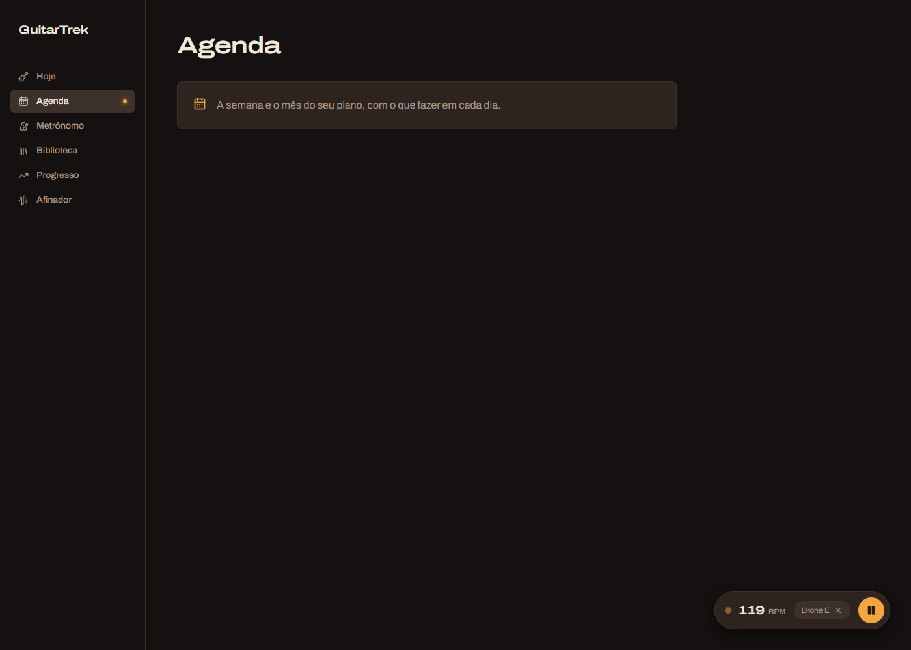
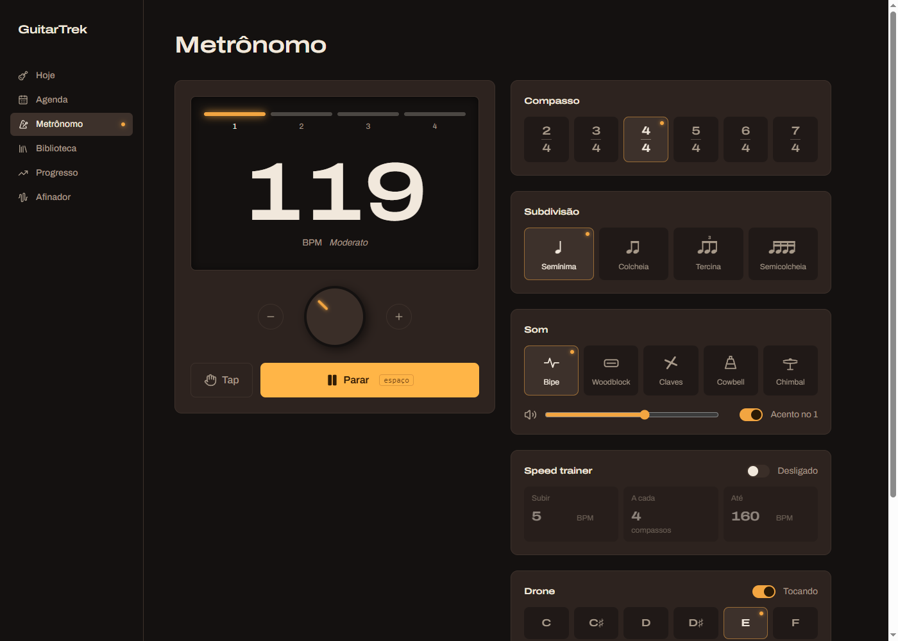

# Aula 03f — Metrônomo (parte 6): painel flutuante, pulso e knob

> 💡 Abra com **`Ctrl+Shift+V`**. Deixe rodando: `npm run dev --prefix web` e o navegador em http://localhost:5173/metronomo. **Ligue o som.**

## O que vamos fazer

Hoje, se você liga o metrônomo e clica em **Agenda** no menu, ele **para**. E quando volta, o BPM voltou para 100. Esta aula resolve isso e fecha o módulo 3:

1. O metrônomo e o drone passam a morar **acima das páginas**. Trocar de tela não para mais nada, e as suas escolhas ficam guardadas.
2. Um **painel flutuante** no canto da tela, em **qualquer página**: mostra o BPM, um **LED que pisca no tempo**, o drone que está tocando e o botão de play/pause.
3. O slider de BPM vira um **knob** de amplificador: você gira arrastando o mouse (ou o dedo) para cima e para baixo.

| Painel em outra tela | Knob no metrônomo |
|---|---|
|  |  |

Arquivos:
1. `web/src/components/ProvedorDeAudio.tsx`: **novo**, pequeno. É a peça que guarda o áudio acima das páginas.
2. `web/src/components/Layout.tsx`: duas linhas novas e o painel.
3. `web/src/pages/Metronomo.tsx`: troca de onde vem o áudio e ganha o knob.
4. `web/src/components/PainelFlutuante.tsx`: **novo**, o painel.

**Pré-requisito:** aula 03e feita (o drone toca).

---

## Como ler as instruções desta aula

Igual às anteriores:

> 📍 **Onde:** o arquivo e a parte dele.
> ❌ **Está assim hoje:** o código atual (para você achar o lugar).
> ✅ **Deixe assim / Cole:** o código novo, **completo**.

---

## Conceitos antes do código (leia sem digitar nada)

### Conceito 1 — Por que o metrônomo para quando você troca de tela

Faça o teste agora: ligue o metrônomo, clique em **Agenda**. Parou. Volte: o BPM está em 100 de novo.

O motivo: quem chama `useMetronome()` é a página `Metronomo`. Todo estado de um hook (`useState`, `useRef`) **pertence ao componente que o chamou**, e vive só enquanto esse componente está na tela. Quando você vai para a Agenda, o React **desmonta** (tira da tela) a página `Metronomo`:

- os `useState` são jogados fora (por isso o BPM volta a 100);
- as limpezas dos efeitos rodam: o agendador para e o `ctx.close()` desliga a mesa de som.

Em C#, é como se o metrônomo fosse um serviço **Scoped** criado dentro de cada requisição: acabou a requisição, acabou o serviço.

### Conceito 2 — A solução: subir o estado para quem nunca sai

Lembra da aula 02? O `Layout` (menu lateral + área de conteúdo) **nunca sai da tela**. Só o miolo dele, o `<Outlet />`, é que troca de página.

```
Layout  ← fica sempre (menu, e agora o áudio)
 └─ Outlet
     └─ Metronomo  ← entra e sai
     └─ Agenda     ← entra e sai
```

Então, se quem chama `useMetronome()` for algo **dentro do Layout, mas fora do Outlet**, o metrônomo vive enquanto o app estiver aberto. Isso se chama **"subir o estado"** (*lifting state up*), e é o jeito React de fazer um **Singleton**.

Mas aí vem o problema: como a página `Metronomo`, lá embaixo dentro do `Outlet`, alcança esse estado? Passar por props (`<Metronomo m={...} />`) não dá, porque quem desenha as páginas é o roteador, não você.

### Conceito 3 — Context: a injeção de dependência do React

O React tem uma ferramenta exatamente para isso: o **Context**. A comparação com o ASP.NET é quase perfeita:

| ASP.NET | React | O que é |
|---|---|---|
| `builder.Services.AddSingleton<IAudio>(...)` | `<ContextoDeAudio value={...}>` em volta dos componentes | **Registrar**: "daqui para dentro, quem pedir recebe isto". |
| Pedir no construtor: `public Pagina(IAudio audio)` | `useContext(ContextoDeAudio)` | **Receber** o que foi registrado. |
| `InvalidOperationException: Unable to resolve service` | O `useContext` devolve o valor padrão (`null`) | Pedir algo que ninguém registrou. |

São três peças:

```tsx
// 1. Criar o "tipo de serviço" (uma vez, fora de componente)
const ContextoDeAudio = createContext<Audio | null>(null)

// 2. Registrar: o componente "provedor" envolve os filhos e entrega o valor
<ContextoDeAudio value={{ metronomo, drone }}>
    {children}
</ContextoDeAudio>

// 3. Receber, em qualquer componente lá dentro, em qualquer profundidade
const audio = useContext(ContextoDeAudio)
```

O `null` do `createContext(null)` é o **valor padrão**: o que `useContext` devolve se alguém pedir **fora** do provedor. Vamos transformar esse caso num erro claro, igual ao do ASP.NET.

> ⚠️ **Nome:** o navegador já tem uma classe chamada `AudioContext` (a mesa de som). Para não confundir, o nosso Context se chama `ContextoDeAudio`. São coisas **sem relação**: uma é do Web Audio, a outra é do React.

### Conceito 4 — `ReturnType<typeof ...>`: deixar o TypeScript escrever o tipo

O Context precisa saber o **tipo** do que guarda. O `useMetronome` devolve um objeto com uns 20 campos (`bpm`, `mudarBpm`, `tempos`...). Escrever esse tipo à mão seria enorme e ficaria desatualizado na primeira mudança.

O TypeScript sabe **perguntar o tipo** de uma coisa que já existe:

```ts
ReturnType<typeof useMetronome>
```

Leia de dentro para fora:
- `typeof useMetronome`: "o tipo da função `useMetronome`" (o que ela recebe e o que devolve).
- `ReturnType<...>`: "só a parte do que ela **devolve**".

Resultado: "o tipo do objeto que `useMetronome()` retorna". Se amanhã você adicionar um campo no hook, o tipo acompanha sozinho. Não existe nada assim em C# (o mais perto é o `var`, mas só dentro de um método).

### Conceito 5 — `AnimatePresence`: animar a **saída**

Você já usa o `motion` (do pacote Motion) para animar elementos que **entram** ou **mudam**: `initial` (como começa) e `animate` (para onde vai).

Animar a **saída** é mais difícil. Quando o React tira um elemento da tela, ele some **na hora**: não sobra nada para animar. O `AnimatePresence` resolve isso. Ele "segura" o elemento na tela por mais um instante, roda a animação `exit`, e só então deixa sumir:

```tsx
<AnimatePresence>
    {visivel && (
        <motion.div
            initial={{ opacity: 0, y: 24 }}   // entra vindo de 24px abaixo, invisível
            animate={{ opacity: 1, y: 0 }}    // e sobe até o lugar, aparecendo
            exit={{ opacity: 0, y: 24 }}      // ao sair, faz o caminho inverso
        />
    )}
</AnimatePresence>
```

Regra: o `AnimatePresence` fica **sempre** na tela, e o que **entra e sai** fica **dentro** dele.

### Conceito 6 — `key` para reiniciar uma animação

Você conhece a `key` das listas (`map`): ela diz ao React "este item é tal". Mas a `key` também serve **fora de listas**, para um truque:

> **Se a `key` de um elemento muda, o React joga o elemento fora e cria um novo.**

E um elemento novo roda o `initial` → `animate` **de novo**. Então:

```tsx
<motion.span key={m.tempoAtual} initial={{ scale: 2 }} animate={{ scale: 1 }} />
```

A cada tempo do metrônomo, `tempoAtual` muda (0, 1, 2, 3, 0...), a `key` muda, e a bolinha nasce grande e encolhe. É o **pulso**. Sem nenhum `if`, sem timer.

### Conceito 7 — Eventos de ponteiro (para o knob)

Um knob se gira **arrastando**: aperta o botão do mouse em cima, move para cima (sobe o BPM) ou para baixo (desce), solta. O navegador avisa cada fase com um evento:

| Evento | Quando |
|---|---|
| `onPointerDown` | Apertou (mouse, dedo ou caneta) em cima do elemento. |
| `onPointerMove` | O ponteiro se mexeu. |
| `onPointerUp` | Soltou. |

"Pointer" (ponteiro) cobre **mouse e toque ao mesmo tempo**, então o mesmo código funciona no celular.

Tem um detalhe: se você aperta no knob e arrasta rápido, o mouse **sai de cima** do knob, e o `onPointerMove` para de chegar. A correção é uma linha:

```ts
e.currentTarget.setPointerCapture(e.pointerId)
```

"**Capturar** o ponteiro": até soltar, todo movimento é entregue a este elemento, mesmo com o mouse do outro lado da tela.

---

## Passo 1 — O provedor de áudio

> 📍 **Onde:** crie o arquivo `web/src/components/ProvedorDeAudio.tsx` (pasta `components`, ao lado do `Layout.tsx`).

✅ **Cole:**

```tsx
import { createContext, useContext, type ReactNode } from 'react'
import { useMetronome } from '@/hooks/useMetronome'
import { useDrone } from '@/hooks/useDrone'

type Audio = {
    metronomo: ReturnType<typeof useMetronome>
    drone: ReturnType<typeof useDrone>
}

const ContextoDeAudio = createContext<Audio | null>(null)

export function ProvedorDeAudio({ children }: { children: ReactNode }) {
    const metronomo = useMetronome()
    const drone = useDrone()

    return <ContextoDeAudio value={{ metronomo, drone }}>{children}</ContextoDeAudio>
}

export function useAudio() {
    const audio = useContext(ContextoDeAudio)
    if (!audio) throw new Error('useAudio só funciona dentro de <ProvedorDeAudio>')
    return audio
}
```

Bloco por bloco:

| Trecho | O que faz |
|---|---|
| `type Audio = {...}` | O tipo do que o Context guarda: um objeto com o metrônomo e o drone. `type` é como um `record` do C# que só existe para o compilador (Conceito 4 para o `ReturnType`). |
| `createContext<Audio \| null>(null)` | Cria o Context (Conceito 3). Guarda um `Audio`, ou `null` quando ninguém registrou. |
| `ProvedorDeAudio` | Um componente que **chama os dois hooks** e entrega o resultado para todos os `children` (o que estiver dentro dele). É ele que vai morar no `Layout`. |
| `<ContextoDeAudio value={...}>` | "Daqui para dentro, quem pedir `ContextoDeAudio` recebe `{ metronomo, drone }`". |
| `{{ metronomo, drone }}` | As chaves de fora são do JSX ("aqui vem código"). As de dentro criam o objeto. `{ metronomo, drone }` é o atalho de `{ metronomo: metronomo, drone: drone }`. |
| `useAudio()` | Um hook nosso que **embrulha** o `useContext`. Vantagem: quem usa escreve só `useAudio()` e já recebe `Audio` (sem `null`), porque se for `null` ele lança um erro claro. |

> 💡 Repare: `useAudio` é um **hook** (nome começa com `use`) e chama outro hook (`useContext`). É assim que hooks se combinam. O `useMetronome` também é isso: um hook feito de `useState`, `useRef` e `useEffect`.

> ℹ️ O VS Code pode mostrar um aviso amarelo (não vermelho) do lint dizendo "*Fast refresh only works when a file only exports components*". Ele aparece porque este arquivo exporta um componente **e** um hook. O único efeito é que, ao salvar este arquivo, a página recarrega inteira em vez de só o pedaço. Pode ignorar (o `button.tsx` do shadcn tem o mesmo aviso).

✅ **Confira:** sem sublinhado vermelho. A tela não mudou.

---

## Passo 2 — O provedor entra no Layout

> 📍 **Onde:** `web/src/components/Layout.tsx`, nos imports do topo.

❌ **Está assim hoje:**

```tsx
import { motion } from 'motion/react'
```

✅ **Deixe assim:**

```tsx
import { motion } from 'motion/react'
import { ProvedorDeAudio } from './ProvedorDeAudio'
```

O `./` quer dizer "na mesma pasta que este arquivo".

> 📍 **Onde:** no `return` do `Layout`, a **primeira** e a **última** linha.

❌ **Está assim hoje:**

```tsx
    return (
        <div className="min-h-screen md:flex">
```

e, no fim:

```tsx
            </nav>
        </div>
    )
}
```

✅ **Deixe assim:** envolva a `<div>` inteira com o provedor.

```tsx
    return (
        <ProvedorDeAudio>
            <div className="min-h-screen md:flex">
```

e, no fim:

```tsx
            </nav>
            </div>
        </ProvedorDeAudio>
    )
}
```

O `<ProvedorDeAudio>` abre antes de tudo e fecha depois de tudo. Agora **todo** o app (menu, páginas e, daqui a pouco, o painel) está "dentro" dele.

> 💡 A indentação ficou torta (a `<div>` deveria andar um nível para a direita). Selecione tudo entre `<ProvedorDeAudio>` e `</ProvedorDeAudio>` e aperte **`Tab`** para empurrar o bloco. Ou deixe torta: o código funciona igual. O arquivo completo, alinhado, está no fim da aula.

✅ **Confira:** a tela não mudou. Mas agora existem **dois** metrônomos: o do provedor (ainda sem uso) e o da página. O próximo passo corrige isso.

---

## Passo 3 — A página passa a usar o áudio do provedor

> 📍 **Onde:** topo de `web/src/pages/Metronomo.tsx`.

❌ **Está assim hoje:**

```tsx
import { SONS, useMetronome } from '@/hooks/useMetronome'
import { ACORDES, NOTAS, TIMBRES, useDrone } from '@/hooks/useDrone'
```

✅ **Deixe assim:**

```tsx
import { SONS } from '@/hooks/useMetronome'
import { ACORDES, NOTAS, TIMBRES } from '@/hooks/useDrone'
import { useAudio } from '@/components/ProvedorDeAudio'
```

A página não chama mais `useMetronome` nem `useDrone`. Ela continua importando as **listas** (`SONS`, `NOTAS`...), que são só dados.

> 📍 **Onde:** dentro de `Metronomo()`, as duas primeiras linhas.

❌ **Está assim hoje:**

```tsx
    const m = useMetronome()
    const drone = useDrone()
```

✅ **Deixe assim:**

```tsx
    const { metronomo: m, drone } = useAudio()
```

Isto é uma **desestruturação** (você viu na aula 03: `const { tocando, setTocando } = m`). O novo é o `metronomo: m`, que quer dizer "pegue o campo `metronomo` e chame de `m` aqui". Assim, todo o resto da página, que já usa `m.bpm`, `m.tocando`..., continua funcionando sem mudar nada.

✅ **Confira, o grande teste:**
1. Mude o BPM para 140 e o drone para **A**. Ligue os dois.
2. Clique em **Agenda** no menu. **O som continua!** 🎉
3. Volte para **Metrônomo**: BPM 140, drone em A, tudo como você deixou.

O problema agora é que, fora da página do metrônomo, não dá para **parar**. É para isso que serve o painel.

---

## Passo 4 — O painel flutuante (versão simples)

Vamos montar o painel em 3 rodadas: primeiro ele aparece, depois ganha animação de entrada e saída, depois o pulso.

> 📍 **Onde:** crie o arquivo `web/src/components/PainelFlutuante.tsx`.

✅ **Cole:**

```tsx
import { Link, useLocation } from 'react-router'
import { Pause, Play, X } from 'lucide-react'
import { NOTAS } from '@/hooks/useDrone'
import { useAudio } from './ProvedorDeAudio'

export function PainelFlutuante() {
    const { metronomo: m, drone } = useAudio()
    const { pathname } = useLocation()

    if (pathname === '/metronomo') return null

    return (
        <div className="fixed right-4 bottom-20 z-10 flex items-center gap-3 rounded-full border bg-card py-2 pr-2 pl-4 shadow-[0_8px_24px_var(--sombra)] md:right-8 md:bottom-8">
            <Link to="/metronomo" className="flex items-baseline gap-1.5">
                <span className="font-heading text-lg font-semibold tabular-nums font-stretch-expanded">{m.bpm}</span>
                <span className="text-xs text-muted-foreground">BPM</span>
            </Link>

            {drone.tocando && (
                <button
                    onClick={() => drone.setTocando(false)}
                    aria-label="Parar o drone"
                    className="flex items-center gap-1.5 rounded-full bg-accent px-3 py-1.5 text-xs text-muted-foreground hover:text-foreground"
                >
                    Drone {NOTAS[drone.tonica]}
                    <X className="size-3.5" />
                </button>
            )}

            <button
                onClick={() => m.setTocando(!m.tocando)}
                aria-label={m.tocando ? 'Parar o metrônomo' : 'Começar o metrônomo'}
                className="grid size-10 place-items-center rounded-full bg-primary text-primary-foreground hover:brightness-110"
            >
                {m.tocando ? <Pause className="size-4 fill-current" /> : <Play className="size-4 fill-current" />}
            </button>
        </div>
    )
}
```

### O que é novo

**`useLocation()`** devolve **onde** o usuário está. O `pathname` é o caminho da URL: `'/agenda'`, `'/metronomo'`... (você usou o `useLocation` no `Layout`, na aula 02, para a animação de troca de página).

**`if (pathname === '/metronomo') return null`**: na página do metrônomo o painel seria repetido, então ele **não desenha nada**. Um componente que retorna `null` simplesmente não aparece. (Em C#, é um `return` antecipado, a "guard clause".)

**`<Link to="/metronomo">`**: um link do React Router. Clicar no BPM leva para a página completa. É o primo do `NavLink` do menu, sem o "ativo".

**`NOTAS[drone.tonica]`**: a tônica é um número (4); a lista transforma em nome ("E").

### Decifrando a `className` da caixa

| Palavra | Faz o quê |
|---|---|
| `fixed` | **Gruda na janela**, não na página: rolar a página não move o painel. |
| `right-4 bottom-20` | A 16px da direita e 80px de baixo. No celular, fica **acima** do menu inferior. |
| `md:right-8 md:bottom-8` | Em telas ≥ 768px (onde não existe menu inferior), desce para 32px do canto. |
| `z-10` | "Fica **na frente**" dos outros elementos. Quanto maior o `z`, mais à frente. |
| `rounded-full` | Cantos totalmente redondos: vira uma pílula. |
| `py-2 pr-2 pl-4` | Pouco espaço em cima, embaixo e à direita (o botão redondo encosta na borda); mais à esquerda. |
| `shadow-[0_8px_24px_var(--sombra)]` | Uma sombra **abaixo** (8px), bem espalhada (24px), na cor do token `--sombra`. Dá a sensação de que o painel flutua. |

✅ **Confira:** ainda nada. O componente existe, mas ninguém o desenha. Vamos colocá-lo no `Layout`.

---

## Passo 5 — O painel entra no Layout

> 📍 **Onde:** `web/src/components/Layout.tsx`, nos imports.

✅ **Adicione** embaixo do import do `ProvedorDeAudio`:

```tsx
import { PainelFlutuante } from './PainelFlutuante'
```

> 📍 **Onde:** no fim do `return`, entre o `</nav>` do menu inferior e o `</div>`.

❌ **Está assim hoje:**

```tsx
            </nav>
            </div>
        </ProvedorDeAudio>
```

✅ **Deixe assim:**

```tsx
            </nav>

            <PainelFlutuante />
            </div>
        </ProvedorDeAudio>
```

O painel está **dentro** do `ProvedorDeAudio` (por isso o `useAudio` funciona nele) e **fora** do `Outlet` (por isso nunca sai da tela ao trocar de página).

✅ **Confira:**
- Na página **Metrônomo**: nenhum painel.
- Clique em **Hoje**: a pílula aparece no canto inferior direito, com o BPM e o ▶.
- Clique no ▶: o metrônomo toca. Clique de novo: para.
- Ligue o drone (na página do metrônomo) e vá para **Agenda**: aparece o chip "Drone E ✕". Clique nele: o drone para e o chip some.
- Clique no **número do BPM**: vai para a página do metrônomo.
- Estreite a janela (ou `F12` → ícone de celular): o painel fica **acima** do menu inferior.

---

## Passo 6 — Animação de entrada e saída

Hoje o painel **pula** para dentro da tela. Vamos fazê-lo subir suave ao aparecer e descer ao sumir (Conceito 5).

> 📍 **Onde:** `PainelFlutuante.tsx`, imports.

✅ **Adicione** na segunda linha:

```tsx
import { AnimatePresence, motion } from 'motion/react'
```

> 📍 **Onde:** o corpo do `PainelFlutuante`, da linha do `if` até a `<div` de abertura, e o fim.

❌ **Está assim hoje:**

```tsx
    if (pathname === '/metronomo') return null

    return (
        <div className="fixed right-4 bottom-20 z-10 flex items-center gap-3 rounded-full border bg-card py-2 pr-2 pl-4 shadow-[0_8px_24px_var(--sombra)] md:right-8 md:bottom-8">
```

e, no fim:

```tsx
            </button>
        </div>
    )
}
```

✅ **Deixe assim:**

```tsx
    return (
        <AnimatePresence>
            {pathname !== '/metronomo' && (
                <motion.div
                    initial={{ opacity: 0, y: 24 }}
                    animate={{ opacity: 1, y: 0 }}
                    exit={{ opacity: 0, y: 24 }}
                    className="fixed right-4 bottom-20 z-10 flex items-center gap-3 rounded-full border bg-card py-2 pr-2 pl-4 shadow-[0_8px_24px_var(--sombra)] md:right-8 md:bottom-8"
                >
```

e, no fim:

```tsx
            </button>
                </motion.div>
            )}
        </AnimatePresence>
    )
}
```

O que mudou:

- O `if (...) return null` **saiu**. Agora o `AnimatePresence` fica sempre, e o painel está **dentro** dele com a condição invertida: `pathname !== '/metronomo' && (...)` = "se **não** está no metrônomo, desenha". (`!==` é o `!=` do C#.)
- A `<div>` virou `<motion.div>` (igual ao que você fez com os LEDs), com `initial`, `animate` e `exit`.

> 💡 Mais uma vez a indentação ficou torta, porque tudo que estava dentro da `<div>` agora está dois níveis mais fundo. Selecione do `<Link` até o último `</button>` e aperte `Tab` duas vezes. (O arquivo completo, alinhado, está no fim.)

✅ **Confira:** vá de **Metrônomo** para **Hoje**: o painel **sobe** do rodapé. Volte para **Metrônomo**: ele **desce** e some.

---

## Passo 7 — O pulso

Agora o LED que pisca no tempo (Conceito 6).

> 📍 **Onde:** `PainelFlutuante.tsx`, logo **depois** da linha `className="fixed ..."` + `>` do `motion.div` e **antes** do `<Link`.

✅ **Cole:**

```tsx
                    <motion.span
                        key={m.tempoAtual}
                        initial={m.tempoAtual >= 0 ? { scale: 2, opacity: 1 } : false}
                        animate={{ scale: 1, opacity: 0.3 }}
                        transition={{ duration: 0.3 }}
                        className={`size-2 rounded-full bg-current ${m.tempoAtual === 0 && m.acento ? 'text-primary' : 'text-foreground'}`}
                    />
```

| Trecho | O que faz |
|---|---|
| `key={m.tempoAtual}` | A cada tempo a `key` muda e o React cria uma bolinha nova, que roda a animação de novo. |
| `initial={... ? {...} : false}` | Com o metrônomo tocando (`tempoAtual` é 0, 1, 2...), a bolinha **nasce grande e acesa**. Parado, `tempoAtual` é `-1` e o `initial` é `false`, que no Motion quer dizer "**não anime a entrada**, já comece no `animate`". Sem isso, a bolinha piscaria uma vez ao apertar ⏸. |
| `animate={{ scale: 1, opacity: 0.3 }}` | Encolhe para o tamanho normal e apaga até 30%. |
| `transition={{ duration: 0.3 }}` | Em 0,3 s. |
| `className=...` | O mesmo truque dos LEDs do visor (aula 03d): `bg-current` + `text-primary` no tempo 1 (âmbar), `text-foreground` nos outros. |

✅ **Confira:** em **Hoje**, aperte ▶ no painel. A bolinha **pulsa** a cada batida, âmbar no tempo 1. Pause: ela fica quieta e apagada.

---

## Passo 8 — O knob de BPM

Último passo! O slider vira um knob de amp (Conceito 7).

### 8a. O componente `Knob`

> 📍 **Onde:** no **fim** de `web/src/pages/Metronomo.tsx`, depois da função `Numero`.

✅ **Cole:**

```tsx
function Knob({ rotulo, valor, min, max, onChange }: { rotulo: string; valor: number; min: number; max: number; onChange: (v: number) => void }) {
    const inicio = useRef<{ y: number; valor: number } | null>(null)
    const angulo = -135 + ((valor - min) / (max - min)) * 270

    return (
        <div
            role="slider"
            tabIndex={0}
            aria-label={rotulo}
            aria-valuemin={min}
            aria-valuemax={max}
            aria-valuenow={valor}
            onPointerDown={(e) => {
                e.currentTarget.setPointerCapture(e.pointerId)
                inicio.current = { y: e.clientY, valor }
            }}
            onPointerMove={(e) => {
                if (!inicio.current) return
                onChange(inicio.current.valor + (inicio.current.y - e.clientY) / 2)
            }}
            onPointerUp={() => {
                inicio.current = null
            }}
            onKeyDown={(e) => {
                if (e.key === 'ArrowUp' || e.key === 'ArrowRight') {
                    e.preventDefault()
                    onChange(valor + 1)
                }
                if (e.key === 'ArrowDown' || e.key === 'ArrowLeft') {
                    e.preventDefault()
                    onChange(valor - 1)
                }
            }}
            style={{ rotate: `${angulo}deg` }}
            className="relative size-24 shrink-0 cursor-ns-resize touch-none rounded-full border-4 border-background bg-secondary shadow-[0_6px_16px_var(--sombra)] outline-offset-4"
        >
            <span className="absolute top-2 left-1/2 h-5 w-1 -translate-x-1/2 rounded-full bg-primary shadow-[0_0_6px_var(--primary)]" />
        </div>
    )
}
```

E o `useRef` precisa ser importado:

> 📍 **Onde:** última linha de imports do `Metronomo.tsx`.

❌ **Está assim hoje:**

```tsx
import { useEffect, type ReactNode } from 'react'
```

✅ **Deixe assim:**

```tsx
import { useEffect, useRef, type ReactNode } from 'react'
```

Vamos por partes.

**1. A conta do ângulo**

```ts
const angulo = -135 + ((valor - min) / (max - min)) * 270
```

Um knob de amp não dá a volta inteira: vai de "7 horas" (mínimo) a "5 horas" (máximo), passando pelo "meio-dia". São 270° no total, de **-135°** a **+135°** (0° é o ponteiro apontando para cima).

- `(valor - min) / (max - min)`: "quanto do caminho já andei", de 0 a 1. Com BPM 30 dá 0; com 300 dá 1; com 165 dá 0,5.
- `* 270`: transforma em graus andados.
- `-135 +`: começa do ponto mínimo.

BPM 165 → `-135 + 0,5 × 270 = 0°`: ponteiro para cima. ✔

**2. A memória do arraste: `useRef`**

```ts
const inicio = useRef<{ y: number; valor: number } | null>(null)
```

Ao **apertar**, guardamos onde o mouse estava (`y`) e qual era o BPM (`valor`). Enquanto arrasta, comparamos com esse ponto de partida. Ao **soltar**, voltamos para `null` ("não estou arrastando").

Por que `useRef` e não `useState`? Porque isso **não aparece na tela**. É só uma anotação interna (a mesma regra do `toques` do tap tempo, na aula 03b).

**3. Os três eventos do arraste**

```ts
onPointerDown={(e) => {
    e.currentTarget.setPointerCapture(e.pointerId)
    inicio.current = { y: e.clientY, valor }
}}
```

Apertou: captura o ponteiro (Conceito 7) e anota o ponto de partida. `e.clientY` é a altura do mouse na janela, em pixels, **contando de cima para baixo**: 0 é o topo. `e.currentTarget` é o próprio knob.

```ts
onPointerMove={(e) => {
    if (!inicio.current) return
    onChange(inicio.current.valor + (inicio.current.y - e.clientY) / 2)
}}
```

Moveu: se não estamos arrastando, ignora (o mouse só passou por cima). Se estamos:
- `inicio.current.y - e.clientY`: quantos pixels o mouse **subiu** desde o aperto. Como o `y` cresce para baixo, subir dá um número **positivo**.
- `/ 2`: cada 2 pixels = 1 BPM. Arrastar 80px para cima sobe 40 BPM.
- `inicio.current.valor + ...`: soma ao BPM que tinha no começo.

O resultado pode ser quebrado (`120.5`) ou passar de 300, mas não tem problema: o `onChange` aqui é o `m.mudarBpm`, que já **arredonda** e **limita** entre 30 e 300 (você escreveu na aula 03).

```ts
onPointerUp={() => {
    inicio.current = null
}}
```

Soltou: para de arrastar.

**4. O teclado (acessibilidade)**

```ts
onKeyDown={(e) => {
    if (e.key === 'ArrowUp' || e.key === 'ArrowRight') {
        e.preventDefault()
        onChange(valor + 1)
    }
    ...
}}
```

Quem não usa mouse precisa conseguir girar o knob. Com o knob em foco (aperte `Tab` até ele), as setas ↑/→ sobem 1 BPM e ↓/← descem. O `e.preventDefault()` impede o comportamento normal da seta, que é **rolar a página**. (`||` é o "ou", igual ao C#.)

**5. Os atributos de acessibilidade**

| Atributo | O que faz |
|---|---|
| `role="slider"` | Diz ao leitor de tela "isto é um controle deslizante", como o `role="switch"` do `Interruptor`. |
| `tabIndex={0}` | Uma `<div>` normal não recebe foco pelo `Tab`. Com `tabIndex={0}`, recebe. |
| `aria-valuemin/max/now` | O leitor de tela fala "BPM, 120, mínimo 30, máximo 300". |

**6. A rotação: `style`**

```tsx
style={{ rotate: `${angulo}deg` }}
```

Até agora todo o visual veio do Tailwind (`className`). Mas o ângulo muda a cada BPM e pode ser **qualquer** número (`-46.3deg`), e o Tailwind só conhece classes escritas no código. Para valores calculados, usa-se o `style`, que recebe um **objeto** com propriedades de CSS. As chaves duplas são as mesmas do `value={{...}}`: as de fora são "aqui vem código", as de dentro criam o objeto.

Girar o knob inteiro faz o **ponteiro** (o `<span>` âmbar lá dentro) girar junto.

**7. A `className` do knob**

| Palavra | Faz o quê |
|---|---|
| `relative` | Referência para o ponteiro `absolute` (como a luz piloto da aula 03d). |
| `size-24 shrink-0` | 96px × 96px, e não encolhe se faltar espaço. |
| `cursor-ns-resize` | O mouse vira uma setinha ↕: "arraste para cima e para baixo". |
| `touch-none` | No celular, arrastar o dedo em cima do knob **não rola a página**. Sem isso, o navegador roubaria o gesto. |
| `rounded-full border-4 border-background bg-secondary` | Um círculo com aro grosso da cor do fundo: parece a saia de um knob. |
| `shadow-[0_6px_16px_var(--sombra)]` | Sombra embaixo: o knob "salta" do painel. |
| `outline-offset-4` | Quando focado pelo teclado, o contorno de foco fica a 4px do knob, sem colar nele. |

E o ponteiro: `absolute top-2 left-1/2 -translate-x-1/2` = "a 8px do topo, centralizado na horizontal" (`left-1/2` põe a **borda esquerda** no meio; `-translate-x-1/2` puxa de volta metade da própria largura). `h-5 w-1` = um tracinho de 20 × 4px, âmbar e brilhando.

### 8b. Trocar o slider pelo knob

> 📍 **Onde:** no `return` do `Metronomo`, a linha dos botões − e + (logo abaixo do visor).

❌ **Está assim hoje:**

```tsx
                    <div className="flex items-center gap-3">
                        <BotaoRedondo rotulo="Diminuir BPM" onClick={() => m.mudarBpm(m.bpm - 1)}>
                            <Minus className="size-4" />
                        </BotaoRedondo>
                        <input
                            type="range"
                            min={30}
                            max={300}
                            value={m.bpm}
                            onChange={(e) => m.mudarBpm(Number(e.target.value))}
                            aria-label="BPM"
                            className="w-full accent-primary"
                        />
                        <BotaoRedondo rotulo="Aumentar BPM" onClick={() => m.mudarBpm(m.bpm + 1)}>
```

✅ **Deixe assim:**

```tsx
                    <div className="flex items-center justify-center gap-8">
                        <BotaoRedondo rotulo="Diminuir BPM" onClick={() => m.mudarBpm(m.bpm - 1)}>
                            <Minus className="size-4" />
                        </BotaoRedondo>
                        <Knob rotulo="BPM" valor={m.bpm} min={30} max={300} onChange={m.mudarBpm} />
                        <BotaoRedondo rotulo="Aumentar BPM" onClick={() => m.mudarBpm(m.bpm + 1)}>
```

- O `<input type="range">` saiu e o `<Knob>` entrou no lugar.
- `justify-center gap-8`: o slider ocupava a largura toda; o knob não, então centralizamos os três e afastamos 32px.
- `onChange={m.mudarBpm}`: passamos a função direto, como no `drone.setTocando` da aula 03e.

✅ **Confira:**
- Abaixo do visor, um knob escuro com um tracinho âmbar, entre o − e o +.
- **Arraste para cima** em cima dele: o BPM sobe e o knob gira para a direita. Para baixo: desce. Continue arrastando mesmo com o mouse fora do knob: segue funcionando (é a captura).
- BPM 30: ponteiro em "7 horas". BPM 300: em "5 horas". BPM 165: para cima.
- Aperte `Tab` até o knob ganhar o contorno de foco e use as **setas**.
- No celular (`F12` → ícone de celular), arraste com o "dedo": a página não rola.

### Se algo deu errado

| Sintoma | Causa provável |
|---|---|
| `useAudio só funciona dentro de <ProvedorDeAudio>` (tela branca, erro no `F12`) | O `<PainelFlutuante />` ou o `<Outlet />` ficou **fora** do `<ProvedorDeAudio>` no Layout. |
| O som para ao trocar de página | A página ainda chama `useMetronome()` / `useDrone()` direto, em vez de `useAudio()`. |
| O painel aparece também na página do metrônomo | Confira o caminho: `'/metronomo'`, sem acento e sem barra no fim. |
| O painel some sem animação | O `AnimatePresence` precisa estar **por fora** da condição `pathname !== ... &&`, e não dentro. |
| A bolinha não pulsa | Faltou `key={m.tempoAtual}`. |
| O knob não gira, mas o número muda | Faltou o `style={{ rotate: ... }}`, ou falta o `deg` no fim. |
| Arrastar no knob seleciona texto ou rola a página | Faltou `touch-none`. |
| O knob anda ao contrário | Inverteu a conta: é `inicio.current.y - e.clientY` (o y de **antes** menos o de **agora**). |

---

## 🔍 Seus arquivos devem estar assim (compare)

<details><summary><code>web/src/components/ProvedorDeAudio.tsx</code></summary>

```tsx
import { createContext, useContext, type ReactNode } from 'react'
import { useMetronome } from '@/hooks/useMetronome'
import { useDrone } from '@/hooks/useDrone'

type Audio = {
    metronomo: ReturnType<typeof useMetronome>
    drone: ReturnType<typeof useDrone>
}

const ContextoDeAudio = createContext<Audio | null>(null)

export function ProvedorDeAudio({ children }: { children: ReactNode }) {
    const metronomo = useMetronome()
    const drone = useDrone()

    return <ContextoDeAudio value={{ metronomo, drone }}>{children}</ContextoDeAudio>
}

export function useAudio() {
    const audio = useContext(ContextoDeAudio)
    if (!audio) throw new Error('useAudio só funciona dentro de <ProvedorDeAudio>')
    return audio
}
```

</details>

<details><summary><code>web/src/components/PainelFlutuante.tsx</code></summary>

```tsx
import { Link, useLocation } from 'react-router'
import { AnimatePresence, motion } from 'motion/react'
import { Pause, Play, X } from 'lucide-react'
import { NOTAS } from '@/hooks/useDrone'
import { useAudio } from './ProvedorDeAudio'

export function PainelFlutuante() {
    const { metronomo: m, drone } = useAudio()
    const { pathname } = useLocation()

    return (
        <AnimatePresence>
            {pathname !== '/metronomo' && (
                <motion.div
                    initial={{ opacity: 0, y: 24 }}
                    animate={{ opacity: 1, y: 0 }}
                    exit={{ opacity: 0, y: 24 }}
                    className="fixed right-4 bottom-20 z-10 flex items-center gap-3 rounded-full border bg-card py-2 pr-2 pl-4 shadow-[0_8px_24px_var(--sombra)] md:right-8 md:bottom-8"
                >
                    <motion.span
                        key={m.tempoAtual}
                        initial={m.tempoAtual >= 0 ? { scale: 2, opacity: 1 } : false}
                        animate={{ scale: 1, opacity: 0.3 }}
                        transition={{ duration: 0.3 }}
                        className={`size-2 rounded-full bg-current ${m.tempoAtual === 0 && m.acento ? 'text-primary' : 'text-foreground'}`}
                    />

                    <Link to="/metronomo" className="flex items-baseline gap-1.5">
                        <span className="font-heading text-lg font-semibold tabular-nums font-stretch-expanded">{m.bpm}</span>
                        <span className="text-xs text-muted-foreground">BPM</span>
                    </Link>

                    {drone.tocando && (
                        <button
                            onClick={() => drone.setTocando(false)}
                            aria-label="Parar o drone"
                            className="flex items-center gap-1.5 rounded-full bg-accent px-3 py-1.5 text-xs text-muted-foreground hover:text-foreground"
                        >
                            Drone {NOTAS[drone.tonica]}
                            <X className="size-3.5" />
                        </button>
                    )}

                    <button
                        onClick={() => m.setTocando(!m.tocando)}
                        aria-label={m.tocando ? 'Parar o metrônomo' : 'Começar o metrônomo'}
                        className="grid size-10 place-items-center rounded-full bg-primary text-primary-foreground hover:brightness-110"
                    >
                        {m.tocando ? <Pause className="size-4 fill-current" /> : <Play className="size-4 fill-current" />}
                    </button>
                </motion.div>
            )}
        </AnimatePresence>
    )
}
```

</details>

<details><summary><code>web/src/components/Layout.tsx</code></summary>

```tsx
import { NavLink, Outlet, useLocation } from 'react-router'
import { CalendarDays, Guitar, Library, Metronome, TrendingUp, AudioWaveform} from 'lucide-react'
import { APP_NAME } from '@/lib/config'
import { motion } from 'motion/react'
import { ProvedorDeAudio } from './ProvedorDeAudio'
import { PainelFlutuante } from './PainelFlutuante'

const menu = [
    { para: '/', rotulo: 'Hoje', icone: Guitar },
    { para: '/agenda', rotulo: 'Agenda', icone: CalendarDays },
    { para: '/metronomo', rotulo: 'Metrônomo', icone: Metronome },
    { para: '/biblioteca', rotulo: 'Biblioteca', icone: Library },
    { para: '/progresso', rotulo: 'Progresso', icone: TrendingUp },
    { para: '/afinador', rotulo: 'Afinador', icone: AudioWaveform },
]

export function Layout() {

    const location = useLocation()

    return (
        <ProvedorDeAudio>
            <div className="min-h-screen md:flex">
                {/* Menu lateral */}
                <aside className="hidden md:flex md:w-56 md:flex-col md:gap-10 md:border-r md:px-4 md:py-8">
                    <span className="px-3 font-heading text-lg font-semibold tracking-tight font-stretch-expanded">{APP_NAME}</span>
                    <nav className="flex flex-col gap-0.5">
                        {menu.map((item) => (
                            <NavLink
                                key={item.para}
                                to={item.para}
                                end
                                className={({ isActive }) =>
                                    `flex items-center gap-3 rounded-md px-3 py-2 text-sm font-medium transition-colors ${isActive
                                        ? 'bg-accent text-foreground'
                                        : 'text-muted-foreground hover:text-foreground'
                                    }`
                                }
                            >
                                {({ isActive }) => (
                                    <>
                                        <item.icone className="size-4" />
                                        {item.rotulo}
                                        {isActive && <span className="ml-auto size-1.5 rounded-full bg-primary shadow-[0_0_8px_var(--primary)]" />}
                                    </>
                                )}
                            </NavLink>
                        ))}
                    </nav>
                </aside>

                {/* Conteúdo principal */}
                <main className="flex-1 px-5 pt-8 pb-28 md:px-12 md:py-12">
                    <motion.div
                        key={location.pathname}
                        initial={{ opacity: 0, y: 8 }}
                        animate={{ opacity: 1, y: 0 }}
                        transition={{ duration: 0.2 }}
                    >
                        <Outlet />
                    </motion.div>
                </main>
                {/* Menu inferior para telas pequenas */}
                <nav className="fixed inset-x-0 bottom-0 flex border-t bg-card md:hidden">
                    {menu.map((item) => (
                        <NavLink
                            key={item.para}
                            to={item.para}
                            end
                            className={({ isActive }) =>
                                `flex flex-1 flex-col items-center gap-1 py-2.5 text-[11px] font-medium ${isActive ? 'text-primary' : 'text-muted-foreground'
                                }`
                            }
                        >
                            <item.icone className='size-5' />
                            {item.rotulo}
                        </NavLink>
                    ))}
                </nav>

                <PainelFlutuante />
            </div>
        </ProvedorDeAudio>
    )
}
```

</details>

<details><summary><code>web/src/pages/Metronomo.tsx</code> (só as partes que mudaram)</summary>

Topo:

```tsx
import { Hand, Minus, Pause, Play, Plus, Volume2 } from 'lucide-react'
import { SONS } from '@/hooks/useMetronome'
import { ACORDES, NOTAS, TIMBRES } from '@/hooks/useDrone'
import { useAudio } from '@/components/ProvedorDeAudio'
import { IconeSubdivisao, IconesSom } from '@/components/IconesMusicais'
import { motion } from 'motion/react'
import { useEffect, useRef, type ReactNode } from 'react'
```

Começo do componente:

```tsx
export function Metronomo() {

    const { metronomo: m, drone } = useAudio()
    const { tocando, setTocando } = m
```

A linha do knob (abaixo do visor):

```tsx
                    <div className="flex items-center justify-center gap-8">
                        <BotaoRedondo rotulo="Diminuir BPM" onClick={() => m.mudarBpm(m.bpm - 1)}>
                            <Minus className="size-4" />
                        </BotaoRedondo>
                        <Knob rotulo="BPM" valor={m.bpm} min={30} max={300} onChange={m.mudarBpm} />
                        <BotaoRedondo rotulo="Aumentar BPM" onClick={() => m.mudarBpm(m.bpm + 1)}>
                            <Plus className="size-4" />
                        </BotaoRedondo>
                    </div>
```

E a função `Knob` no fim do arquivo, igual ao Passo 8a.

</details>

---

## 🏋️ Exercícios

### Exercício 1 — Espaço em qualquer tela ⌨️

Hoje a barra de espaço liga/desliga o metrônomo **só** na página dele. Faça funcionar em **qualquer** página. Dica: o `useEffect` do teclado está no `Metronomo.tsx`. Para onde ele deveria ir?

<details><summary>Gabarito</summary>

Para um componente que **nunca sai da tela** e tem acesso ao metrônomo: o `PainelFlutuante`. "Mas na página do metrônomo o painel some!" Some a **pílula**, não o componente: o `PainelFlutuante` continua montado no `Layout` e só não desenha nada dentro do `AnimatePresence`. Os hooks dele rodam sempre.

Recorte o `useEffect` inteiro do `Metronomo.tsx` e cole no `PainelFlutuante`, logo depois do `useLocation()`, trocando `tocando`/`setTocando` por `m.tocando`/`m.setTocando`:

```tsx
    useEffect(() => {
        function aoTeclar(e: KeyboardEvent) {
            if (e.code === 'Space') {
                e.preventDefault()
                m.setTocando(!m.tocando)
            }
        }
        window.addEventListener('keydown', aoTeclar)
        return () => window.removeEventListener('keydown', aoTeclar)
    }, [m])
```

Importe o `useEffect` de `'react'` no painel. Na página, apague a linha `const { tocando, setTocando } = m` e troque os usos que sobraram (no botão Começar/Parar) por `m.tocando` e `m.setTocando`.

</details>

### Exercício 2 — Knob mais sensível 🎛️

Faça cada **pixel** de arraste valer **1 BPM** (o dobro da sensibilidade atual).

<details><summary>Gabarito</summary>

Tire o `/ 2`: `onChange(inicio.current.valor + (inicio.current.y - e.clientY))`. Ou, para deixar ajustável, use `* 1`. Quanto maior o divisor, mais "fino" o controle.

</details>

### Exercício 3 — Pulso mais dramático 💥

Faça a bolinha do painel nascer **3x** maior e apagar mais devagar (meio segundo).

<details><summary>Gabarito</summary>

```tsx
initial={m.tempoAtual >= 0 ? { scale: 3, opacity: 1 } : false}
...
transition={{ duration: 0.5 }}
```

Cuidado: em BPMs altos (200+) o tempo entre batidas é menor que 0,5 s, então a bolinha nunca termina de apagar antes da próxima. Por isso o padrão é curto.

</details>

### Exercício 4 — Pergunta rápida 🤔

Se você colocasse o `<ProvedorDeAudio>` **dentro** do `Metronomo.tsx` (envolvendo o `return` da página) em vez de no `Layout`, o som continuaria ao trocar de tela? Por quê?

<details><summary>Resposta</summary>

**Não.** O provedor seria desmontado junto com a página, e os hooks dentro dele (com o `AudioContext`) iriam embora. O que faz o áudio sobreviver não é o Context em si, é **onde** o provedor mora: num componente que nunca sai da tela. O Context só serve para as páginas **alcançarem** esse estado lá de cima.

</details>

---

## 📖 Glossário novo

| Termo | Significado |
|---|---|
| **Desmontar** | O React tirar um componente da tela. Os estados dele são jogados fora e as limpezas dos efeitos rodam. |
| **Subir o estado** | Mover um estado para um componente mais alto, que vive mais (aqui, o `Layout`). |
| **Context** | A injeção de dependência do React: um provedor registra um valor, e qualquer componente dentro dele recebe com `useContext`. |
| **`createContext` / `useContext`** | Criar o "tipo de serviço" / receber o valor registrado. |
| **Provedor** | O componente que envolve os outros e entrega o valor (`<Contexto value={...}>`). |
| **`ReturnType<typeof f>`** | "O tipo do que a função `f` devolve." |
| **`useLocation().pathname`** | O caminho atual da URL (`'/agenda'`). |
| **`<Link to>`** | Link do React Router (troca de página sem recarregar). |
| **`return null`** | Um componente que não desenha nada. |
| **`fixed` / `z-10`** | Grudado na janela / na frente dos outros. |
| **`AnimatePresence` + `exit`** | Permite animar a saída de um elemento antes de ele sumir. |
| **`key` para reiniciar** | Mudar a `key` faz o React criar um elemento novo, que roda a animação de entrada de novo. |
| **`onPointerDown/Move/Up`** | Eventos de apertar, mover e soltar. Valem para mouse **e** toque. |
| **`setPointerCapture`** | Continua recebendo o movimento mesmo com o ponteiro fora do elemento. |
| **`clientY`** | Altura do ponteiro na janela, em pixels, de cima para baixo. |
| **`tabIndex={0}`** | Faz um elemento qualquer receber foco pelo `Tab`. |
| **`style={{ ... }}`** | CSS calculado na hora, para valores que o Tailwind não conhece de antemão. |
| **`touch-none`** | No celular, o gesto em cima do elemento não rola a página. |

---

✅ **Terminou?** Me avise. Com isso, o **módulo 3 (Metrônomo + drone) está completo**, e eu fecho a issue #3. O próximo é o **módulo 4: Biblioteca de exercícios**, a primeira vez que o front conversa de verdade com a sua API em C# e o Postgres.
