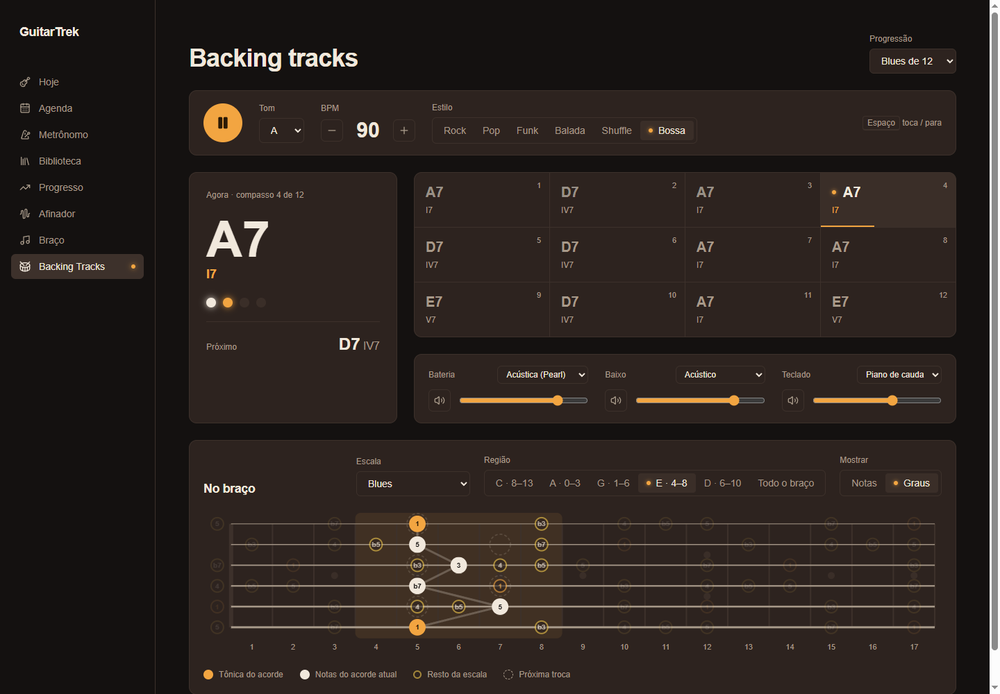

# Aula 18b — Baixo, teclado, timbres reais e mixer

> 💡 Abra com **`Ctrl+Shift+V`**. Deixe rodando `npm run dev --prefix web` e o `npm run test --prefix web`.

Até agora a backing era só uma bateria eletrônica. Nesta aula ela vira uma banda:
- **baixo** e **teclado** tocando o acorde de cada compasso;
- **instrumentos gravados de verdade**, com opções em cada canal (bateria acústica ou eletrônica; baixo de dedo, de palheta, fretless ou acústico; piano de cauda, piano elétrico ou órgão);
- cada estilo já vem com o som que combina com ele: a Bossa com contrabaixo acústico e piano, o Rock com baixo de palheta e órgão;
- o **swing** do blues e dois estilos novos (**Shuffle** e **Bossa**);
- um toque **humano** (ninguém toca exatamente no tempo), reverb e um **mixer** com timbre, volume e mudo por canal;
- uma bateria que **muda ao longo da música**: viradas, pratos e seções de verso e refrão;
- **cores por papel** no braço (1, 3, 5, 7 e tensão), também nos tracejados do próximo acorde, e a **função** de cada acorde (tônica, subdominante, dominante).



> 🎸 **E a guitarra?** Ela ficou de fora de propósito. Uma guitarra base montada nota por nota soa artificial, e você ouviu isso no protótipo. Além disso, backing de guitarrista é **sem guitarra**: a guitarra é você. A guitarra gravada de verdade vem na **18e**, com trechos que você mesmo grava.

**O que você vai aprender:**
1. Um dicionário de **funções**, e uma função que **devolve** outra função
2. `Promise` com `.then` para cada instrumento, e trocar um instrumento **sem parar a música**
3. Um **tipo mapeado** (`{ [C in Canal]: ... }`)
4. A matemática do **swing**
5. `Math.random()` para humanizar
6. `<input type="range">`, o slider nativo do navegador
7. Chave calculada num objeto: `{ [canal]: ... }`
8. `Set`, a coleção sem repetição
9. Teoria: o **papel** de cada nota no acorde e a **função** de cada acorde na progressão

> 📦 Nada para instalar. Tudo vem do `smplr` que você já tem. Os sons baixam da internet na primeira vez, como a bateria da 18a.

---

## Antes de começar: uma correção no `shape` (aula 05c)

Uma auditoria da teoria conferiu as 250 combinações de acorde (12 tônicas × 5 tipos × 5 formas CAGED), as 8 escalas e os desenhos de escala. Os acordes e as escalas estão certos, mas os **desenhos de escala perto da pestana** tinham um bug.

Em 9 casos, a caixa começa na corda solta e, nas cordas de cima, a nota anterior cairia **antes da pestana**: casa −1, que não existe. A chave fica `'4--1'` (corda 4, casa −1), o `<Fretboard>` não acha essa casa, e a nota **some** do desenho. Um exemplo é a pentatônica maior de Mi na posição 1.

A correção é a mesma do `voicing` dos acordes: se alguma nota cair antes da pestana, a caixa inteira sobe uma oitava. Em `web/src/theory/braco.ts`, a assinatura do `shape` ganha um parâmetro:

```ts
export function shape(tonica: Nota, escala: NomeEscala, posicao: number, oitava = 0): string[] {
```

Depois do `if (escala === 'blues') { ... }`, a parte de baixo fica assim:

```ts
    const notas = notasDaEscala(tonica, escala)
    const porCorda = notas.length < 7 ? 2 : 3
    let altura = ALTURA_CORDA_SOLTA[5] + distancia('E', notas[posicao]) + oitava
    const casas: string[] = []
    let antesDaPestana = false

    for (let corda = 5; corda >= 0; corda--) {
        for (let i = 0; i < porCorda; i++) {
            const casa = altura - ALTURA_CORDA_SOLTA[corda]
            if (casa < 0) antesDaPestana = true
            casas.push(`${corda}-${casa}`)
            altura = proximaNaEscala(altura, notas)
        }
    }
    // perto da pestana, a caixa pode cair na casa -1: aí ela inteira sobe uma oitava, como no voicing
    return antesDaPestana ? shape(tonica, escala, posicao, oitava + 12) : casas
}
```

| Código | O que significa |
|---|---|
| `oitava = 0` | Um **parâmetro com valor padrão**, como o `int oitava = 0` do C#. Quem chama não precisa passar: as páginas continuam iguais. |
| `+ oitava` | Na segunda tentativa, tudo começa 12 semitons acima: a mesma caixa, 12 casas para a direita. |
| `return antesDaPestana ? shape(..., oitava + 12) : casas` | **Recursão:** a função chama a si mesma, uma vez, com a oitava de cima. A segunda chamada nunca cai antes da pestana, então para por aí. |

E um teste em `web/src/theory/tests/braco.test.ts`, dentro do `describe('shapes', ...)`:

```ts
    it('perto da pestana a caixa sobe uma oitava em vez de cair na casa -1', () => {
        const caixa = shape('E', 'pentaMaior', 0)
        expect(caixa.every((chave) => !chave.includes('--'))).toBe(true)
        expect(caixa[0]).toBe('5-12')
    })
```

O `'--'` é o sinal do bug: uma chave como `'4--1'` só aparece quando a casa é negativa.

**✅ O que você deve ver:** 35 testes passando. No Braço, a pentatônica maior de Mi na posição 1 aparece inteira, a partir da casa 12.

---

## Parte 0 — A ideia: o baixo e o teclado também viram partitura

Na 18a, a bateria virou texto: `'X...x...X...x...'`. O baixo e o teclado seguem a mesma ideia, com uma diferença: eles tocam **notas**, e a nota depende do acorde do compasso. Então a partitura não diz "toque Lá", e sim "**toque a raiz do acorde**". O app descobre qual nota é essa.

| Instrumento | Exemplo | Como ler |
|---|---|---|
| Bateria | `'X...x...X...x...'` | `X` forte, `x` fraco, `.` silêncio (igual à 18a) |
| Teclado | `'X-------X-------'` | `X`/`x` = toca o acorde inteiro. **`-` = segura** a nota de antes. Isso é dois acordes de 2 tempos cada. |
| Baixo | `'1.3.5.6.8.6.5.3.'` | Cada **número** é uma nota do acorde: `1` raiz, `3` terça, `5` quinta, `6` sexta, `7` sétima, `8` oitava. |

O `3` do baixo é **a terça do acorde**: num A7 é o C#, num Am7 é o C. A mesma partitura serve para qualquer acorde, em qualquer tom. É assim que um baixista pensa: "raiz, terça, quinta", e não "Lá, Dó#, Mi".

---

## Parte 1 — As notas do baixo e do teclado

### Relembrando: MIDI

Você já usou MIDI no drone (aula 03e): o `DO_GRAVE = 48` do `useDrone` é o número MIDI do Dó 3. Cada tecla do piano tem um número, e **cada semitom soma 1**:

| Nota | MIDI |
|---|---|
| Mi solto do baixo (E1) | 28 |
| Lá solto do baixo (A1) | 33 |
| Dó 3 | 48 |
| Dó central (C4) | 60 |

"A terça maior de uma nota" é só **+4**, e "a oitava" é **+12**. É o `ACORDES` da 05 (`dom7: [0, 4, 7, 10]`), somado a um número de verdade.

### Passo 1.1 — `web/src/backing/notas.ts`

Crie o arquivo:

```ts
import { distancia } from '@/theory/notas'
import { ACORDES } from '@/theory/acordes'
import type { Acorde } from '@/theory/progressoes'

// Nas partituras do baixo: cada número é uma nota do acorde do compasso
const CODIGOS: Record<string, (intervalos: number[]) => number> = {
    '1': () => 0,
    '3': (i) => i[1],
    '5': (i) => i[2],
    '6': () => 9,
    '7': (i) => i[3] ?? 12, // tríade não tem 7ª: toca a oitava
    '8': () => 12,
}

const MI_GRAVE = 28 // MIDI do Mi solto do baixo (E1)
const DO_CENTRAL = 48 // MIDI do Dó 3, onde começa o teclado

// A nota MIDI do baixo para um código ('1', '5', '8'...) sobre um acorde
export function notaDoBaixo(acorde: Acorde, codigo: string): number {
    const raiz = MI_GRAVE + distancia('E', acorde.raiz)
    return raiz + CODIGOS[codigo](ACORDES[acorde.tipo])
}

// As notas MIDI do acorde no teclado, empilhadas a partir da raiz
export function notasDoTeclado(acorde: Acorde): number[] {
    const raiz = DO_CENTRAL + distancia('C', acorde.raiz)
    return ACORDES[acorde.tipo].map((intervalo) => raiz + intervalo)
}

// Quantos passos dura a nota que começa em `passo`: ela mesma mais os '-' logo depois
export function duracaoEmPassos(padrao: string, passo: number): number {
    let fim = passo + 1
    while (padrao[fim] === '-') fim++
    return fim - passo
}
```

| Código | O que significa |
|---|---|
| `Record<string, (intervalos: number[]) => number>` | **Um dicionário de funções.** A chave é o código (`'3'`) e o valor é uma função que recebe os intervalos do acorde e devolve quantos semitons subir. É um `Dictionary<string, Func<int[], int>>` do C#. |
| `'3': (i) => i[1]` | A terça é o **2º** intervalo do acorde: 4 no maior, 3 no menor. A função pergunta ao acorde, em vez de chutar. |
| `'6': () => 9` | A sexta **não** está no acorde, então é fixa: 9 semitons. É a nota do "boogie" do blues. |
| `i[3] ?? 12` | **`??`** é o mesmo do C#: "se o da esquerda for `undefined`, use o da direita". Uma tríade tem só 3 intervalos, então `i[3]` não existe e o baixo toca a oitava. |
| `distancia('E', acorde.raiz)` | Semitons do Mi até a raiz (a função da 05). Lá → 5, então a raiz do Lá no baixo é 28 + 5 = **33**, a corda Lá solta. Começando do Mi, a raiz sempre cai entre o Mi (28) e o Ré# (39), a região "gorda" do baixo. |
| `CODIGOS[codigo](ACORDES[...])` | Pega a função do código e **chama na hora**. É o `CODIGOS[codigo].Invoke(...)` do C#. |
| `while (padrao[fim] === '-') fim++` | Anda para a direita enquanto tiver `-`. Em `'1--.5...'`, a partir do passo 0, para no 3: a nota dura 3 passos. No fim da string, `padrao[16]` é `undefined`, e o laço para sozinho. |

### Passo 1.2 — Testes

Crie `web/src/backing/tests/notas.test.ts`:

```ts
import { describe, it, expect } from 'vitest'
import { duracaoEmPassos, notaDoBaixo, notasDoTeclado } from '../notas'

describe('notas do baixo e do teclado', () => {
    it('a raiz de Lá no baixo é a corda Lá solta (MIDI 33)', () => {
        expect(notaDoBaixo({ raiz: 'A', tipo: 'dom7' }, '1')).toBe(33)
    })
    it('o 3 segue o acorde: maior sobe 4, menor sobe 3', () => {
        expect(notaDoBaixo({ raiz: 'A', tipo: 'maior' }, '3')).toBe(37)
        expect(notaDoBaixo({ raiz: 'A', tipo: 'menor' }, '3')).toBe(36)
    })
    it('o 7 de uma tríade vira a oitava', () => {
        expect(notaDoBaixo({ raiz: 'A', tipo: 'maior' }, '7')).toBe(45)
    })
    it('o teclado empilha o acorde a partir do Dó 3', () => {
        expect(notasDoTeclado({ raiz: 'C', tipo: 'maj7' })).toEqual([48, 52, 55, 59])
    })
})

describe('duração', () => {
    it('cada "-" segura mais um passo', () => {
        expect(duracaoEmPassos('1--.5...', 0)).toBe(3)
        expect(duracaoEmPassos('1--.5...', 4)).toBe(1)
    })
    it('não passa do fim do compasso', () => {
        expect(duracaoEmPassos('X---', 0)).toBe(4)
    })
})
```

O segundo teste é o coração da Parte 0: o **mesmo código** (`'3'`) dá notas diferentes conforme o acorde.

**✅ O que você deve ver:** **41 testes passando**.

---

## Parte 2 — O catálogo de timbres

Cada canal (bateria, baixo, teclado) vai ter uma lista de **timbres**, ou seja, de "sons": qual instrumento gravado ele usa. Todos são instrumentos do `smplr` e funcionam do mesmo jeito: `start()` para tocar, `stop()` para parar, `output.volume` e `ready`, uma `Promise` que se resolve quando o som baixou. O tipo comum deles é o `Smplr`, como uma interface do C#.

### De onde vêm os sons

| Canal | Timbre | O que é |
|---|---|---|
| Bateria | Acústica (Pearl) | Uma bateria Pearl DX de verdade, gravada com microfones, com uma gravação para batida forte e outra para fraca. Vem do projeto Hydrogen (licença **GPL**). |
| Bateria | Eletrônica (LM-2) | A drum machine da 18a. |
| Baixo | Elétrico (dedo, palheta), Fretless | Gravações nota a nota (banco General MIDI "MusyngKite"). |
| Baixo | Acústico | Um contrabaixo de verdade, tocado em pizzicato (dedilhado), gravado por Dan Smolken. |
| Teclado | Piano de cauda | Um Steinway gravado em várias intensidades ("Splendid Grand Piano"). |
| Teclado | Piano elétrico | Um Wurlitzer EP200. |
| Teclado | Órgão | Órgão de drawbar, o som de Hammond. |

> ⚖️ **Licença:** para estudar e para o beta, tudo certo. A bateria acústica é **GPL**, então antes de **vender** o app vale trocar por um banco CC0 ou CC-BY. Está anotado no `PLANO.md`.

### Passo 2.1 — `web/src/backing/timbres.ts`

Crie o arquivo:

```ts
import { ElectricPiano, Sampler, Smolken, Soundfont, SplendidGrandPiano, type Smplr } from 'smplr'

export type Canal = 'bateria' | 'baixo' | 'teclado'

export const CANAIS: Canal[] = ['bateria', 'baixo', 'teclado']

type Timbre = { nome: string; criar: (ctx: AudioContext) => Smplr }

const SAMPLES = 'https://smpldsnds.github.io'

// Uma bateria vira um Sampler com 2 gravações por peça: 'kick-X' (forte) e 'kick-x' (fraca)
function kit(ctx: AudioContext, pasta: string, pecas: Record<string, [string, string]>) {
    const buffers: Record<string, string> = {}
    for (const [peca, [forte, fraca]] of Object.entries(pecas)) {
        buffers[`${peca}-X`] = `${SAMPLES}/${pasta}/${forte}.m4a`
        buffers[`${peca}-x`] = `${SAMPLES}/${pasta}/${fraca}.m4a`
    }
    // ponytail: o smplr 1.1.0 vira NaN se estes 3 faltarem (copia `undefined` por cima do padrão); tirar quando corrigirem
    return Sampler(ctx, { buffers, detune: 0, decayTime: 0.3, lpfCutoffHz: 20000 })
}

const soundfont = (instrument: string) => (ctx: AudioContext) => Soundfont(ctx, { instrument })
```

| Código | O que significa |
|---|---|
| `Timbre` | O que cada opção precisa ter: um **nome** para a tela e uma função **criar** que recebe o áudio e devolve o instrumento. A função só roda quando alguém escolhe aquele timbre: assim, os 9 timbres não baixam todos de uma vez. |
| `kit(ctx, pasta, pecas)` | Monta uma bateria a partir de arquivos soltos. Para cada peça, o primeiro arquivo do par é a batida **forte** e o segundo a **fraca**. |
| `Record<string, [string, string]>` | Cada peça tem uma **tupla** de 2 nomes de arquivo, a mesma ideia da `janela` da 05e. |
| `for (const [peca, [forte, fraca]] of ...)` | Desestruturação **dentro** de desestruturação: o par `['kick', ['h2ogmbd/Kick-Hard', 'h2ogmbd/Kick-Soft']]` vira 3 variáveis de uma vez. |
| `` buffers[`${peca}-X`] = ... `` | O "nome" da gravação: `'kick-X'` toca o bumbo forte e `'kick-x'` o fraco. Sai direto da letra da partitura: o agendador só junta `peca` + `-` + `letra`. |
| `.m4a` | O formato que toca em todos os navegadores, inclusive o Safari do iPhone. |
| `Sampler(ctx, { buffers, ... })` | O instrumento "genérico" do `smplr`: toca qualquer lista de arquivos. |
| O comentário `ponytail:` | **Um bug do próprio `smplr`.** Sem esses 3 valores, ele calcula a afinação das notas como `NaN`, o "não é um número" do JavaScript. A primeira batida dá erro e a música trava no tempo 1. Foi o que aconteceu no protótipo. Passar os 3 valores contorna o bug. O comentário diz **por que** a linha existe e **quando** ela pode sair, para ninguém apagar por achar que sobrou. |
| `const soundfont = (instrument) => (ctx) => Soundfont(...)` | **Uma função que devolve outra função.** `soundfont('electric_bass_finger')` não cria o baixo: ela devolve **uma função** que cria o baixo quando receber o `ctx`. É exatamente o formato do `criar`. Assim cada timbre de Soundfont ocupa uma linha só. No C#, seria um método que devolve `Func<AudioContext, Smplr>`. |

Embaixo, o catálogo:

```ts
export const TIMBRES = {
    bateria: {
        acustica: {
            nome: 'Acústica (Pearl)',
            criar: (ctx) =>
                kit(ctx, 'hydrogen-drum-samples', {
                    kick: ['h2ogmbd/Kick-Hard', 'h2ogmbd/Kick-Soft'],
                    snare: ['h2ogmsn/Snare-Hard', 'h2ogmsn/Snare-Soft'],
                    hhclosed: ['h2ogmhh/HatClosed-Hard', 'h2ogmhh/HatClosed-Soft'],
                    hhopen: ['h2ogmhh/HatOpen-Med', 'h2ogmhh/HatOpen-Soft'],
                    stick: ['h2ogmsn/SideStick-Hard', 'h2ogmsn/SideStick-Soft'],
                    ride: ['h2ogmcy/Ride-Hard', 'h2ogmcy/Ride-Soft'],
                }),
        },
        eletronica: {
            nome: 'Eletrônica (LM-2)',
            criar: (ctx) =>
                kit(ctx, 'drum-machines/LM-2', {
                    kick: ['kick', 'kick'],
                    snare: ['snare-h', 'snare-m'],
                    hhclosed: ['hhclosed', 'hhclosed-short'],
                    hhopen: ['hhopen', 'hhopen'],
                    stick: ['stick-h', 'stick-m'],
                    ride: ['ride', 'ride'],
                }),
        },
    },
    baixo: {
        dedo: { nome: 'Elétrico (dedo)', criar: soundfont('electric_bass_finger') },
        palheta: { nome: 'Elétrico (palheta)', criar: soundfont('electric_bass_pick') },
        fretless: { nome: 'Fretless', criar: soundfont('fretless_bass') },
        acustico: { nome: 'Acústico', criar: (ctx) => Smolken(ctx, { instrument: 'Pizzicato' }) },
    },
    teclado: {
        piano: {
            nome: 'Piano de cauda',
            // só a região onde o teclado toca (Dó 3 até Si 4): baixa bem menos
            criar: (ctx) => SplendidGrandPiano(ctx, { notesToLoad: { notes: Array.from({ length: 24 }, (_, i) => 48 + i) } }),
        },
        wurli: { nome: 'Piano elétrico', criar: (ctx) => ElectricPiano(ctx, { instrument: 'WurlitzerEP200' }) },
        orgao: { nome: 'Órgão', criar: soundfont('drawbar_organ') },
    },
} satisfies Record<Canal, Record<string, Timbre>>

export type Timbres = { [C in Canal]: keyof (typeof TIMBRES)[C] }

// Onde cada canal fica no estéreo (-1 esquerda, 1 direita) e quanto reverb leva
export const SALA: Record<Canal, { pan: number; reverb: number }> = {
    bateria: { pan: 0, reverb: 0.12 },
    baixo: { pan: 0, reverb: 0 },
    teclado: { pan: 0.25, reverb: 0.25 },
}

export function criarTimbre(ctx: AudioContext, canal: Canal, nome: string): Smplr {
    const timbre = (TIMBRES[canal] as Record<string, Timbre>)[nome]
    return timbre.criar(ctx)
}
```

| Código | O que significa |
|---|---|
| A LM-2 com `['kick', 'kick']` | A drum machine só tem uma gravação de bumbo, então a forte e a fraca são o mesmo arquivo. A diferença de força vem do `velocity` (Parte 4). |
| `notesToLoad: { notes: ... }` | O piano de cauda tem gravações de **todas** as 88 teclas, em várias intensidades: são muitos megas. O teclado só toca entre o Dó 3 (48) e o Si 4 (71), então só essas 24 baixam. |
| `Array.from({ length: 24 }, (_, i) => 48 + i)` | `[48, 49, ..., 71]`. É o `Enumerable.Range(48, 24)` do C#, o mesmo truque das `casas` do `<Fretboard>`. |
| `satisfies Record<Canal, Record<string, Timbre>>` | Confere tudo: os 3 canais estão lá e cada timbre tem `nome` e `criar`. E, por causa do `satisfies`, o TypeScript **também** sabe os nomes exatos (`'dedo'`, `'palheta'`...), que é o que a próxima linha usa. |
| `type Timbres = { [C in Canal]: keyof (typeof TIMBRES)[C] }` | **Tipo mapeado.** Lê-se: "para **cada** canal `C`, um campo `C` cujo valor é **uma das chaves** de `TIMBRES[C]`". O resultado é `{ bateria: 'acustica' \| 'eletronica'; baixo: 'dedo' \| 'palheta' \| 'fretless' \| 'acustico'; teclado: 'piano' \| 'wurli' \| 'orgao' }`. Escrever `{ baixo: 'piano' }` vira erro. O `[C in Canal]` é um `foreach` que roda **no tipo**, não no código. |
| `SALA` | A "mixagem" fixa: o teclado um pouco à direita (`pan: 0.25`) e um pouco de reverb, como se a banda estivesse numa sala. O baixo fica no centro e seco, como numa gravação de verdade. |
| `as Record<string, Timbre>` | Um **cast**, igual ao do C#. Dentro da função, `nome` é uma `string` qualquer e o TypeScript não deixa indexar `TIMBRES[canal]` com ela. O cast diz "confie em mim, é um dicionário de timbres". Quem chama a função já garante o nome certo, com o tipo `Timbres`. |

---

## Parte 3 — Os estilos ganham baixo, teclado, swing e timbres

### O conceito: swing

Toque colcheias "retas" e elas dividem o tempo ao meio: **1-e-2-e**. No blues e no jazz, a segunda colcheia de cada tempo **atrasa** e cai na **3ª nota de uma tercina**. É o "**tã-da tã-da**" do shuffle.

Na grade de 16 passos, cada tempo tem 4 passos, e a 2ª colcheia é o passo do meio (2, 6, 10, 14):

```
reto:    |1 . e .|     a "e" cai em 2/4 = 1/2 do tempo
shuffle: |1 . . e|     a "e" cai em 2/3 do tempo
```

De 1/2 para 2/3 do tempo são **1/6 de tempo**. Como um passo vale 1/4 de tempo, isso dá **2/3 de um passo**. Cada estilo tem um número `swing`, de 0 (reto) a 1 (shuffle cheio), e o atraso é `swing × 2/3 de passo`.

### Passo 3.1 — `web/src/backing/estilos.ts`

Troque o arquivo inteiro. Os padrões são **dados musicais**: pode colar, mas leia cada um batendo o pé.

```ts
import type { Timbres } from './timbres'

// Cada linha é 1 compasso em 16 passos (semicolcheias). Os tempos 1, 2, 3 e 4 caem nos passos 0, 4, 8 e 12.
// Bateria e teclado: 'X' = forte, 'x' = fraco, '.' = silêncio.
// Baixo: '1' '3' '5' '6' '7' '8' = nota do acorde ('8' = oitava).
// Em todos: '-' segura a nota de antes.
// swing: 0 = reto, 1 = shuffle (a 2ª colcheia de cada tempo cai na 3ª nota da tercina)
type PecaBateria = 'kick' | 'snare' | 'hhclosed' | 'hhopen' | 'stick' | 'ride'

type Estilo = {
    nome: string
    swing: number
    bateria: Partial<Record<PecaBateria, string>>
    baixo: string
    teclado: string
    timbres: Timbres // o som que combina com o estilo; dá para trocar no mixer
}

export const ESTILOS = {
    rock: {
        nome: 'Rock',
        swing: 0,
        bateria: {
            kick: 'X.......X.X.....',
            snare: '....X.......X...',
            hhclosed: 'X.x.X.x.X.x.X...',
            hhopen: '..............x.',
        },
        baixo: '1.1.1.1.1.1.1.1.',
        teclado: 'X-------X-------',
        timbres: { bateria: 'acustica', baixo: 'palheta', teclado: 'orgao' },
    },
    pop: {
        nome: 'Pop',
        swing: 0,
        bateria: {
            kick: 'X.....x.X.......',
            snare: '....X.......X...',
            hhclosed: 'xxXxxxXxxxXxxxXx',
        },
        baixo: '1-----1-5-----5-',
        teclado: 'X--.X--.X--.X--.',
        timbres: { bateria: 'acustica', baixo: 'dedo', teclado: 'piano' },
    },
    funk: {
        nome: 'Funk',
        swing: 0,
        bateria: {
            kick: 'X..x..x...X..x..',
            snare: '....X..x.x..X..x',
            hhclosed: 'XxXxXxXxXxXxXxXx',
        },
        baixo: '1..8..1...5.7.8.',
        teclado: '..x...x...x.x...',
        timbres: { bateria: 'acustica', baixo: 'dedo', teclado: 'wurli' },
    },
    balada: {
        nome: 'Balada',
        swing: 0,
        bateria: {
            kick: 'X.......X.....x.',
            stick: '....X.......X...',
            ride: 'X...x...X...x...',
        },
        baixo: '1-------5-------',
        teclado: 'X---------------',
        timbres: { bateria: 'acustica', baixo: 'dedo', teclado: 'piano' },
    },
    shuffle: {
        nome: 'Shuffle',
        swing: 1,
        bateria: {
            kick: 'X.......X.......',
            snare: '....X.......X...',
            hhclosed: 'X.x.X.x.X.x.X.x.',
        },
        baixo: '1.3.5.6.8.6.5.3.',
        teclado: '....X-......X-..',
        timbres: { bateria: 'acustica', baixo: 'dedo', teclado: 'orgao' },
    },
    bossa: {
        nome: 'Bossa',
        swing: 0,
        bateria: {
            kick: 'X..xX..xX..xX..x',
            stick: 'X..X..X...X..X..',
            hhclosed: 'xxxxxxxxxxxxxxxx',
        },
        baixo: '1-----5-1-----5-',
        teclado: 'x..x..x...x..x..',
        timbres: { bateria: 'acustica', baixo: 'acustico', teclado: 'piano' },
    },
} satisfies Record<string, Estilo>

export type NomeEstilo = keyof typeof ESTILOS
```

| Código | O que significa |
|---|---|
| `type Estilo` | Antes o formato estava escrito direto no `satisfies`, e agora é grande demais para isso: ganhou um nome. |
| `timbres: Timbres` | O tipo mapeado da Parte 2 trabalhando: `baixo: 'acustico'` passa, e `baixo: 'piano'` é erro. |

Repare em três coisas musicais:
- **Rock:** o baixo de palheta martela a raiz em colcheias (`1.1.1.1.`), e o órgão segura o acorde por 2 tempos.
- **Shuffle:** o baixo é a **linha de boogie** do blues, 1-3-5-6-8-6-5-3. Com o `swing: 1`, ela vira o "tã-da tã-da".
- **Bossa:** o aro da caixa (`stick`) e o piano tocam **a mesma figura sincopada**, a "batida" da bossa, e o contrabaixo acústico faz raiz e quinta.

### Passo 3.2 — Um teste que protege a digitação

Em `web/src/backing/tests/estilos.test.ts`, acrescente no fim:

```ts
it('baixo e teclado têm 16 passos e não começam segurando nada', () => {
    for (const estilo of Object.values(ESTILOS)) {
        expect(estilo.baixo).toMatch(/^[135678.][135678.-]{15}$/)
        expect(estilo.teclado).toMatch(/^[Xx.][Xx.-]{15}$/)
    }
})
```

| Regex | O que exige |
|---|---|
| `^[135678.]` | O **1º** caractere é uma nota ou silêncio. Um `-` logo no começo seguraria... nada. |
| `[135678.-]{15}$` | Os outros 15 podem ser nota, silêncio ou `-`. |

**✅ O que você deve ver:** **42 testes passando**. A tela ainda dá erro de TypeScript no `useBacking`, e é normal: ele é a próxima parte.

---

## Parte 4 — O hook toca a banda

O `web/src/hooks/useBacking.ts` muda quase todo. **Apague o conteúdo** e monte de novo, em 6 blocos. O agendador continua o mesmo da 18a por dentro.

### Passo 4.1 — Imports e o toque humano

```ts
import { useEffect, useRef, useState } from 'react'
import { Reverb, type Smplr } from 'smplr'
import type { Nota } from '@/theory/notas'
import { acordeDoGrau, PROGRESSOES, type NomeProgressao } from '@/theory/progressoes'
import { ESTILOS, type NomeEstilo } from '@/backing/estilos'
import { duracaoEmPassos, notaDoBaixo, notasDoTeclado } from '@/backing/notas'
import { CANAIS, criarTimbre, SALA, type Canal, type Timbres } from '@/backing/timbres'

const INTERVALO_MS = 25
const JANELA_S = 0.1
const PASSOS = 16

type Mixer = Record<Canal, { volume: number; mudo: boolean }>

// Um músico nunca toca exatamente no tempo nem com a mesma força: ±5 ms e ±6 de força
const humano = () => (Math.random() - 0.5) * 0.01
const forca = (v: number) => Math.max(1, Math.min(127, Math.round(v + (Math.random() - 0.5) * 12)))
```

| Código | O que significa |
|---|---|
| `Math.random()` | Um número aleatório entre 0 e 1, o `Random.Shared.NextDouble()` do C#. |
| `(Math.random() - 0.5) * 0.01` | Entre −0,5 e 0,5, vezes 0,01: entre **−5 ms e +5 ms**. Somado ao horário de cada nota, ninguém toca no tempo "de máquina". É pouco demais para parecer atrasado, mas o ouvido sente a diferença entre robô e gente. |
| `forca(v)` | A força (`velocity`, de 1 a 127) com ±6 de variação. O `Math.max(1, Math.min(127, ...))` **trava** entre 1 e 127, como a `janela` da 05e travava em 0. |

### Passo 4.2 — Os estados

```ts
export function useBacking() {
    const [tocando, setTocando] = useState(false)
    const [bpm, setBpm] = useState(90)
    const [tom, setTom] = useState<Nota>('A')
    const [estilo, setEstiloSo] = useState<NomeEstilo>('rock')
    const [progressao, setProgressao] = useState<NomeProgressao>('blues12')
    const [compassoAtual, setCompassoAtual] = useState(-1)
    const [tempoAtual, setTempoAtual] = useState(-1)
    const [timbres, setTimbres] = useState<Timbres>(ESTILOS.rock.timbres)
    const [prontos, setProntos] = useState<Partial<Record<Canal, string>>>({})
    const [mixer, setMixer] = useState<Mixer>({
        bateria: { volume: 100, mudo: false },
        baixo: { volume: 100, mudo: false },
        teclado: { volume: 80, mudo: false },
    })

    const audio = useRef<{ ctx: AudioContext; reverb: ReturnType<typeof Reverb> } | null>(null)
    const instrumentos = useRef<Partial<Record<Canal, Smplr>>>({})
```

| Código | O que significa |
|---|---|
| `setEstiloSo` | O `set` "de verdade" do estilo, que só muda o estilo. O nome é esquisito de propósito: no Passo 4.5, o `setEstilo` que a página usa vai mudar o estilo **e** os timbres. |
| `timbres` | Qual timbre cada canal usa **agora**. Começa com os do Rock. |
| `prontos` | Qual timbre de cada canal **já terminou de baixar**: `{ bateria: 'acustica' }`. Quando `timbres` e `prontos` são diferentes num canal, ele está carregando. |
| `Partial<Record<Canal, ...>>` | Um registro em que os canais podem **faltar**: no começo, nenhum está pronto. |
| `ReturnType<typeof Reverb>` | "O tipo do que a função `Reverb` devolve". Útil quando a biblioteca não exporta o tipo com um nome fácil. |
| `instrumentos` | Os instrumentos carregados, um por canal. É um `useRef` porque o agendador lê no meio da música, e trocar um instrumento não precisa redesenhar a tela. |

### Passo 4.3 — A sala: o áudio e o reverb

```ts
    useEffect(() => {
        const ctx = new AudioContext()
        audio.current = { ctx, reverb: Reverb(ctx) }
        return () => {
            ctx.close()
            audio.current = null
            instrumentos.current = {}
            setProntos({})
        }
    }, [])
```

Um `AudioContext` e **um** reverb para a banda inteira. Cada instrumento manda um pouco do som para ele, como os músicos de uma banda tocando na mesma sala. O reverb do `smplr` é um algoritmo clássico (Dattorro), que roda numa thread de áudio separada (um *AudioWorklet*).

Na limpeza, tudo zera. No modo dev, o StrictMode monta o hook duas vezes, e a segunda montagem precisa recarregar os instrumentos no `AudioContext` **novo**. Por isso o `setProntos({})`.

### Passo 4.4 — Carregar (e trocar) os timbres

```ts
    // Carrega o timbre de cada canal que mudou. O antigo continua tocando até o novo ficar pronto.
    useEffect(() => {
        const sala = audio.current
        if (!sala) return
        let cancelado = false
        for (const canal of CANAIS) {
            const nome = timbres[canal] as string
            if (prontos[canal] === nome) continue
            const novo = criarTimbre(sala.ctx, canal, nome)
            novo.output.pan = SALA[canal].pan
            if (SALA[canal].reverb > 0) novo.output.addEffect('reverb', sala.reverb, SALA[canal].reverb)
            novo.ready.then(() => {
                if (cancelado) return novo.dispose()
                instrumentos.current[canal]?.dispose()
                instrumentos.current[canal] = novo
                setProntos((atual) => ({ ...atual, [canal]: nome }))
            })
        }
        return () => {
            cancelado = true
        }
        // sem `prontos` de propósito: ele muda por causa deste efeito, e incluí-lo recarregaria tudo de novo
    }, [timbres])

    const carregado = CANAIS.every((canal) => prontos[canal])
```

É o coração da aula. Linha a linha:

| Código | O que significa |
|---|---|
| `if (prontos[canal] === nome) continue` | Esse canal já está com o timbre pedido: pula. Trocou só o baixo? Só o baixo carrega. |
| `criarTimbre(...)` | Chama o `criar` do catálogo, e o download começa. |
| `novo.output.pan` / `addEffect('reverb', ...)` | A posição no estéreo e o quanto vai para o reverb, da `SALA`. |
| `novo.ready.then(...)` | Quando o novo terminar de baixar... |
| `if (cancelado) return novo.dispose()` | ...e alguém já pediu **outro** timbre enquanto este baixava, ele é jogado fora. O `dispose()` libera a memória: é o `Dispose()` do C#, com o mesmo nome. |
| `instrumentos.current[canal]?.dispose()` | O instrumento **antigo** sai, mas só **agora**, com o novo pronto. Por isso a música não para durante a troca: o baixo velho toca até o segundo em que o novo chega. |
| `setProntos((atual) => ({ ...atual, [canal]: nome }))` | Marca o canal como pronto. **`[canal]:`** é uma **chave calculada**: sem colchetes, `{ canal: nome }` criaria uma chave chamada literalmente `"canal"`. Com eles, a chave é o **valor** da variável, como `{ baixo: 'acustico' }`. É o `dicionario[canal] = nome` do C#, só que dentro da criação do objeto. |
| `[timbres]` sem `prontos` | O efeito **atualiza** o `prontos`. Se o `prontos` estivesse na lista, cada canal que ficasse pronto rodaria o efeito de novo. O comentário explica isso para quem ler depois. |
| `CANAIS.every(...)` | "Todos os canais estão prontos?" É o `All()` do LINQ. O `carregado` deixou de ser um estado e virou uma **conta**: sai direto do `prontos`. |

### Passo 4.5 — Mixer, timbre e estilo

```ts
    useEffect(() => {
        for (const canal of CANAIS) {
            const inst = instrumentos.current[canal]
            if (inst) inst.output.volume = mixer[canal].mudo ? 0 : mixer[canal].volume
        }
    }, [mixer, prontos])

    function mudarCanal(canal: Canal, novo: Partial<Mixer[Canal]>) {
        setMixer((atual) => ({ ...atual, [canal]: { ...atual[canal], ...novo } }))
    }

    function mudarTimbre<C extends Canal>(canal: C, nome: Timbres[C]) {
        setTimbres((atual) => ({ ...atual, [canal]: nome }))
    }

    // Trocar de estilo traz junto o som que combina com ele
    function setEstilo(novo: NomeEstilo) {
        setEstiloSo(novo)
        setTimbres(ESTILOS[novo].timbres)
    }
```

| Código | O que significa |
|---|---|
| `[mixer, prontos]` | O volume vai para os instrumentos quando você mexe no mixer **e** quando um instrumento novo chega. Sem o `prontos`, um baixo recém-trocado nasceria com o volume padrão, ignorando o slider. |
| `output.volume` | Todo instrumento do `smplr` tem uma saída com volume de 0 a 127, a escala do MIDI. Mudo = 0. |
| `{ ...atual[canal], ...novo }` | O `mudar` da 05e, um nível mais fundo: espalha o canal antigo e põe por cima o que mudou. |
| `mudarTimbre<C extends Canal>(canal: C, nome: Timbres[C])` | **Generic amarrando os dois parâmetros.** Se o `canal` é `'baixo'`, o `nome` **tem que** ser um timbre de baixo. É o generic do `Alternador` da 18a, agora ligando um parâmetro ao outro. |
| `setEstilo` | A página continua chamando `b.setEstilo(...)`, como na 18a. Por dentro, ele agora troca também os timbres. Quem usa o hook nem fica sabendo. |

### Passo 4.6 — O agendador

```ts
    const config = useRef({ bpm, tom, estilo, progressao })
    useEffect(() => {
        config.current = { bpm, tom, estilo, progressao }
    })

    useEffect(() => {
        const ctx = audio.current?.ctx
        if (!tocando || !ctx) return
        ctx.resume()

        let proximoPasso = ctx.currentTime + 0.05
        let passo = 0
        let compasso = 0
        const timeouts: number[] = []

        const agendador = setInterval(() => {
            while (proximoPasso < ctx.currentTime + JANELA_S) {
                const c = config.current
                const e = ESTILOS[c.estilo]
                const inst = instrumentos.current
                const duracao = 60 / c.bpm / 4
                const graus = PROGRESSOES[c.progressao].compassos
                const acorde = acordeDoGrau(c.tom, graus[compasso % graus.length])
                // Swing: a 2ª colcheia de cada tempo (passos 2, 6, 10, 14) atrasa até 2/3 de um passo
                const quando = proximoPasso + (passo % 4 === 2 ? e.swing * duracao * (2 / 3) : 0)

                if (passo % 4 === 0) {
                    const esteCompasso = compasso
                    const esteTempo = passo / 4
                    const atraso = (proximoPasso - ctx.currentTime) * 1000
                    timeouts.push(
                        window.setTimeout(() => {
                            setCompassoAtual(esteCompasso)
                            setTempoAtual(esteTempo)
                        }, atraso),
                    )
                }

                for (const [peca, padrao] of Object.entries(e.bateria)) {
                    const letra = padrao[passo]
                    if (letra === 'X' || letra === 'x') {
                        inst.bateria?.start({ note: `${peca}-${letra}`, time: quando + humano() / 2, velocity: forca(letra === 'X' ? 110 : 70) })
                    }
                }

                const codigo = e.baixo[passo]
                if (codigo !== '.' && codigo !== '-') {
                    inst.baixo?.start({
                        note: notaDoBaixo(acorde, codigo),
                        time: quando + humano(),
                        duration: duracaoEmPassos(e.baixo, passo) * duracao * 0.9,
                        velocity: forca(95),
                    })
                }

                const letra = e.teclado[passo]
                if (letra === 'X' || letra === 'x') {
                    const inicio = quando + humano()
                    for (const nota of notasDoTeclado(acorde)) {
                        inst.teclado?.start({
                            note: nota,
                            time: inicio,
                            duration: duracaoEmPassos(e.teclado, passo) * duracao * 0.9,
                            velocity: forca(letra === 'X' ? 80 : 55),
                        })
                    }
                }

                proximoPasso += duracao
                passo = (passo + 1) % PASSOS
                if (passo === 0) compasso = (compasso + 1) % graus.length
            }
        }, INTERVALO_MS)

        return () => {
            clearInterval(agendador)
            timeouts.forEach(clearTimeout)
            for (const canal of CANAIS) instrumentos.current[canal]?.stop()
            setCompassoAtual(-1)
            setTempoAtual(-1)
        }
    }, [tocando])

    return {
        tocando, setTocando, carregado, bpm, setBpm, tom, setTom, estilo, setEstilo, progressao, setProgressao,
        compassoAtual, tempoAtual, mixer, mudarCanal, timbres, mudarTimbre, prontos,
    }
}
```

A estrutura é a da 18a. O que é novo:

| Código | O que significa |
|---|---|
| `tom` na `config` | Agora o hook calcula os acordes, e para isso precisa do tom. |
| `const inst = instrumentos.current` **dentro** do `while` | Lido a cada passo, porque um instrumento pode ser **trocado no meio da música** (Passo 4.4). Se fosse lido uma vez só, antes do `setInterval`, o baixo novo nunca tocaria. |
| `graus[compasso % graus.length]` | O `%` protege contra trocar de progressão tocando: no compasso 10 do blues, trocando para uma de 4 compassos, `10 % 4 = 2`, e não `graus[10]`, que não existe. |
| `quando` | O horário real da nota: o do passo mais o atraso do swing nos passos do meio. O `proximoPasso` continua reto, porque o **relógio** não balança, só as notas. |
| `` note: `${peca}-${letra}` `` | `'kick-X'` ou `'snare-x'`: o nome da gravação forte ou fraca, montado no `kit` da Parte 2. |
| `humano() / 2` na bateria | Metade da variação: o baterista é quem segura o tempo da banda. |
| `inst.baixo?.start(...)` | O `?.` de sempre: se o baixo ainda não carregou, não toca nada e não quebra. |
| `codigo !== '.' && codigo !== '-'` | Só **começa** nota num número. O `-` não toca: a nota de antes já foi agendada com a duração certa. |
| `duration: ... * 0.9` | A nota acaba um pouco antes da próxima. Sem isso, as notas se encostam e o baixo "embola". |
| `for (const nota of notasDoTeclado(acorde))` | Um acorde são várias notas **no mesmo horário** (`inicio`): o `start` é chamado 3 ou 4 vezes. |
| `const letra` duas vezes | O `letra` da bateria vive **dentro** do `for` dela. Este é outro, de fora. É o escopo de bloco, como no C#. |
| `for (...) instrumentos.current[canal]?.stop()` | Ao parar, silencia tudo na hora. Sem isso, um acorde de 4 tempos da Balada continuaria soando depois do "Parar". |

**✅ O que você deve ver:** a tela ainda reclama do `NOMES_CANAL` (próxima parte), mas já toca. Aperte o espaço: bateria **acústica**, baixo de palheta e órgão tocando o blues, mudando no D7 e no E7. Troque para **Shuffle**: o balanço muda na hora. Troque para **Bossa**: o contrabaixo acústico e o piano carregam enquanto a música continua.

---

## Parte 5 — O mixer na tela

Em `web/src/pages/Backing.tsx`, os imports:

```tsx
import { Minus, Pause, Play, Plus, Volume2, VolumeX } from 'lucide-react'
import { CANAIS, TIMBRES, type Canal, type Timbres } from '@/backing/timbres'
```

Embaixo do `OPCOES_ESTILO`:

```tsx
const NOMES_CANAL = { bateria: 'Bateria', baixo: 'Baixo', teclado: 'Teclado' } satisfies Record<Canal, string>
```

O mixer vai **embaixo da grade**, na coluna da direita. Para isso, a grade e o mixer ficam juntos numa coluna. Troque a abertura da grade:

```tsx
                <div className="grid grid-cols-4 gap-px self-start overflow-hidden rounded-xl border bg-border">
```

por **duas** linhas: uma coluna e, dentro dela, a grade sem o `self-start`.

```tsx
                <div className="flex flex-col gap-6">
                <div className="grid grid-cols-4 gap-px overflow-hidden rounded-xl border bg-border">
```

Depois do `</div>` que fecha a grade (logo após o `})}` do `compassos.map`), vem o mixer, mais um `</div>` para fechar a coluna:

```tsx

                <div className="grid gap-x-6 gap-y-5 rounded-xl border bg-card px-5 py-4 md:grid-cols-3">
                    {CANAIS.map((canal) => {
                        const { volume, mudo } = b.mixer[canal]
                        const carregando = b.prontos[canal] !== b.timbres[canal]
                        return (
                            <div key={canal} className={`flex flex-col gap-2 ${mudo ? 'opacity-50' : ''}`}>
                                <div className="flex items-center justify-between gap-2 text-xs text-muted-foreground">
                                    <span className="flex items-center gap-2">
                                        {NOMES_CANAL[canal]}
                                        {carregando && <span className="motion-safe:animate-pulse">carregando…</span>}
                                    </span>
                                    <select
                                        value={b.timbres[canal]}
                                        onChange={(e) => b.mudarTimbre(canal, e.target.value as Timbres[Canal])}
                                        aria-label={`Timbre: ${NOMES_CANAL[canal]}`}
                                        className="rounded-md border bg-card px-2 py-1 text-xs text-foreground"
                                    >
                                        {Object.entries(TIMBRES[canal]).map(([chave, timbre]) => (
                                            <option key={chave} value={chave}>
                                                {timbre.nome}
                                            </option>
                                        ))}
                                    </select>
                                </div>
                                <div className="flex items-center gap-3">
                                    <button
                                        onClick={() => b.mudarCanal(canal, { mudo: !mudo })}
                                        aria-pressed={mudo}
                                        aria-label={`Mudo: ${NOMES_CANAL[canal]}`}
                                        className={`grid size-8 shrink-0 place-items-center rounded-md border ${mudo ? 'bg-secondary text-primary' : 'text-muted-foreground hover:text-foreground'}`}
                                    >
                                        {mudo ? <VolumeX className="size-4" /> : <Volume2 className="size-4" />}
                                    </button>
                                    <input
                                        type="range"
                                        min={0}
                                        max={127}
                                        value={volume}
                                        onChange={(e) => b.mudarCanal(canal, { volume: Number(e.target.value) })}
                                        aria-label={`Volume: ${NOMES_CANAL[canal]}`}
                                        className="flex-1 accent-primary"
                                    />
                                </div>
                            </div>
                        )
                    })}
                </div>
                </div>
```

| Código | O que significa |
|---|---|
| `carregando` | `timbres` (o pedido) diferente de `prontos` (o que chegou) = baixando. É a conta do Passo 4.4, agora na tela. |
| `motion-safe:animate-pulse` | Uma animação do Tailwind que faz o texto "respirar". O prefixo `motion-safe:` liga ela **só** para quem não pediu menos movimento no sistema. O `reducedMotion` do `MotionConfig` (aula 02) só vale para o `motion`, e não para animações de CSS. Sem o prefixo, o pulso apareceria para todo mundo. |
| `Object.entries(TIMBRES[canal])` | Os pares `[chave, timbre]` daquele canal, como `['dedo', { nome: 'Elétrico (dedo)', ... }]`. A **chave** vai no `value` do `<option>` e o **nome** aparece na tela. |
| `e.target.value as Timbres[Canal]` | O `value` do `<select>` é uma `string`. O cast diz "é um dos timbres", porque só existem as opções que nós mesmos listamos. |
| `<input type="range">` | O **slider nativo** do navegador. Já funciona com mouse, toque e setas do teclado, e o leitor de tela já sabe ler. Nada de biblioteca. |
| `min={0} max={127}` | A escala do volume do `smplr`. |
| `Number(e.target.value)` | O `value` de **todo** input chega como texto, até o do slider, igual ao BPM da 18a. |
| `accent-primary` | Pinta o slider com o âmbar do tema. O `accent-color` do CSS colore os controles nativos, e o Tailwind usa o token. |
| `aria-label` no slider e no select | Eles não têm um `<label>` visível próprio, então o leitor de tela precisa do nome. Com 3 sliders iguais, ele diria "slider, slider, slider". |
| `md:grid-cols-3` | Um canal por coluna a partir da tela média. No celular, um embaixo do outro. |

**✅ O que você deve ver:** o mixer do print do começo. Com o blues tocando:
- troque o **Baixo** para *Acústico*: aparece "carregando…", a música **não para**, e o contrabaixo entra no lugar;
- troque o **Teclado** para *Piano elétrico*;
- aperte o mudo do **Teclado**: o canal apaga e o piano some; tire do mudo e ele volta **no volume em que estava**;
- troque o estilo para **Bossa**: os 3 seletores mudam sozinhos para o som dela.

> 🎸 **Para treinar:** deixe o teclado no mudo e toque os acordes você mesmo, com a bateria e o baixo. No Shuffle, faça a linha de boogie na guitarra junto com o baixo.

---

## Parte 6 — A bateria ganha vida: viradas, pratos e verso/refrão

Até aqui, a bateria toca **o mesmo compasso** do começo ao fim. Um baterista de verdade não faz isso: ele avisa que a volta vai recomeçar, abre o som no refrão e marca o começo das partes com um prato. É isso que esta parte ensina a bateria a fazer:

| O quê | Onde | Como soa |
|---|---|---|
| **Virada** | último compasso de cada seção | nos 2 últimos tempos, a caixa toca semicolcheias e desce pelos tons até o surdo. O groove para para dar espaço. |
| **Mini-virada** | fim de cada frase de 4 compassos | só o último tempo, na caixa: um "pá-pá-pá" curto |
| **Prato de ataque** | tempo 1 de cada seção; no refrão, também no começo de cada frase | o "tchhh" que marca "começou outra parte" |
| **Verso e refrão** | as seções se alternam | no refrão, a bateria **abre**: o chimbal fechado vira prato de condução (ride), ou o chimbal abre |

Uma **seção** tem pelo menos 8 compassos. O blues de 12 usa os 12 dele, e as progressões de 2 ou 4 compassos repetem até completar 8. Sem isso, num vamp de 2 compassos, a virada viria a cada 2 compassos e o verso e o refrão trocariam a todo momento.

### Passo 6.1 — As peças novas no kit

A virada usa **3 tons** e o refrão usa o **prato de ataque**. Em `web/src/backing/timbres.ts`, acrescente 4 peças em **cada** kit, depois da linha do `ride`. Na bateria acústica:

```ts
                    crash: ['h2ogmcy/Crash-Hard', 'h2ogmcy/Crash-Soft'],
                    tom1: ['h2ogmht/Tom1-Hard', 'h2ogmht/Tom1-Soft'],
                    tom2: ['h2ogmmt/Tom2-Hard', 'h2ogmmt/Tom2-Soft'],
                    tom3: ['h2ogmft/TomFloor-Hard', 'h2ogmft/TomFloor-Soft'],
```

E na LM-2:

```ts
                    crash: ['crash', 'crash'],
                    tom1: ['tom-h', 'tom-h'],
                    tom2: ['tom-m', 'tom-m'],
                    tom3: ['tom-l', 'tom-l'],
```

O `tom1` é o tom mais agudo (pendurado no bumbo), o `tom2` o do meio e o `tom3` o **surdo**, o tom grande do chão. A virada desce do 1 para o 3, do agudo para o grave.

### Passo 6.2 — O refrão de cada estilo

Em `web/src/backing/estilos.ts`, três mudanças. Primeiro, as peças novas no tipo, que agora tem `export` porque outro arquivo vai usar:

```ts
export type PecaBateria = 'kick' | 'snare' | 'hhclosed' | 'hhopen' | 'stick' | 'ride' | 'crash' | 'tom1' | 'tom2' | 'tom3'
```

O `type Estilo` também ganha `export` e um campo novo, embaixo do `bateria`:

```ts
export type Estilo = {
    nome: string
    swing: number
    bateria: Partial<Record<PecaBateria, string>>
    refrao: Partial<Record<PecaBateria, string>> // o que muda na bateria quando a volta é de refrão
    baixo: string
    teclado: string
    timbres: Timbres // o som que combina com o estilo; dá para trocar no mixer
}
```

E cada estilo ganha o seu `refrao`, logo depois do `bateria: { ... },`. O refrão **não** repete a bateria inteira: ele diz só **o que muda**. Uma peça com `'................'` (16 pontos) **some** no refrão.

| Estilo | Linha para acrescentar | O que muda |
|---|---|---|
| `rock` | `refrao: { hhclosed: '................', hhopen: '................', ride: 'X.x.X.x.X.x.X.x.', kick: 'X.X.....X.X.....' },` | chimbal sai, entra o ride; o bumbo dobra |
| `pop` | `refrao: { hhclosed: '................', ride: 'X.x.X.x.X.x.X.x.', snare: '....X.......X..x' },` | ride no lugar do chimbal e uma caixa a mais no fim |
| `funk` | `refrao: { hhclosed: 'XxXxXx.xXxXxXx.x', hhopen: '......x.......x.' },` | o chimbal **abre** nos contratempos (e fecha um passo antes, para não tocar fechado e aberto juntos) |
| `balada` | `refrao: { stick: '................', ride: '................', snare: '....X.......X...', hhclosed: 'x.x.x.x.x.x.x.x.' },` | sai o aro e o ride, entram a caixa cheia e o chimbal: o "refrão que explode" da balada |
| `shuffle` | `refrao: { hhclosed: '................', ride: 'X.x.X.x.X.x.X.x.' },` | ride no lugar do chimbal |
| `bossa` | `refrao: { hhclosed: '................', ride: 'x.x.x.x.x.x.x.x.' },` | um ride suave no lugar do chimbal |

> 💡 O TypeScript ajuda: se você esquecer o `refrao` de algum estilo, o `satisfies Record<string, Estilo>` reclama, porque o campo agora é obrigatório.

### Passo 6.3 — `web/src/backing/bateria.ts`

A regra de "o que a bateria toca em cada compasso" é uma **função pura**: recebe o estilo e a posição na música, e devolve os padrões do compasso. Assim dá para testar sem tocar som nenhum. Crie o arquivo:

```ts
import type { Estilo, PecaBateria } from './estilos'

type Padroes = Partial<Record<PecaBateria, string>>

// Uma virada toma o fim do compasso: de `desde` até o passo 15, só ela toca
type Virada = { desde: number; pecas: Padroes }

// No fim da volta: 2 tempos de caixa descendo pelos tons, até o surdo
const VIRADA: Virada = {
    desde: 8,
    pecas: { kick: 'X.......', snare: 'XxXx....', tom1: '....Xx..', tom2: '......X.', tom3: '.......X' },
}

// No fim de cada frase de 4 compassos: só o último tempo, na caixa
const MINI: Virada = { desde: 12, pecas: { snare: 'X.XX' } }

const SILENCIO = '................'

function encaixar(padroes: Padroes, virada: Virada): Padroes {
    const resultado: Padroes = {}
    for (const peca of new Set([...Object.keys(padroes), ...Object.keys(virada.pecas)]) as Set<PecaBateria>) {
        const antes = (padroes[peca] ?? SILENCIO).slice(0, virada.desde)
        const depois = virada.pecas[peca] ?? SILENCIO.slice(virada.desde)
        resultado[peca] = antes + depois
    }
    return resultado
}

// Uma seção tem pelo menos 8 compassos: uma progressão de 2 ou 4 repete até completar
export function tamanhoDaSecao(compassos: number): number {
    return Math.ceil(8 / compassos) * compassos
}

// O que a bateria toca num compasso da seção. As seções se alternam: verso (par) e refrão (ímpar).
export function bateriaDoCompasso(estilo: Estilo, compasso: number, tamanho: number, secao: number): Padroes {
    const refrao = secao % 2 === 1
    let padroes: Padroes = { ...estilo.bateria, ...(refrao ? estilo.refrao : {}) }

    if (compasso === tamanho - 1) padroes = encaixar(padroes, VIRADA)
    else if (compasso % 4 === 3) padroes = encaixar(padroes, MINI)

    // Prato de ataque no 1 de cada seção e, no refrão, no começo de cada frase
    if (compasso === 0 || (refrao && compasso % 4 === 0)) {
        padroes.crash = 'X' + (padroes.crash ?? SILENCIO).slice(1)
    }
    return padroes
}
```

| Código | O que significa |
|---|---|
| `Virada = { desde, pecas }` | Uma virada também é **dado**: a partir de qual passo ela toma conta e o que cada peça toca daí em diante. A `VIRADA` começa no passo 8 (tempo 3) e tem 8 caracteres por peça; a `MINI` começa no 12 (tempo 4) e tem 4. |
| `'XxXx....'` na caixa | Semicolcheias forte-fraco-forte-fraco no tempo 3. Depois `tom1` (`'....Xx..'`), `tom2` e `tom3`, uma nota cada: a caixa "desce a escada" até o surdo. |
| `kick: 'X.......'` | O bumbo marca o tempo 3 junto com o começo da virada. Sem ele, a virada fica "solta no ar". |
| `{ ...estilo.bateria, ...(refrao ? estilo.refrao : {}) }` | O **espalhar** de sempre: a bateria do verso, e **por cima** o que o refrão muda. Peças que o refrão não cita ficam como no verso. Espalhar um `{}` não muda nada. |
| `new Set([...a, ...b])` | Um **`Set`** é uma coleção sem repetição, o `HashSet<T>` do C#. Aqui junta as peças do groove com as da virada, e cada uma aparece uma vez só. |
| `as Set<PecaBateria>` | O `Object.keys` devolve `string[]`, e o cast diz que são peças de bateria, como o `as NomeEscala[]` que você já usa. |
| `.slice(0, virada.desde)` + virada | O compasso é **costurado**: o começo do groove normal mais o fim da virada. Uma peça que a virada não cita (o chimbal, por exemplo) recebe silêncio no fim: o groove para e a virada aparece. |
| `Math.ceil(8 / compassos) * compassos` | O `Math.Ceiling` do C#: arredonda para cima. Com 2 compassos: `ceil(4) * 2 = 8`. Com 12: `ceil(0,67) * 12 = 12`. A seção sempre termina no fim de uma volta da progressão. |
| `if ... else if` | Último compasso da seção = virada grande. Senão, fim de frase (compasso 3, 7, 11...) = mini. Nunca as duas. |
| `'X' + (... ?? SILENCIO).slice(1)` | Troca **só o 1º caractere** do prato por `X`. Uma string não pode ser mudada no lugar (como no C#), então monta-se outra. |

### Passo 6.4 — Testes

Crie `web/src/backing/tests/bateria.test.ts`:

```ts
import { describe, it, expect } from 'vitest'
import { bateriaDoCompasso, tamanhoDaSecao } from '../bateria'
import { ESTILOS } from '../estilos'

const rock = ESTILOS.rock

describe('bateria que muda ao longo da música', () => {
    it('a seção tem pelo menos 8 compassos', () => {
        expect(tamanhoDaSecao(12)).toBe(12)
        expect(tamanhoDaSecao(4)).toBe(8)
        expect(tamanhoDaSecao(2)).toBe(8)
    })
    it('no meio da frase, toca o groove normal', () => {
        expect(bateriaDoCompasso(rock, 1, 12, 0)).toEqual(rock.bateria)
    })
    it('o 1º compasso da seção começa com prato', () => {
        expect(bateriaDoCompasso(rock, 0, 12, 0).crash?.[0]).toBe('X')
    })
    it('o último compasso tem a virada nos tons, e o groove some no fim', () => {
        const ultimo = bateriaDoCompasso(rock, 11, 12, 0)
        expect(ultimo.tom3).toBe('...............X')
        expect(ultimo.hhclosed?.slice(8)).toBe('........')
        expect(ultimo.kick?.slice(0, 8)).toBe(rock.bateria.kick.slice(0, 8))
    })
    it('no fim de cada frase de 4, uma mini-virada só no último tempo', () => {
        expect(bateriaDoCompasso(rock, 3, 12, 0).snare?.slice(12)).toBe('X.XX')
    })
    it('a 2ª seção é o refrão: troca o chimbal pelo prato de condução', () => {
        const refrao = bateriaDoCompasso(rock, 1, 12, 1)
        expect(refrao.ride).toBe(rock.refrao.ride)
        expect(refrao.hhclosed).toBe('................')
    })
    it('todo padrão, depois de virada e prato, continua com 16 passos', () => {
        for (const estilo of Object.values(ESTILOS)) {
            for (let compasso = 0; compasso < 12; compasso++) {
                for (const padrao of Object.values(bateriaDoCompasso(estilo, compasso, 12, compasso % 2))) {
                    expect(padrao).toMatch(/^[Xx.]{16}$/)
                }
            }
        }
    })
})
```

O último teste é a **rede de segurança**: ele passa por todos os estilos, compassos e seções. Se uma virada tiver 7 caracteres em vez de 8, a costura do `encaixar` dá um compasso de 15 passos, e ele pega.

| Código | O que significa |
|---|---|
| `crash?.[0]` | O `?.` funciona com colchetes também: "se `crash` existir, pegue o caractere 0". |
| `.toEqual(rock.bateria)` | No meio da frase, a função não pode mexer em nada: o resultado é **igual** ao groove original. |

**✅ O que você deve ver:** **49 testes passando**.

### Passo 6.5 — O hook usa a função

Em `web/src/hooks/useBacking.ts`, o import:

```ts
import { bateriaDoCompasso, tamanhoDaSecao } from '@/backing/bateria'
```

Um estado para a tela saber se é verso ou refrão, embaixo do `tempoAtual`:

```ts
    const [refrao, setRefrao] = useState(false)
```

No efeito de tocar, embaixo do `let compasso = 0`:

```ts
        let total = 0 // compassos tocados desde o play: dá a seção (verso ou refrão) e a posição dentro dela
```

O `compasso` dá a volta na progressão (0 a 11 no blues), e por isso não serve para saber em que **seção** você está. O `total` só cresce.

Dentro do `if (passo % 4 === 0)`, o aviso para a tela ganha o refrão:

```ts
                    const esteCompasso = compasso
                    const esteTempo = passo / 4
                    const esteRefrao = Math.floor(total / tamanhoDaSecao(graus.length)) % 2 === 1
                    const atraso = (proximoPasso - ctx.currentTime) * 1000
                    timeouts.push(
                        window.setTimeout(() => {
                            setCompassoAtual(esteCompasso)
                            setTempoAtual(esteTempo)
                            setRefrao(esteRefrao)
                        }, atraso),
                    )
```

O `for` da bateria passa a ler os padrões **do compasso**, e não os do estilo direto:

```ts
                const secao = tamanhoDaSecao(graus.length)
                const bateria = bateriaDoCompasso(e, total % secao, secao, Math.floor(total / secao))
                for (const [peca, padrao] of Object.entries(bateria)) {
```

| Código | O que significa |
|---|---|
| `total % secao` | A posição **dentro** da seção: no blues, de 0 a 11; num vamp de 2 compassos, de 0 a 7. |
| `Math.floor(total / secao)` | **Qual** seção: 0, 1, 2... É a divisão inteira do C# (`total / secao` com `int`). Par = verso, ímpar = refrão. |

No fim do `while`, o `total` cresce junto com o `compasso`:

```ts
                if (passo === 0) {
                    compasso = (compasso + 1) % graus.length
                    total++
                }
```

Na limpeza, junto do `setTempoAtual(-1)`:

```ts
            setRefrao(false)
```

E o `refrao` entra no `return`, depois do `tempoAtual`.

### Passo 6.6 — Verso ou refrão na tela

No `Backing.tsx`, no cartão "Agora", troque o `<span>` do "Agora · compasso..." por uma linha com o selo do lado:

```tsx
                    <div className="flex items-center justify-between gap-2 text-xs text-muted-foreground">
                        <span>Agora · compasso {indice + 1} de {compassos.length}</span>
                        {b.tocando && (
                            <span className={`flex items-center gap-1.5 rounded bg-secondary px-2 py-0.5 ${b.refrao ? 'text-foreground' : ''}`}>
                                {b.refrao && <span className="size-1.5 rounded-full bg-primary shadow-[0_0_6px_var(--primary)]" />}
                                {b.refrao ? 'Refrão' : 'Verso'}
                            </span>
                        )}
                    </div>
```

No refrão, o selo acende a **luz piloto**, o mesmo sinal de "ativo" do resto do app. Fundo âmbar cheio, não: é a regra do design.

**✅ O que você deve ver:** toque o blues no Rock e conte:
- compasso 1: **prato**;
- fim do compasso 4 e do 8: a **mini-virada** na caixa;
- compasso 12: a **virada** descendo pelos tons, e o selo passa a **Refrão**;
- no refrão: o **ride** no lugar do chimbal e um prato a cada 4 compassos;
- 12 compassos depois, a virada de novo e volta o **Verso**.

Num vamp de 2 compassos (Vamp dórico), o refrão só entra depois de 8.

---

## Parte 7 — Cada nota com a cor do seu papel

### O conceito

No blues em Lá, a escala é a mesma o tempo todo, mas o acorde muda, e com ele o **papel** de cada nota. O G é a 7ª do A7, a "cor" do acorde. Sobre o D7, ele fica **meio tom acima do F#**, a terça do D7, e briga com ela se você parar nele. Mesma nota, outro papel.

O braço vai pintar cada nota com o papel que ela tem **no acorde que está tocando**:

| Cor | Papel | No improviso |
|---|---|---|
| âmbar | **1**, a tônica do acorde | repouso |
| verde-água | **3** | diz se o acorde é maior ou menor; o melhor lugar para terminar uma frase |
| branco | **5** | neutra, sempre segura |
| roxo | **7** | a "cor" do acorde |
| contorno vermelho | **tensão** | meio tom acima de uma nota do acorde: passe por ela, não pare nela |
| contorno apagado | resto da escala | notas de passagem |

E cada **acorde** também tem um papel na progressão, a **função harmônica**:

| Função | Graus | Sensação |
|---|---|---|
| **T**, tônica | I, iii, vi | repouso, "em casa" |
| **S**, subdominante | ii, IV (e o bVI, bVII emprestados do menor) | se afasta de casa |
| **D**, dominante | V, vii | tensão que pede a volta para o I |

O blues é **T S T T S S T T D S T D**: dá para "ler" a música inteira por essas letras.

### Passo 7.1 — Os tokens de cor

As cores novas viram **tokens**, como todas as outras do app. Em `web/src/index.css`, no tema `amp`, depois da linha do `--cat-foreground`:

```css
  --grau-3: #4fd1c5;              /* a terça: a nota que diz maior ou menor */
  --grau-7: #c792ea;              /* a sétima: a cor do acorde */
  --tensao: #ff6b6b;              /* meio tom acima de uma nota do acorde */
  --funcao-t: #7bd88f;            /* tônica: repouso */
  --funcao-s: #6c9cf0;            /* subdominante: afasta */
  --funcao-d: #f0715a;            /* dominante: tensão que pede a volta */
```

No tema `treino` (o claro), também depois do `--cat-foreground`, versões mais escuras, que aparecem em fundo branco:

```css
  --grau-3: #0f8f84;
  --grau-7: #8a4fd1;
  --tensao: #d93636;
  --funcao-t: #1f9d55;
  --funcao-s: #3060d0;
  --funcao-d: #d9542b;
```

E no `@theme inline`, depois do `--color-cat-foreground`, a ponte para as classes do Tailwind (`fill-grau-3`, `text-funcao-d`...):

```css
  --color-grau-3: var(--grau-3);
  --color-grau-7: var(--grau-7);
  --color-tensao: var(--tensao);
  --color-funcao-t: var(--funcao-t);
  --color-funcao-s: var(--funcao-s);
  --color-funcao-d: var(--funcao-d);
```

A tônica não ganha token novo: ela continua no `primary`, o âmbar do app. A quinta usa o `foreground`, a cor do texto.

### Passo 7.2 — O papel da nota: `web/src/theory/acordes.ts`

No **fim** do arquivo:

```ts
// O papel de uma nota no acorde: 1, 3, 5 ou 7 se for do acorde; 'tensao' se estiver
// meio tom acima de uma nota do acorde (soa errada se você parar nela); senão, só 'escala'
export type Papel = '1' | '3' | '5' | '7' | 'tensao' | 'escala'

const PAPEIS = ['1', '3', '5', '7'] as const

export function papel(raiz: Nota, tipo: TipoAcorde, nota: Nota): Papel {
    const intervalos = ACORDES[tipo]
    const d = distancia(raiz, nota)
    const i = intervalos.indexOf(d)
    if (i >= 0) return PAPEIS[i]
    if (intervalos.some((intervalo) => (intervalo + 1) % 12 === d)) return 'tensao'
    return 'escala'
}
```

| Código | O que significa |
|---|---|
| `intervalos.indexOf(d)` | Em que **posição** do acorde está a distância da nota até a raiz. No A7 (`[0, 4, 7, 10]`), o C# está a 4 semitons: posição 1, papel `'3'`. `-1` = não é do acorde. É o `IndexOf` do C#. |
| `PAPEIS[i]` | A posição vira o nome: 0 → `'1'`, 1 → `'3'`, 2 → `'5'`, 3 → `'7'`. |
| `intervalos.some(...)` | "Algum intervalo do acorde, **mais 1 semitom**, cai nesta nota?" É o `Any()` do LINQ. No D7, o F# está no intervalo 4; o G está em 5 = 4 + 1: tensão. |
| `% 12` | Para dar a volta na oitava: meio tom acima do 11 (a 7ª maior) é o 0. |

### Passo 7.3 — A função do grau: `web/src/theory/progressoes.ts`

Embaixo do `export type NomeProgressao`:

```ts
// Função harmônica: T = tônica (repouso), S = subdominante (afasta), D = dominante (tensão que pede a volta)
export type Funcao = 'T' | 'S' | 'D'

const FUNCOES: Record<string, Funcao> = { I: 'T', II: 'S', III: 'T', IV: 'S', V: 'D', VI: 'T', VII: 'D' }

export function funcao(grau: string): Funcao {
    const [, bemol, numeral] = grau.match(/^(b?)([IViv]+)/)!
    return bemol ? 'S' : FUNCOES[numeral.toUpperCase()] // bVI e bVII: emprestados do menor, soam como subdominante
}
```

A mesma regex do `acordeDoGrau` (aula 18a), sem o sufixo. O `!` no fim do `match` é o **"confie em mim, não é `null`"** do TypeScript: todo grau das progressões casa com a regex. É o `!` do C# para nullable.

### Passo 7.4 — Testes

No **topo** de `web/src/theory/tests/teoria.test.ts`, o import do `acordes` ganha o `papel`, e entra um import novo:

```ts
import { ACORDES, FORMAS, notasDoAcorde, papel, voicing, type Forma, type TipoAcorde } from '../acordes'
import { funcao } from '../progressoes'
```

E no **fim** do arquivo:

```ts
describe('papel da nota no acorde', () => {
    it('A7: A é 1, C# é 3, E é 5, G é 7', () => {
        expect(['A', 'C#', 'E', 'G'].map((n) => papel('A', 'dom7', n as 'A'))).toEqual(['1', '3', '5', '7'])
    })
    it('no D7, o G (meio tom acima do F#) é tensão; o E é só escala', () => {
        expect(papel('D', 'dom7', 'G')).toBe('tensao')
        expect(papel('D', 'dom7', 'E')).toBe('escala')
    })
    it('no E7, o C (meio tom acima do B) é tensão', () => {
        expect(papel('E', 'dom7', 'C')).toBe('tensao')
    })
})

describe('função do grau', () => {
    it('I tônica, IV subdominante, V dominante', () => {
        expect(['I7', 'IV7', 'V7', 'vi', 'ii7', 'bVII'].map(funcao)).toEqual(['T', 'S', 'D', 'T', 'S', 'S'])
    })
})
```

O `n as 'A'` é um atalho: o array é de `string`, e o `papel` quer uma `Nota`. Qualquer nota serviria no cast.

**✅ O que você deve ver:** **53 testes passando**.

### Passo 7.5 — O `<Fretboard>` pinta por papel

Em `web/src/components/Fretboard.tsx`, o import:

```tsx
import { papel, type Papel, type TipoAcorde } from '@/theory/acordes'
```

Troque a função `cores` inteira por:

```tsx
// A cor de cada papel: [preenchimento quando é do desenho, traço, texto quando é só contorno]
const COR_PAPEL: Record<Papel, [string, string, string]> = {
    '1': ['fill-primary', 'stroke-primary', 'fill-primary'],
    '3': ['fill-grau-3', 'stroke-grau-3', 'fill-grau-3'],
    '5': ['fill-foreground', 'stroke-foreground', 'fill-foreground'],
    '7': ['fill-grau-7', 'stroke-grau-7', 'fill-grau-7'],
    tensao: ['fill-card', 'stroke-tensao', 'fill-tensao'],
    escala: ['fill-card', 'stroke-cat-escalas', 'fill-foreground'],
}

// [cor do círculo, cor do texto]. Sem acorde na tela, só a tônica muda de cor.
function cores(ehTonica: boolean, doAcorde: boolean, p: Papel | null): [string, string] {
    if (!p) return ehTonica ? ['fill-primary stroke-primary', 'fill-primary-foreground'] : ['fill-card stroke-cat-escalas', 'fill-foreground']
    const [cheio, traco, texto] = COR_PAPEL[p]
    if (doAcorde) return [`${cheio} ${traco}`, p === '1' ? 'fill-primary-foreground' : 'fill-background']
    return [`fill-card ${traco}`, texto]
}

type Acorde = { raiz: Nota; tipo: TipoAcorde }
```

| Código | O que significa |
|---|---|
| `Record<Papel, [string, string, string]>` | Para cada papel, uma tupla de 3 classes. O `Record<Papel, ...>` obriga a ter **todos** os 6 papéis. |
| As classes escritas inteiras | O Tailwind só gera as classes que ele **lê** no código (Passo 4.6 da 18c). Por isso `'fill-grau-3'` está escrito por extenso, e não montado como `` `fill-${cor}` ``. |
| `!p` | Sem acorde (nas páginas Escalas e Acordes), o braço fica **igual a antes**: tônica âmbar e o resto com o contorno da escala. |
| `doAcorde` | Nota do **desenho** do acorde: bolinha **cheia** na cor do papel. Fora do desenho, só o **contorno** na cor. |

No `type Props`, depois do `chegada?: number`:

```tsx
    acorde?: Acorde // o acorde que está tocando: as notas ganham a cor do papel delas nele
    proximoAcorde?: Acorde // o próximo: os tracejados ganham a cor do papel no próximo
```

Na assinatura, depois do `chegada = 0`:

```tsx
export function Fretboard({ tonica, notas, mostrar = 'nota', alvos = [], destaque = [], desenhos = [], proximo = [], chegada = 0, acorde: acordeAtual, proximoAcorde }: Props) {
```

O `acorde: acordeAtual` **renomeia** a prop na desestruturação, porque dentro do componente já existe uma variável `acorde` (o `desenhos.flat()` da 05e). É o mesmo que `const acordeAtual = props.acorde`.

Nos **tracejados**, dentro do `proximo.map`, depois do `const [corda, casa] = ...`:

```tsx
                    const p = proximoAcorde ? papel(proximoAcorde.raiz, proximoAcorde.tipo, notaNaCasa(corda, casa)) : null
```

E no `<circle>` do tracejado, troque o `strokeWidth` e o `className`:

```tsx
                            strokeWidth={2}
                            strokeDasharray="4 3"
                            className={p ? COR_PAPEL[p][1] : 'stroke-muted-foreground'}
```

O `[1]` pega o **traço** da tupla. Um anel verde-água no fim do A7 quer dizer "aqui vai estar a **3** do próximo acorde".

Nas **notas**, troque as linhas do `soEscala` e do `cores(...)`:

```tsx
                        const p = comAcorde && acordeAtual ? papel(acordeAtual.raiz, acordeAtual.tipo, nota) : null
                        const soEscala = comAcorde && !doAcorde
                        // fora do desenho: notas do acorde e tensões ficam visíveis, o resto da escala apaga
                        const opacidade = apagada ? 0.1 : !soEscala ? 1 : p === 'escala' || !p ? 0.55 : 0.85
                        const [corCirculo, corTexto] = cores(ehTonica, doAcorde, p)
```

E no `animate` do `<motion.g>`:

```tsx
                                animate={{ scale: 1, opacity: opacidade }}
```

A opacidade é uma **hierarquia**: o desenho do acorde em 100%, as notas do acorde e as tensões fora dele em 85% (você precisa enxergar onde estão), o resto da escala em 55%, e o que está fora da região em 10%.

### Passo 7.6 — A legenda vira componente

A legenda das cores aparece em duas páginas (Backing e Escala + Acorde), e só o último item muda. Crie `web/src/components/LegendaPapeis.tsx`:

```tsx
import type { ReactNode } from 'react'

const PAPEIS = [
    { cor: 'bg-primary', nome: '1 · tônica do acorde' },
    { cor: 'bg-grau-3', nome: '3 · diz se é maior ou menor' },
    { cor: 'bg-foreground', nome: '5' },
    { cor: 'bg-grau-7', nome: '7 · a cor do acorde' },
]

// A legenda das cores do braço quando tem um acorde na tela. `extra` = um item a mais no fim.
export function LegendaPapeis({ extra }: { extra?: ReactNode }) {
    return (
        <div className="flex flex-wrap gap-x-6 gap-y-2 text-xs text-muted-foreground">
            {PAPEIS.map((p) => (
                <span key={p.nome} className="flex items-center gap-2">
                    <span className={`size-3.5 rounded-full ${p.cor}`} /> {p.nome}
                </span>
            ))}
            <span className="flex items-center gap-2">
                <span className="size-3 rounded-full border-2 border-tensao" /> Tensão: não pare nela
            </span>
            <span className="flex items-center gap-2">
                <span className="size-3 rounded-full border-2 border-cat-escalas opacity-60" /> Resto da escala
            </span>
            {extra && <span className="flex items-center gap-2">{extra}</span>}
        </div>
    )
}
```

| Código | O que significa |
|---|---|
| `ReactNode` | O tipo de "qualquer coisa que dá para desenhar": texto, um elemento ou vários. Uma prop pode receber **JSX**. |
| `extra?: ReactNode` | Opcional: sem `extra`, a legenda só mostra os papéis. |
| `{extra && ...}` | O `&&` de sempre: só desenha o último item se ele veio. |

### Passo 7.7 — A Backing usa tudo

No `Backing.tsx`, os imports:

```tsx
import { acordeDoGrau, formaPerto, funcao, PROGRESSOES, type Funcao, type NomeProgressao } from '@/theory/progressoes'
import { LegendaPapeis } from '@/components/LegendaPapeis'
```

(Se o seu `formaPerto` estiver no `acordes.ts`, ele continua vindo de lá.)

Em cima, junto das outras constantes:

```tsx
// T = tônica (repouso), S = subdominante (afasta), D = dominante (pede a volta)
const COR_FUNCAO = { T: 'text-funcao-t', S: 'text-funcao-s', D: 'text-funcao-d' } satisfies Record<Funcao, string>
const NOME_FUNCAO = { T: 'tônica', S: 'subdominante', D: 'dominante' } satisfies Record<Funcao, string>
```

No cartão "Agora", troque o `<p>` do grau por um com a função do lado:

```tsx
                        <p className="flex items-baseline gap-3 font-heading text-lg font-semibold font-stretch-expanded">
                            <span className="text-primary">{atual.grau}</span>
                            <span className={`text-sm ${COR_FUNCAO[funcao(atual.grau)]}`}>{NOME_FUNCAO[funcao(atual.grau)]}</span>
                        </p>
```

Na grade, troque o `<small>` do grau:

```tsx
                                <small className="flex items-center gap-2 text-xs">
                                    <span className={agora ? 'text-primary' : 'text-muted-foreground'}>{acorde.grau}</span>
                                    <span className={`font-semibold ${COR_FUNCAO[funcao(acorde.grau)]}`} title={NOME_FUNCAO[funcao(acorde.grau)]}>
                                        {funcao(acorde.grau)}
                                    </span>
                                </small>
```

O `title` é o balãozinho que aparece ao parar o mouse em cima: na grade só cabe a letra, e o `title` explica o que ela quer dizer.

No `<Fretboard>`, depois do `chegada`:

```tsx
                        acorde={atual}
                        proximoAcorde={proximo}
```

O `atual` tem um campo a mais (`grau`), e tudo bem: um objeto com campos **a mais** ainda serve para o tipo `Acorde`.

E a legenda inteira do braço (o `<div className="flex flex-wrap gap-x-6 ...">` com os 4 itens) vira:

```tsx
                <LegendaPapeis
                    extra={
                        <>
                            <span className="size-3.5 rounded-full border-2 border-dashed border-muted-foreground" /> Próxima troca (na cor do papel no próximo acorde)
                        </>
                    }
                />
```

### Passo 7.8 — O Escala + Acorde também

No `EscalasNoAcorde.tsx`, importe a legenda:

```tsx
import { LegendaPapeis } from '@/components/LegendaPapeis'
```

No `<Fretboard>`, passe o acorde:

```tsx
                <Fretboard tonica={tonica} notas={notas} mostrar={mostrar} destaque={[...regiao, ...desenhos.flat()]} desenhos={desenhos} acorde={{ raiz: tonica, tipo }} />
```

E troque a legenda de 4 itens por:

```tsx
            <LegendaPapeis
                extra={
                    <>
                        <span className="h-3.5 w-6 rounded bg-primary/10" /> Região da forma
                    </>
                }
            />
```

**✅ O que você deve ver:** toque o blues em Lá com **Graus**:
- no **A7**: o G aparece em **roxo** (7) e o C# em **verde-água** (3);
- no **D7**: o mesmo G vira **contorno vermelho** (tensão), o C fica roxo (agora ele é o 7) e o D#, meio tom acima do D, também fica vermelho;
- no fim de cada compasso antes de uma troca, os tracejados aparecem **coloridos**: no fim do A7, o anel verde-água mostra onde vai estar o F# do D7;
- na grade: **T S T T S S T T D S T D**, e no cartão "IV7 · subdominante".

No **Braço → Escala + Acorde**, as mesmas cores, com o acorde que você escolher.

> 🎸 **Para treinar:** no D7, termine cada frase numa nota **verde-água** (o F#, que nem está na escala de blues!) e repare como ela "encaixa". Depois termine no G vermelho e sinta a diferença.

---

## Resumo

| Conceito | Onde apareceu | No C# seria |
|---|---|---|
| Dicionário de funções | `CODIGOS` | `Dictionary<string, Func<int[], int>>` |
| Função que devolve função | `soundfont('...')` | método que devolve `Func<AudioContext, Smplr>` |
| Tipo mapeado `{ [C in Canal]: ... }` | `Timbres` | — (o TypeScript gera um tipo por canal) |
| Generic ligando dois parâmetros | `mudarTimbre<C>` | `void Mudar<C>(C canal, Timbres<C> nome)` |
| `??` | `i[3] ?? 12` | o mesmo `??` |
| Trocar sem parar (`ready.then` + `dispose`) | Passo 4.4 | carregar em segundo plano e trocar a referência |
| Chave calculada `{ [canal]: ... }` | `mudarCanal`, `prontos` | `dict[canal] = ...` |
| `Math.random()` | `humano`, `forca` | `Random.Shared.NextDouble()` |
| `<input type="range">` | mixer | o `Slider` do WPF |
| Swing | `quando` | — (atraso de 2/3 de passo) |
| `Set` | `encaixar` | `HashSet<T>` |
| Função pura testável (virada, refrão) | `bateriaDoCompasso` | um método `static` sem efeito colateral |
| `indexOf` / `some` | `papel` | `IndexOf` / `Any()` |
| Renomear na desestruturação | `acorde: acordeAtual` | — (`var acordeAtual = props.acorde`) |
| `!` (não é `null`) | `funcao` | o `!` de nullable |
| JSX como prop (`ReactNode`) | `LegendaPapeis` | — |

**Testes:** 53 passando.

---

## Exercícios

**1.** Crie um estilo **Reggae**. Dicas musicais:
- o teclado toca **só nos contratempos** (o "e" de cada tempo), curtinho, num **órgão**;
- a bateria é o "one drop": bumbo e aro **juntos no tempo 3**, e mais nada de bumbo;
- o baixo é pesado e espaçado, com a raiz no 1 e no 3 e uma passagem antes do 3.

<details><summary>Gabarito</summary>

```ts
    reggae: {
        nome: 'Reggae',
        swing: 0,
        bateria: {
            kick: '........X.......',
            stick: '........X.......',
            hhclosed: 'x.x.x.x.x.x.x.x.',
        },
        baixo: '1-----5.1-----8.',
        teclado: '..x...x...x...x.',
        timbres: { bateria: 'acustica', baixo: 'dedo', teclado: 'orgao' },
        refrao: { hhclosed: '................', ride: 'x.x.x.x.x.x.x.x.' },
    },
```

O refrão troca o chimbal por um ride suave, como na Bossa. Sem o `refrao`, o TypeScript reclama: depois da Parte 6, ele é obrigatório. O teclado em `'..x...x...x...x.'` cai nos passos 2, 6, 10 e 14: o "e" de cada tempo, o mesmo lugar que o swing atrasa. Por isso o reggae fica com `swing: 0`, porque com swing ele viraria outra coisa. O `x` minúsculo e sem `-` deixa o acorde curto e fraco, o "tchak" do reggae. O teste do Passo 3.2 confere o tamanho das strings, e o tipo `Timbres` confere os nomes dos timbres.
</details>

**2.** *(Previsão.)* No Shuffle, se o `swing` fosse **0.5**, em que fração do tempo cairia a 2ª colcheia? E com **1.5**?

<details><summary>Gabarito</summary>

O atraso é `swing × 1/6 de tempo`, somado a 1/2:
- **0.5** → 1/2 + 1/12 = **7/12** do tempo (≈ 0,58). É o swing leve, "meio caminho", comum no hip hop e no neo-soul.
- **1.5** → 1/2 + 1/4 = **3/4** do tempo, a mesma posição do passo 3. É o "pontuado" (colcheia pontuada + semicolcheia), mais duro que o shuffle.

A fórmula aceita qualquer número, mas o que soa como "swing" fica entre 0 e 1.
</details>

**3.** No Shuffle, troque o baixo para `'1.3.5.6.7.6.5.3.'` (o `8` vira `7`). Sem tocar: que nota o baixo toca no lugar da oitava, sobre o **A7**? E sobre o **D7**? Depois confira de ouvido.

<details><summary>Gabarito</summary>

O `7` pega o 4º intervalo do acorde. Num `dom7` (`[0, 4, 7, 10]`), são **10 semitons**, a sétima menor:
- **A7** → **Sol** (G)
- **D7** → **Dó** (C)

A linha fica 1-3-5-6-**b7**-6-5-3, a outra linha de boogie clássica, mais "bluesy" que a da oitava. E ela só funciona porque o `CODIGOS['7']` pergunta ao acorde: num `maj7`, o mesmo `7` tocaria a sétima **maior**, e numa tríade, a oitava.
</details>

**4.** *(No ouvido.)* Ponha o `humano` para devolver sempre `0`, troque o `forca` para `(v: number) => v` e toque o Pop. Depois volte ao normal. Dá para ouvir a diferença?

<details><summary>Gabarito</summary>

Sem a variação, cada batida é **idêntica** à anterior, no tempo exato: é o "som de máquina", que o ouvido reconhece rápido, principalmente no chimbal de semicolcheias do Pop (`xxXx...`). Com ±5 ms e ±6 de força, ninguém consegue apontar uma nota "fora", mas o conjunto respira. Produtores de música eletrônica usam o mesmo truque, chamado *humanize*, nas DAWs.
</details>
