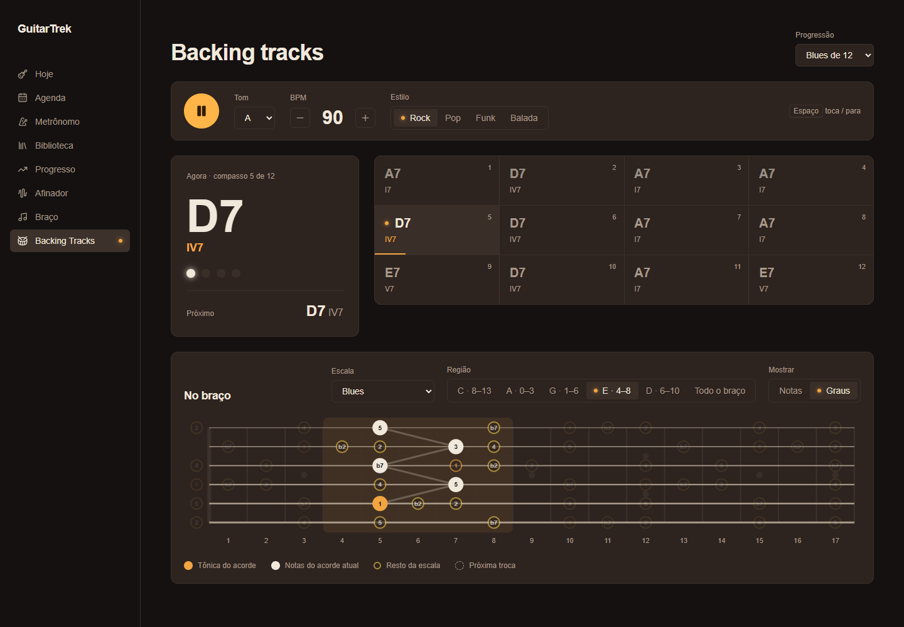

# Aula 18c — A tela nova da backing, com o braço junto

> 💡 Abra com **`Ctrl+Shift+V`**. Deixe rodando `npm run dev --prefix web` e o `npm run test --prefix web`.

Na 18a a backing passou a tocar, mas a tela ficou crua. Na 05e o braço aprendeu a mostrar o acorde dentro da escala. Esta aula junta as duas coisas: **enquanto a faixa toca, o braço acompanha o acorde da vez**.



O plano do módulo 18 mudou um pouco desde a 18a:

| Aula | O que sai |
|---|---|
| 18a ✅ | Bateria, estilos, progressões em graus e o compasso atual aceso |
| **18c** (esta) | A tela do mockup (`docs/mockups/backing.html`) e o braço acompanhando a música |
| 18b | Baixo e acordes tocando junto, swing e mixer |
| 18d | Monte a sua backing track: grade de compassos, seções e salvar na API |

**O que você vai aprender:**
1. Ordenar com uma função de comparação, o `OrderBy` do JavaScript
2. Cancelar o resultado de uma `Promise` quando o componente sai da tela
3. `style={{ ... }}` para o valor que muda a cada instante
4. Grid que muda com o tamanho da tela (`lg:`) e o truque da linha de 1px
5. `%` para "dar a volta" numa lista

---

## Parte 0 — A ideia

Pense no blues em Lá. Você está improvisando na caixa da casa 5, e o acorde muda de A7 para D7. Você **não** muda de lugar no braço: continua na mesma caixa. O que muda é **onde estão as notas do acorde dentro dela**.

| Compasso | Acorde | Forma CAGED que cai nas casas 4–8 |
|---|---|---|
| 1 | A7 | forma de **E** (a pestana na casa 5) |
| 2 | D7 | forma de **A** (a pestana na casa 5, na corda Lá) |
| 9 | E7 | forma de **C** (casas 4 a 7) |

É isso que a tela vai fazer:
- você escolhe uma **região**, que é uma das 5 formas do primeiro acorde;
- a região fica parada;
- a cada compasso, o app procura a forma do acorde atual que fica **mais perto** dela.

Os graus passam a ser contados a partir do **acorde**, e não do tom. Sobre o D7, o Lá vira **5**. É assim que um improvisador pensa: "estou na 3ª do acorde, estou na 7ª".

Antes de cada troca, o **próximo** acorde aparece em anéis tracejados, para você já mirar a nota de chegada. Na Parte 4 eles aparecem no último tempo. Na Parte 5, eles vão surgindo devagar ao longo do compasso inteiro.

---

## Parte 1 — A teoria

### Passo 1.1 — Cada progressão sugere uma escala

Em `web/src/theory/progressoes.ts`, no topo, embaixo do import de `TipoAcorde`:

```ts
import type { NomeEscala } from './escalas'
```

Agora cada progressão ganha um campo `escala`, logo depois do `nome`:

```ts
export const PROGRESSOES = {
    blues12: { nome: 'Blues de 12', escala: 'blues', compassos: ['I7', 'IV7', 'I7', 'I7', 'IV7', 'IV7', 'I7', 'I7', 'V7', 'IV7', 'I7', 'V7'] },
    pop: { nome: 'I–V–vi–IV', escala: 'pentaMaior', compassos: ['I', 'V', 'vi', 'IV'] },
    anos50: { nome: 'I–vi–IV–V', escala: 'pentaMaior', compassos: ['I', 'vi', 'IV', 'V'] },
    doisCincoUm: { nome: 'ii–V–I', escala: 'maior', compassos: ['ii7', 'V7', 'I7M', 'I7M'] },
    andaluza: { nome: 'Andaluza', escala: 'menor', compassos: ['i', 'bVII', 'bVI', 'V'] },
    modal: { nome: 'Vamp dórico', escala: 'dorico', compassos: ['i7', 'IV7'] },
    bluesMenor: { nome: 'Blues menor', escala: 'pentaMenor', compassos: ['i7', 'iv7', 'i7', 'i7', 'iv7', 'iv7', 'i7', 'i7', 'bVI7', 'V7', 'i7', 'V7'] },
} satisfies Record<string, { nome: string; escala: NomeEscala; compassos: string[] }>
```

| Código | O que significa |
|---|---|
| `escala: 'blues'` | A escala "padrão" para improvisar sobre aquela progressão. O usuário ainda pode trocar na tela. |
| `escala: NomeEscala` no `satisfies` | Se você digitar `'bluez'`, o TypeScript reclama na hora: só valem os nomes que existem em `ESCALAS`. |
| `import type` | Importa **só o tipo**, que some quando o código vira JavaScript. Você já viu na 05d. |

**✅ O que você deve ver:** nada muda na tela, e os testes continuam passando.

### Passo 1.2 — `formaPerto`: a forma do acorde mais perto de uma região

Em `web/src/theory/acordes.ts`, o import do `braco` ganha o `janela`:

```ts
import { AFINACAO_PADRAO, janela } from './braco'
```

E no **fim** do arquivo:

```ts
// O meio da janela de um desenho: a casa "em volta" da qual ele fica
function centro(desenho: string[]) {
    const [de, ate] = janela(desenho)
    return (de + ate) / 2
}

// Das 5 formas do acorde, a que fica mais perto de outro desenho
export function formaPerto(raiz: Nota, tipo: TipoAcorde, perto: string[]): string[] {
    const alvo = centro(perto)
    const desenhos = (Object.keys(FORMAS) as Forma[]).map((f) => voicing(raiz, tipo, f))
    return desenhos.sort((a, b) => Math.abs(centro(a) - alvo) - Math.abs(centro(b) - alvo))[0]
}
```

| Código | O que significa |
|---|---|
| `centro` sem `export` | Uma função auxiliar, usada só aqui. Sem `export`, ela é `private` do arquivo. |
| `(de + ate) / 2` | A janela 4–8 tem centro 6. É um jeito simples de dizer "esse desenho fica em volta da casa 6". |
| `perto: string[]` | Recebe um **desenho**, e não um número: "a forma mais perto **deste** desenho". Quem chama não precisa saber de centro nem de janela. |
| `desenhos` | As 5 formas do acorde: C, A, G, E e D. |
| `.sort((a, b) => ...)` | Ordena com uma função de comparação, como o `list.Sort((a, b) => ...)` do C#. O resultado **negativo** coloca `a` antes, o **positivo** coloca `b` antes. Aqui a conta compara as distâncias até o alvo: quem está mais perto vem primeiro. |
| `Math.abs(...)` | O valor absoluto, igual ao `Math.Abs` do C#. A distância da casa 4 até a 6 e da 8 até a 6 é 2 nos dois casos. |
| `[0]` | Pega o primeiro, o mais perto. A linha toda é o `OrderBy(d => distancia).First()` do LINQ. |

> ⚠️ **Pegadinha:** o `.sort` do JavaScript **muda o próprio array**. Ele não devolve uma cópia como o `OrderBy`. Aqui não tem problema, porque o array `desenhos` foi criado na linha de cima e ninguém mais usa. Mas nunca use `.sort` direto numa lista que veio de fora, como uma prop ou um estado.

> ❓ **Por que no `acordes.ts`, e não no `braco.ts`?** O `acordes.ts` já importa do `braco.ts`. Se o `braco.ts` importasse do `acordes.ts`, um arquivo dependeria do outro, como duas classes que se criam no construtor. Quem usa o `voicing` fica junto do `voicing`.

### Passo 1.3 — Testes

Em `web/src/theory/tests/braco.test.ts`, troque o import do `acordes`:

```ts
import { formaPerto, voicing } from "../acordes";
```

E no fim do arquivo:

```ts
describe('forma mais perto', () => {
    it('no blues em Lá, perto do A7 da casa 5 o D7 é a forma de A', () => {
        expect(formaPerto('D', 'dom7', voicing('A', 'dom7', 'E'))).toEqual(voicing('D', 'dom7', 'A'))
    })
    it('e o E7 é a forma de C', () => {
        expect(formaPerto('E', 'dom7', voicing('A', 'dom7', 'E'))).toEqual(voicing('E', 'dom7', 'C'))
    })
    it('o próprio acorde fica onde está', () => {
        const a7 = voicing('A', 'dom7', 'E')
        expect(formaPerto('A', 'dom7', a7)).toEqual(a7)
    })
})
```

São os 3 casos da tabela da Parte 0. O terceiro protege uma regra óbvia: se o acorde não muda, o desenho também não muda.

**✅ O que você deve ver:** **34 testes passando**.

---

## Parte 2 — O hook

### Passo 2.1 — Um bug escondido da 18a

Abra o `web/src/hooks/useBacking.ts`. Lembra que, no modo dev, o React monta todo componente **duas vezes** (o `StrictMode`, aula 02)? Para a maioria dos efeitos, tudo bem, porque a limpeza desfaz o primeiro. Mas veja a ordem do que acontece aqui:

1. **1ª montagem:** cria o `AudioContext` 1 e começa a baixar a bateria 1.
2. **Limpeza:** fecha o `AudioContext` 1. A bateria 1 **continua baixando**: a `Promise` não sabe que o componente saiu.
3. **2ª montagem:** cria o `AudioContext` 2 e começa a baixar a bateria 2.
4. A bateria 2 termina e vai para o `bateria.current`.
5. A bateria 1 termina **depois** e **sobrescreve** o `bateria.current`.

O app então toca numa bateria ligada a um contexto **fechado**, e não sai som. Depende de qual download termina antes, então às vezes funciona e às vezes não. É o pior tipo de bug.

O C# resolve isso com `CancellationToken`. Aqui é ainda mais simples: uma variável. Troque o primeiro `useEffect` por:

```ts
    useEffect(() => {
        const ctx = new AudioContext()
        audio.current = ctx
        let cancelado = false
        const drums = DrumMachine(ctx, { instrument: 'LM-2' })
        drums.ready.then(() => {
            if (cancelado) return
            bateria.current = drums
            setCarregado(true)
        })
        return () => {
            cancelado = true
            ctx.close()
        }
    }, [])
```

| Código | O que significa |
|---|---|
| `let cancelado = false` | Cada execução do efeito tem a **sua** variável. A 1ª montagem e a 2ª não dividem nada. |
| `if (cancelado) return` | Quando a bateria 1 terminar de baixar, ela vê que foi cancelada e não faz nada. |
| `cancelado = true` na limpeza | A limpeza roda quando o componente sai. Ela marca a bateria **dessa** execução como cancelada. |

O truque funciona porque a função do `.then` **captura** a variável `cancelado` da execução em que nasceu. É uma closure, como um lambda do C# que captura uma variável local.

### Passo 2.2 — O tempo atual (1, 2, 3, 4)

A tela nova tem 4 luzes, uma por tempo, e uma barrinha que enche ao longo do compasso. Hoje o hook só avisa quando o **compasso** muda, e agora ele precisa avisar a cada **tempo**.

Embaixo do `useState` do `compassoAtual`:

```ts
    const [tempoAtual, setTempoAtual] = useState(-1)
```

No agendador, troque o bloco `if (passo === 0) { ... }` inteiro por:

```ts
                if (passo % 4 === 0) {
                    const esteCompasso = compasso
                    const esteTempo = passo / 4
                    const atraso = (proximoPasso - ctx.currentTime) * 1000
                    timeouts.push(
                        window.setTimeout(() => {
                            setCompassoAtual(esteCompasso)
                            setTempoAtual(esteTempo)
                        }, atraso),
                    )
                }
```

| Código | O que significa |
|---|---|
| `passo % 4 === 0` | Os tempos caem nos passos 0, 4, 8 e 12, como diz o comentário do `estilos.ts`. O resto da divisão por 4 é 0 só neles. |
| `passo / 4` | Passo 0 → tempo 0, passo 4 → tempo 1, até o passo 12 → tempo 3. |
| Dois `set` no mesmo `setTimeout` | O React junta os dois numa renderização só (o *batching*). A tela nunca mostra o compasso novo com o tempo velho. |
| `esteTempo` | A mesma cópia que o `esteCompasso` já fazia. O `passo` vai ter mudado quando o `setTimeout` rodar. |

Na limpeza do efeito de tocar, embaixo do `setCompassoAtual(-1)`:

```ts
            setTempoAtual(-1)
```

E no `return`, acrescente o `tempoAtual` no fim:

```ts
    return { tocando, setTocando, carregado, bpm, setBpm, tom, setTom, estilo, setEstilo, progressao, setProgressao, compassoAtual, tempoAtual }
```

**✅ O que você deve ver:** a página antiga continua tocando igual. Com o hook dando o tempo, a tela nova já pode acender as luzes.

---

## Parte 3 — Dois ajustes nos componentes

### Passo 3.1 — `<Fretboard>`: o próximo acorde tracejado

Em `web/src/components/Fretboard.tsx`, no `type Props`, embaixo de `desenhos?: string[][]`:

```tsx
    proximo?: string[]
```

Na assinatura, depois de `desenhos = []`:

```tsx
export function Fretboard({ tonica, notas, mostrar = 'nota', alvos = [], destaque = [], desenhos = [], proximo = [] }: Props) {
```

E logo **antes** do `<AnimatePresence>`, depois do `desenhos.map` da linha:

```tsx
            {proximo.map((chave) => {
                const [corda, casa] = chave.split('-').map(Number)
                return (
                    <circle
                        key={chave}
                        cx={xCasa(casa)}
                        cy={yCorda(corda)}
                        r={15}
                        fill="none"
                        strokeWidth={1.5}
                        strokeDasharray="4 3"
                        className="stroke-muted-foreground"
                    />
                )
            })}
```

| Código | O que significa |
|---|---|
| `r={15}` | Maior que a bolinha da nota (11): o anel fica **em volta** dela. Se no lugar não tem nota, aparece só o anel. |
| `strokeDasharray="4 3"` | Traço tracejado: 4 unidades de linha, 3 de espaço, repetindo. |
| Antes do `<AnimatePresence>` | Fica **embaixo** das notas, pela regra das camadas do SVG da 05e. |
| `{` e `return` no `map` | Na 05e o `map` da linha também tinha um corpo com `{ }`. Quando a função precisa de uma variável antes do JSX, ela ganha chaves e um `return`. |

### Passo 3.2 — `<Alternador>`: o rótulo não quebra

A Região vai ter 6 opções. No celular, o `Alternador` espreme os botões e o "Todo o braço" quebra em 3 linhas. Em `web/src/components/Alternador.tsx`, no `className` do `<button>`, acrescente `whitespace-nowrap` depois de `text-sm`:

```tsx
                    className={`flex items-center gap-2 rounded px-3 py-1 text-sm whitespace-nowrap tabular-nums transition-colors ${
```

`whitespace-nowrap` é "não quebre o texto". O botão passa a ter sempre a largura do rótulo. Logo mais, na página, a Região ganha uma rolagem lateral para caber no celular.

---

## Parte 4 — A página

A tela nova muda quase tudo no `Backing.tsx`. Em vez de editar linha por linha, **apague todo o conteúdo do arquivo** e monte de novo, de cima para baixo. Boa parte você reconhece da 18a e da 05e.

### Passo 4.1 — Imports e opções

```tsx
import { useEffect, useState } from 'react'
import { Minus, Pause, Play, Plus } from 'lucide-react'
import { NOTAS, type Nota } from '@/theory/notas'
import { cifra, FORMAS, formaPerto, voicing, type Forma } from '@/theory/acordes'
import { notasDaEscala, ROTULOS_ESCALA, type NomeEscala } from '@/theory/escalas'
import { aoRedor, janela } from '@/theory/braco'
import { acordeDoGrau, PROGRESSOES, type NomeProgressao } from '@/theory/progressoes'
import { ESTILOS, type NomeEstilo } from '@/backing/estilos'
import { useBacking } from '@/hooks/useBacking'
import { Alternador } from '@/components/Alternador'
import { Fretboard, type Exibicao } from '@/components/Fretboard'

const NOMES_PROGRESSAO = Object.keys(PROGRESSOES) as NomeProgressao[]
const NOMES_ESCALA = Object.keys(ROTULOS_ESCALA) as NomeEscala[]

const OPCOES_ESTILO = (Object.keys(ESTILOS) as NomeEstilo[]).map((e) => ({ valor: e, rotulo: ESTILOS[e].nome }))

const OPCOES_MOSTRAR = [
    { valor: 'nota', rotulo: 'Notas' },
    { valor: 'grau', rotulo: 'Graus' },
] satisfies { valor: Exibicao; rotulo: string }[]
```

Tudo aqui é repetido de outras páginas. A novidade é que o estilo agora usa o `Alternador` em vez de um `<select>`: são só 4 opções, então cabem à vista.

### Passo 4.2 — Estados e contas

Embaixo das constantes, o componente começa assim:

```tsx
export function Backing() {
    const b = useBacking()
    const [escala, setEscala] = useState<NomeEscala>('blues')
    const [regiao, setRegiao] = useState<Forma | null>('E')
    const [mostrar, setMostrar] = useState<Exibicao>('grau')

    const { tocando, setTocando } = b
    useEffect(() => {
        function aoTeclar(e: KeyboardEvent) {
            if (e.code === 'Space') {
                e.preventDefault()
                setTocando(!tocando)
            }
        }
        window.addEventListener('keydown', aoTeclar)
        return () => window.removeEventListener('keydown', aoTeclar)
    }, [tocando, setTocando])

    const compassos = PROGRESSOES[b.progressao].compassos.map((grau) => ({ grau, ...acordeDoGrau(b.tom, grau) }))
    const indice = b.compassoAtual === -1 ? 0 : b.compassoAtual % compassos.length
    const atual = compassos[indice]
    const proximo = compassos[(indice + 1) % compassos.length]
```

O atalho do espaço é o seu exercício da 18a, sem mudança. O que é novo:

| Código | O que significa |
|---|---|
| `regiao: Forma \| null` | A forma do primeiro acorde que marca a região. `null` = "Todo o braço". É o mesmo truque do "Todas" da 05d. |
| `({ grau, ...acordeDoGrau(b.tom, grau) })` | Monta um objeto com o `grau` **mais** os campos do acorde: `{ grau: 'IV7', raiz: 'D', tipo: 'dom7' }`. O `...` "espalha" o objeto, como no `mudar` da 05e. Assim a tela tem a cifra **e** o grau de cada compasso. Os parênteses em volta do `{` dizem que é um objeto, e não o corpo da função. |
| `b.compassoAtual === -1 ? 0 : ...` | Parado, a tela mostra o compasso 1, em vez de um "—" solto. |
| `(indice + 1) % compassos.length` | O próximo compasso, **dando a volta**: no compasso 12 (índice 11), `12 % 12` é 0, o primeiro. Sem o `%`, o índice 12 não existe e o `proximo` vira `undefined`. |

Agora as contas do braço, logo embaixo:

```tsx
    // A região é uma forma do PRIMEIRO acorde: ela fica parada, e cada acorde usa a forma dele que cai ali
    const primeiro = compassos[0]
    const OPCOES_REGIAO = [
        ...(Object.keys(FORMAS) as Forma[]).map((f) => {
            const [de, ate] = janela(voicing(primeiro.raiz, primeiro.tipo, f))
            return { valor: f, rotulo: `${f} · ${de}–${ate}` }
        }),
        { valor: null, rotulo: 'Todo o braço' },
    ]

    const notas = notasDaEscala(b.tom, escala)
    const base = regiao === null ? null : voicing(primeiro.raiz, primeiro.tipo, regiao)
    const desenhos = base
        ? [formaPerto(atual.raiz, atual.tipo, base)]
        : (Object.keys(FORMAS) as Forma[]).map((f) => voicing(atual.raiz, atual.tipo, f))
    const destaque = base ? [...aoRedor(base, notas), ...desenhos[0]] : []
    const vaiTrocar = b.tempoAtual === 3 && cifra(proximo.raiz, proximo.tipo) !== cifra(atual.raiz, atual.tipo)
    const desenhoProximo = base && vaiTrocar ? formaPerto(proximo.raiz, proximo.tipo, base) : []
```

| Código | O que significa |
|---|---|
| `OPCOES_REGIAO` dentro do componente | As outras opções ficam **fora** porque nunca mudam. Esta depende do tom e da progressão: em Lá, a forma de E fica nas casas 4–8, mas em Dó ela fica nas 7–11. Então ela é recalculada a cada render. |
| `` `${f} · ${de}–${ate}` `` | O rótulo "E · 4–8": a forma e as casas, usando o `janela` da 05e. |
| `base` | O desenho da região: a forma escolhida do **primeiro** acorde. Com "Todo o braço", não tem base. |
| `desenhos` | Com região: **uma** forma do acorde atual, a mais perto da base. Sem região: as 5 formas, como no "Todas" da 05e. |
| `destaque` | As notas da escala na região mais as do acorde. O resto do braço fica apagado. Sem região, a lista vazia deixa tudo aceso. |
| `vaiTrocar` | É o último tempo (`3`) e o próximo acorde é **diferente**. Do compasso 3 para o 4 do blues (A7 → A7), nada de tracejado. Comparar as cifras é o jeito fácil de comparar dois acordes. |
| `base && vaiTrocar ? ... : []` | O tracejado só aparece quando tem região. Com o braço inteiro, seriam 5 formas tracejadas: poluição. |

> ❓ **Por que a base é o primeiro acorde, e não o acorde atual?** Se a base fosse o acorde atual, a região andaria a cada compasso, e você teria que correr pelo braço atrás dela. A ideia da Parte 0 é o contrário: **você fica parado** e o acorde muda de forma em volta de você.

### Passo 4.3 — O topo

Agora o `return`. O título fica à esquerda e a progressão à direita, como no mockup:

```tsx
    return (
        <section className="flex max-w-6xl flex-col gap-6">
            <div className="flex flex-wrap items-end justify-between gap-4">
                <h1 className="text-4xl">Backing tracks</h1>
                <label className="flex flex-col gap-1.5 text-xs text-muted-foreground">
                    Progressão
                    <select
                        value={b.progressao}
                        onChange={(e) => {
                            const nova = e.target.value as NomeProgressao
                            b.setProgressao(nova)
                            setEscala(PROGRESSOES[nova].escala)
                        }}
                        className="rounded-md border bg-card px-3 py-2 text-sm text-foreground"
                    >
                        {NOMES_PROGRESSAO.map((nome) => (
                            <option key={nome} value={nome}>
                                {PROGRESSOES[nome].nome}
                            </option>
                        ))}
                    </select>
                </label>
            </div>
```

Ao trocar a progressão, a escala muda junto para a sugerida no Passo 1.1. É o mesmo padrão do exercício 1 da 05e: guardar o valor novo numa variável (`nova`) porque ele é usado duas vezes.

### Passo 4.4 — O transporte

O "painel do amp": tocar, tom, BPM e estilo numa faixa só. Continue embaixo:

```tsx
            {/* 1. Transporte */}
            <div className="flex flex-wrap items-center gap-6 rounded-xl border bg-card px-5 py-4">
                <button
                    onClick={() => b.setTocando(!b.tocando)}
                    disabled={!b.carregado}
                    aria-label={b.tocando ? 'Parar' : 'Tocar'}
                    className="grid size-14 place-items-center rounded-full bg-primary text-primary-foreground hover:brightness-110 disabled:opacity-50"
                >
                    {b.tocando ? <Pause className="size-5 fill-current" /> : <Play className="size-5 fill-current" />}
                </button>

                <label className="flex flex-col gap-1.5 text-xs text-muted-foreground">
                    Tom
                    <select
                        value={b.tom}
                        onChange={(e) => b.setTom(e.target.value as Nota)}
                        className="rounded-md border bg-card px-3 py-2 text-sm text-foreground"
                    >
                        {NOTAS.map((nota) => (
                            <option key={nota}>{nota}</option>
                        ))}
                    </select>
                </label>

                <div className="flex flex-col gap-1.5 text-xs text-muted-foreground">
                    BPM
                    <div className="flex items-center gap-1">
                        <button
                            onClick={() => b.setBpm(Math.max(40, b.bpm - 5))}
                            aria-label="Diminuir BPM"
                            className="grid size-8 place-items-center rounded-md border hover:text-foreground"
                        >
                            <Minus className="size-4" />
                        </button>
                        <span className="w-16 text-center font-heading text-3xl font-semibold tabular-nums text-foreground font-stretch-expanded">
                            {b.bpm}
                        </span>
                        <button
                            onClick={() => b.setBpm(Math.min(240, b.bpm + 5))}
                            aria-label="Aumentar BPM"
                            className="grid size-8 place-items-center rounded-md border hover:text-foreground"
                        >
                            <Plus className="size-4" />
                        </button>
                    </div>
                </div>

                <div className="flex flex-col gap-1.5 text-xs text-muted-foreground">
                    Estilo
                    <Alternador opcoes={OPCOES_ESTILO} valor={b.estilo} onChange={b.setEstilo} />
                </div>

                <span className="ml-auto text-xs text-muted-foreground">
                    <kbd className="rounded border border-b-2 px-1.5 py-0.5 font-sans">Espaço</kbd> toca / para
                </span>
            </div>
```

| Código | O que significa |
|---|---|
| `aria-label` | O botão agora só tem um ícone, sem texto. O `aria-label` é o nome dele para o leitor de tela de quem não enxerga. Sem ele, o botão seria anunciado como "botão", e nada mais. |
| `grid size-14 place-items-center rounded-full` | Um círculo de 56px com o ícone bem no meio. `place-items-center` centraliza nas duas direções, e é o jeito mais curto de centralizar uma coisa só. |
| `Math.max(40, b.bpm - 5)` | Trava o mínimo em 40, igual ao `Math.max(0, ...)` da `janela`. O `Math.min(240, ...)` trava o máximo. |
| `onChange={b.setEstilo}` | Passa a função direto, sem `(e) => b.setEstilo(e)`. O `Alternador` chama `onChange(valor)`, e o `setEstilo` aceita exatamente isso. |
| `<kbd>` | A tag HTML para "tecla do teclado". O `border-b-2` engrossa a borda de baixo, para parecer uma tecla. |
| `ml-auto` | Margem esquerda automática: empurra o atalho para a ponta direita. O mesmo truque da luz piloto no menu. |

### Passo 4.5 — "Agora": o acorde da vez

O cartão grande à esquerda e a grade à direita ficam num **grid** de duas colunas:

```tsx
            {/* 2. Agora + grade */}
            <div className="grid gap-6 lg:grid-cols-[300px_1fr]">
                <div className="flex flex-col gap-5 rounded-xl border bg-card p-6">
                    <span className="text-xs text-muted-foreground">
                        Agora · compasso {indice + 1} de {compassos.length}
                    </span>
                    <div>
                        <p className="font-heading text-7xl font-semibold font-stretch-expanded">{cifra(atual.raiz, atual.tipo)}</p>
                        <p className="font-heading text-lg font-semibold text-primary font-stretch-expanded">{atual.grau}</p>
                    </div>
                    <div className="flex gap-2.5">
                        {[0, 1, 2, 3].map((t) => (
                            <span
                                key={t}
                                className={`size-3.5 rounded-full ${
                                    t > b.tempoAtual
                                        ? 'bg-secondary'
                                        : t === 0
                                          ? 'bg-foreground shadow-[0_0_10px_var(--foreground)]'
                                          : 'bg-primary shadow-[0_0_10px_var(--primary)]'
                                }`}
                            />
                        ))}
                    </div>
                    <div className="flex items-baseline justify-between border-t pt-4">
                        <span className="text-xs text-muted-foreground">Próximo</span>
                        <span>
                            <b className="font-heading text-2xl font-semibold font-stretch-expanded">{cifra(proximo.raiz, proximo.tipo)}</b>{' '}
                            <span className="text-muted-foreground">{proximo.grau}</span>
                        </span>
                    </div>
                </div>
```

| Código | O que significa |
|---|---|
| `grid` | Sem colunas definidas, o grid empilha os filhos, um embaixo do outro. É assim no celular. |
| `lg:grid-cols-[300px_1fr]` | A partir da tela **grande** (`lg:`, 1024px ou mais), duas colunas: a primeira com 300px fixos e a segunda (`1fr`) com o resto. O `_` vira espaço no CSS. Os prefixos `sm:`, `md:` e `lg:` são "a partir deste tamanho": o Tailwind começa pelo celular e vai acrescentando. |
| `[0, 1, 2, 3].map` | As 4 luzes. Um array literal serve de "repita 4 vezes". |
| `t > b.tempoAtual` | Apagada se ainda não chegou. O tempo 2 acende as luzes 0, 1 e 2. Parado, o `tempoAtual` é −1 e todas ficam apagadas. |
| `t === 0` → `bg-foreground` | O tempo 1 acende numa cor **diferente** (branco), para você sentir onde o compasso começa. É a ideia do acento do metrônomo da 03d, com as cores trocadas: lá o 1 é âmbar, aqui o âmbar já marca o compasso atual na grade. |
| `shadow-[0_0_10px_var(--primary)]` | O brilho da luz piloto, um pouco maior. Usa o token, nunca a cor fixa. |
| `{' '}` | Um espaço de verdade entre a cifra e o grau. O JSX joga fora os espaços entre linhas, e o `{' '}` força um. |

### Passo 4.6 — A grade dos compassos

Continue, ainda dentro do grid:

```tsx
                <div className="grid grid-cols-4 gap-px self-start overflow-hidden rounded-xl border bg-border">
                    {compassos.map((acorde, i) => {
                        const agora = b.tocando && i === indice
                        const passou = b.tocando && i < indice
                        return (
                            <div key={i} className={`relative flex flex-col gap-1 px-4 pt-3.5 pb-4 ${agora ? 'bg-secondary' : 'bg-card'}`}>
                                <span className="absolute top-2.5 right-3 text-[11px] text-muted-foreground">{i + 1}</span>
                                <b
                                    className={`flex items-center gap-2.5 font-heading text-xl font-semibold font-stretch-expanded ${
                                        agora ? 'text-foreground' : passou ? 'text-foreground/55' : 'text-muted-foreground'
                                    }`}
                                >
                                    {agora && <span className="size-1.5 rounded-full bg-primary shadow-[0_0_6px_var(--primary)]" />}
                                    {cifra(acorde.raiz, acorde.tipo)}
                                </b>
                                <small className={`text-xs ${agora ? 'text-primary' : 'text-muted-foreground'}`}>{acorde.grau}</small>
                                {agora && (
                                    <span
                                        className="absolute bottom-0 left-0 h-0.5 bg-primary transition-[width] duration-300"
                                        style={{ width: `${(b.tempoAtual + 1) * 25}%` }}
                                    />
                                )}
                            </div>
                        )
                    })}
                </div>
            </div>
```

| Código | O que significa |
|---|---|
| `gap-px` + `bg-border` | **O truque da linha de 1px.** O fundo da grade é a cor da borda, e as células têm o fundo do cartão. Entre elas sobra 1px de espaço (`gap-px`), e por esse espaço aparece o fundo, que vira a linha. Assim não é preciso calcular "qual célula tem borda à direita". |
| `self-start` | A grade não estica para a altura do cartão "Agora". Ela fica do tamanho dela, encostada em cima. |
| `relative` na célula e `absolute` no número | O `absolute` posiciona o número em relação ao pai `relative` mais próximo: no canto de cima à direita da **célula**. É o mesmo par do painel flutuante da 03f. |
| `text-foreground/55` | A cor do texto com 55% de opacidade. O `/55` funciona com qualquer token. Os compassos que já passaram ficam meio claros. |
| `style={{ width: ... }}` | **Estilo direto**, sem classe. O Tailwind só conhece as classes que ele **lê no código** quando roda o `npm run dev`, então uma classe montada na hora (`` `w-[${x}%]` ``) não funcionaria. Para um valor que muda a cada tempo, o certo é o `style`. As chaves duplas são as do JSX (`{`) com um objeto dentro (`{ width }`). |
| `(b.tempoAtual + 1) * 25` | Tempo 0 → 25%, tempo 3 → 100%. A barra enche em 4 passos. |
| `transition-[width] duration-300` | Anima só a largura, em 300ms. Os 4 passos viram um enchimento suave. |

### Passo 4.7 — O braço

O último bloco, depois do `</div>` do grid:

```tsx
            {/* 3. Braço */}
            <div className="flex flex-col gap-4 rounded-xl border bg-card p-5">
                <div className="flex flex-wrap items-end gap-5">
                    <h2 className="mr-auto text-lg">No braço</h2>
                    <label className="flex flex-col gap-1.5 text-xs text-muted-foreground">
                        Escala
                        <select
                            value={escala}
                            onChange={(e) => setEscala(e.target.value as NomeEscala)}
                            className="rounded-md border bg-card px-3 py-2 text-sm text-foreground"
                        >
                            {NOMES_ESCALA.map((nome) => (
                                <option key={nome} value={nome}>
                                    {ROTULOS_ESCALA[nome]}
                                </option>
                            ))}
                        </select>
                    </label>
                    <div className="flex max-w-full flex-col gap-1.5 text-xs text-muted-foreground">
                        Região
                        <div className="overflow-x-auto">
                            <Alternador opcoes={OPCOES_REGIAO} valor={regiao} onChange={setRegiao} />
                        </div>
                    </div>
                    <div className="flex flex-col gap-1.5 text-xs text-muted-foreground">
                        Mostrar
                        <Alternador opcoes={OPCOES_MOSTRAR} valor={mostrar} onChange={setMostrar} />
                    </div>
                </div>
                <div className="overflow-x-auto">
                    <Fretboard
                        tonica={atual.raiz}
                        notas={notas}
                        mostrar={mostrar}
                        destaque={destaque}
                        desenhos={desenhos}
                        proximo={desenhoProximo}
                    />
                </div>
                <div className="flex flex-wrap gap-x-6 gap-y-2 text-xs text-muted-foreground">
                    <span className="flex items-center gap-2">
                        <span className="size-3.5 rounded-full bg-primary" /> Tônica do acorde
                    </span>
                    <span className="flex items-center gap-2">
                        <span className="size-3.5 rounded-full bg-foreground" /> Notas do acorde atual
                    </span>
                    <span className="flex items-center gap-2">
                        <span className="size-3 rounded-full border-2 border-cat-escalas opacity-60" /> Resto da escala
                    </span>
                    <span className="flex items-center gap-2">
                        <span className="size-3.5 rounded-full border border-dashed border-muted-foreground" /> Próxima troca
                    </span>
                </div>
            </div>
        </section>
    )
}
```

| Código | O que significa |
|---|---|
| `mr-auto` no `h2` | O espelho do `ml-auto`: empurra os controles para a direita. |
| `max-w-full` + `overflow-x-auto` | A Região nunca fica mais larga que o painel. Se não couber, como no celular, ela rola de lado, igual ao braço. Aqui o `whitespace-nowrap` do Passo 3.2 trabalha junto. |
| `tonica={atual.raiz}` | **O detalhe mais importante da página.** A tônica do braço é a do **acorde**, e não a do tom. Isso faz os graus serem contados a partir do acorde (Parte 0), e a bolinha âmbar cair na tônica dele, pela função `cores()` da 05e. |
| `notas={notas}` | A escala continua no **tom**: blues de Lá do começo ao fim. É a combinação das duas coisas: a escala parada e o acorde mudando. |
| `border-dashed` | Borda tracejada no CSS, o par do `strokeDasharray` do SVG. |

**✅ O que você deve ver:** a tela do print do começo da aula.
- Parado, o compasso 1 (A7) aparece no cartão "Agora", e o braço mostra a forma de E na casa 5.
- Aperte o espaço. As luzes acendem a cada tempo, a primeira em branco, e a barrinha enche dentro do compasso atual.
- No 4º tempo do compasso 4, aparecem os anéis tracejados do D7. No compasso 5, o desenho troca para o D7 na casa 5, **sem sair da região**.
- Troque a Região para "C · 8–13" e repare que todos os acordes passam a cair entre as casas 8 e 13.
- Troque a progressão para "Vamp dórico" e veja a escala mudar sozinha para Dórico.

---

## Parte 5 — Os anéis aparecem devagar

Aparecer só no 4º tempo é tarde: dá uma batida para mirar a nota de chegada. Fica melhor assim: os anéis do próximo acorde **começam a surgir no tempo 1 do compasso anterior à troca** e ficam cada vez mais fortes até a troca. Você vê a mudança chegando o compasso inteiro.

### Passo 5.1 — O `<Fretboard>` aprende a "chegar"

Em `web/src/components/Fretboard.tsx`, no `type Props`, embaixo de `proximo?: string[]`:

```tsx
    chegada?: number
```

Na assinatura, depois de `proximo = []`:

```tsx
export function Fretboard({ tonica, notas, mostrar = 'nota', alvos = [], destaque = [], desenhos = [], proximo = [], chegada = 0 }: Props) {
```

E coloque o `proximo.map` inteiro **dentro** de um `<motion.g>`:

```tsx
            <motion.g key={proximo.join(' ')} initial={{ opacity: 0 }} animate={{ opacity: 1 }} transition={{ duration: chegada, ease: 'linear' }}>
                {proximo.map((chave) => {
                    // ... o mesmo de antes, sem mudar nada
                })}
            </motion.g>
```

| Código | O que significa |
|---|---|
| `chegada` | Quantos **segundos** os anéis levam para aparecer por inteiro. O padrão `0` = aparecem na hora, para quem não passar a prop. |
| `<motion.g>` | O `<g>` (grupo do SVG) da 05b, com a animação do `motion` que você já usa nas bolinhas. A opacidade do grupo vale para todos os anéis de uma vez. |
| `initial={{ opacity: 0 }}` → `animate={{ opacity: 1 }}` | Nasce invisível e vai até 100%. |
| `ease: 'linear'` | Velocidade **constante**. O padrão do `motion` acelera e freia (bom para movimento), mas aqui a opacidade é um **relógio**: metade do compasso tem que dar metade da opacidade. |
| `key={proximo.join(' ')}` | **O truque.** Quando a `key` muda, o React trata o grupo como um elemento **novo**: joga o velho fora e monta outro, e a animação recomeça do `initial`. A `key` é o desenho do próximo acorde, então cada acorde novo começa de 0. Sem ela, o grupo ficaria em 100% e os anéis do acorde seguinte já nasceriam fortes. |

### Passo 5.2 — A página passa o tempo do compasso

Em `web/src/pages/Backing.tsx`, o `vaiTrocar` deixa de esperar o 4º tempo. Basta estar tocando:

```tsx
    const vaiTrocar = b.tocando && cifra(proximo.raiz, proximo.tipo) !== cifra(atual.raiz, atual.tipo)
```

E o `<Fretboard>` ganha a prop, embaixo de `proximo={desenhoProximo}`:

```tsx
                        chegada={(60 / b.bpm) * 4}
```

`60 / bpm` é a duração de um tempo em segundos, a mesma conta do agendador, e um compasso tem 4 tempos. A 90 BPM, isso dá 2,67 s.

**✅ O que você deve ver:** no compasso 1 do blues (A7), os anéis do D7 surgem bem fracos no tempo 1 e chegam a 100% bem na troca. No compasso 3 (A7 → A7), nenhum anel aparece. Mude o BPM para 60 e veja que eles passam a demorar mais.

---

## Resumo

| Conceito | Onde apareceu | No C# seria |
|---|---|---|
| `.sort((a, b) => ...)` | `formaPerto` | `Sort(Comparison<T>)` / `OrderBy` (mas o `.sort` muda o array!) |
| Flag de cancelamento no efeito | `useBacking` | `CancellationToken` |
| `passo % 4`, `(i + 1) % n` | tempo e próximo compasso | o mesmo `%` |
| `style={{ width }}` | barrinha do compasso | — (valor dinâmico, sem classe) |
| `lg:grid-cols-[...]` | "Agora" + grade | — (CSS responsivo) |
| `gap-px` + fundo | grade de compassos | — (truque de CSS) |
| `aria-label` | botão de tocar | `AutomationProperties.Name` do WPF |
| `key` que muda = elemento novo | anéis que recomeçam do 0 | — (o React recria o componente) |

**Teste:** 34 passando.

---

## Exercícios

**1.** As regiões aparecem na ordem do nome, CAGED: "C · 8–13", "A · 0–3", "G · 1–6"... Num braço, faria mais sentido ir **da casa mais baixa para a mais alta**. Ordene as opções pela casa inicial, mantendo o "Todo o braço" no fim.

<details><summary>Gabarito</summary>

Guarde o `de` junto de cada opção, ordene, e depois tire:

```tsx
    const OPCOES_REGIAO = [
        ...(Object.keys(FORMAS) as Forma[])
            .map((f) => {
                const [de, ate] = janela(voicing(primeiro.raiz, primeiro.tipo, f))
                return { valor: f, rotulo: `${f} · ${de}–${ate}`, de }
            })
            .sort((a, b) => a.de - b.de),
        { valor: null, rotulo: 'Todo o braço' },
    ]
```

O `a.de - b.de` é a comparação crescente clássica: negativo se `a` vem antes. Para decrescente, é `b.de - a.de`. O campo `de` a mais não atrapalha o `Alternador`: ele só lê `valor` e `rotulo`. O TypeScript aceita, porque um objeto com campos **a mais** ainda é compatível com o tipo. Em Lá, a ordem fica A · 0–3, G · 1–6, E · 4–8, D · 6–10, C · 8–13. São as 5 formas subindo pelo braço, uma emendando na outra: é o desenho do CAGED.

Aqui o `.sort` pode mudar o array, porque o array nasceu no `.map` da linha de cima.
</details>

**2.** A legenda das cores agora aparece igual em duas páginas, o `EscalaNoAcorde` e o `Backing`. Só muda o último item ("Região da forma" ou "Próxima troca"). Extraia um componente `<Legenda>` em `web/src/components/Legenda.tsx` que receba esse último item como prop.

<details><summary>Gabarito</summary>

```tsx
import type { ReactNode } from 'react'

export function Legenda({ extra }: { extra: ReactNode }) {
    return (
        <div className="flex flex-wrap gap-x-6 gap-y-2 text-xs text-muted-foreground">
            <span className="flex items-center gap-2">
                <span className="size-3.5 rounded-full bg-primary" /> Tônica do acorde
            </span>
            <span className="flex items-center gap-2">
                <span className="size-3.5 rounded-full bg-foreground" /> Notas do acorde
            </span>
            <span className="flex items-center gap-2">
                <span className="size-3 rounded-full border-2 border-cat-escalas opacity-60" /> Resto da escala
            </span>
            <span className="flex items-center gap-2">{extra}</span>
        </div>
    )
}
```

E no `Backing.tsx`:

```tsx
                <Legenda
                    extra={
                        <>
                            <span className="size-3.5 rounded-full border border-dashed border-muted-foreground" /> Próxima troca
                        </>
                    }
                />
```

| Código | O que significa |
|---|---|
| `ReactNode` | O tipo de "qualquer coisa que dá para desenhar": texto, um elemento ou uma lista deles. Uma prop pode receber **JSX**, e não só texto ou número. |
| `<>...</>` | O **Fragment**: agrupa vários elementos sem criar uma `<div>` a mais. A prop recebe uma coisa só, e o fragment junta a bolinha e o texto numa. |
| `{ extra }: { extra: ReactNode }` | O tipo das props escrito na hora, sem um `type Props` separado. Para uma prop só, é comum. |

Repare que o texto do 2º item mudou para "Notas do acorde", que serve para as duas páginas.
</details>

**3.** *(No braço, sem código.)* Toque o blues em Lá com **Graus** ligado e olhe as notas da escala sobre o **D7**. O D# (o b5 do blues de Lá, a "blue note") aparece como que grau? E o C (o b3 de Lá)? Por que, na prática, o C soa bem sobre o D7 e o D# soa estranho se você parar nele?

<details><summary>Gabarito</summary>

- **D#** sobre D7 é o **b2**, meio tom acima da tônica do acorde. É a nota mais tensa possível, e por isso o b5 do blues é nota de **passagem**: você passa por ela a caminho do E ou do D, mas não para nela.
- **C** sobre D7 é a **b7**, uma nota **do acorde** (D7 = D F# A C). Ele soa "em casa" sobre o D7. Por isso a frase do blues que termina no C funciona tanto no A7 (onde ela é b3, a tensão do blues) quanto no D7 (onde ela é b7, a nota do acorde).

É exatamente isso que a tela ensina: a **mesma nota** muda de papel quando o acorde muda. O tom diz quais notas você tem, e o acorde diz qual delas está "em casa" agora.
</details>
