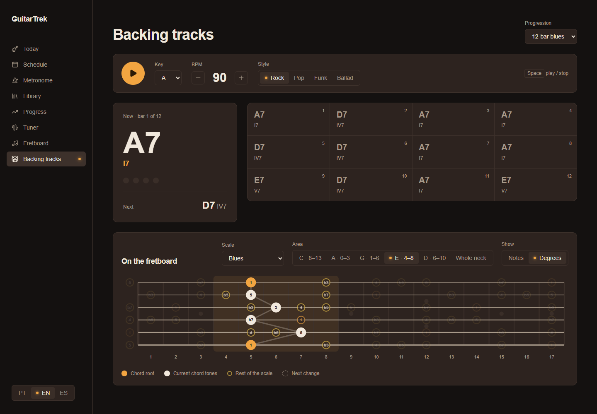

# Aula 22a — O app em português, inglês e espanhol

> 💡 Abra com **`Ctrl+Shift+V`**. Deixe rodando `npm run dev --prefix web` e o `npm run test --prefix web`.

Começa o módulo **22, multilíngua** (issue #22). Inglês é o maior público de guitarra do mundo, e espanhol cobre a América Latina inteira. Ele entra **agora** porque o app ainda tem poucas telas: daqui para frente, toda tela nova já nasce traduzível.



| Aula | O que sai |
|---|---|
| **22a** (esta) | O dicionário, a escolha do idioma (lembrada entre visitas), o menu, as páginas "em breve", os nomes da teoria e a Backing |
| 22b | O Metrônomo, o painel flutuante, o resto do Braço e a opção de nomes de nota `Dó Ré Mi` |

**O que você vai aprender:**
1. `typeof` para **tirar um tipo de um valor**: o português vira o "contrato" dos outros idiomas
2. Funções dentro do dicionário, para frases com números no meio
3. `localStorage`: guardar uma coisa no navegador
4. Um **type guard** (`texto is Idioma`), o `is` do C# com o seu próprio teste
5. JSX guardado numa variável e usado duas vezes

---

## Parte 0 — A ideia

No .NET você já viu isso: o `Resources.resx` com os textos em português e um `Resources.en.resx` com os mesmos nomes em inglês. No código você escreve `Resources.TituloDaPagina`, que é **tipado**: se o nome não existe, nem compila. O .NET escolhe o arquivo pelo idioma da thread.

Aqui vai ser igual, só que com objetos:

```tsx
// em vez de
<h1>Backing tracks</h1>
// fica
<h1>{t.backing.titulo}</h1>
```

O `t` é o dicionário do idioma atual. Ele vem de um Context, igual ao `useAudio()` da 03f, e quando você troca o idioma, todas as telas re-renderizam com o dicionário novo.

| Peça | Arquivo | No .NET seria |
|---|---|---|
| Os textos em português, que são a referência | `i18n/pt.ts` | `Resources.resx` |
| Inglês e espanhol, com as mesmas chaves | `i18n/en.ts`, `i18n/es.ts` | `Resources.en.resx`, `Resources.es.resx` |
| Quem guarda o idioma atual e entrega o `t` | `i18n/ProvedorDeIdioma.tsx` | o `CultureInfo.CurrentUICulture` |

> ❓ **E as bibliotecas prontas, como o `react-i18next`?** Elas usam chaves em texto, como `t('backing.titulo')`. Erre uma letra e você só descobre na tela. Com objeto, o TypeScript avisa na hora e o VS Code completa as chaves. Para o tamanho do app, isso basta. Se um dia tiver centenas de telas, a gente reavalia.

**O que não se traduz:** cifras (`A7`, `Dm7`), graus (`IV7`, `b3`) e nomes de nota (`C`, `D#`). Eles são a "notação" da música, iguais no mundo inteiro. A exceção é o `Dó Ré Mi`, que vira uma opção na 22b.

---

## Parte 1 — O dicionário

### Passo 1.1 — O português: `web/src/i18n/pt.ts`

Crie a pasta `i18n` dentro de `web/src` e, nela, o arquivo `pt.ts`:

```ts
import type { NomeEscala } from '@/theory/escalas'
import type { TipoAcorde } from '@/theory/acordes'
import type { NomeProgressao } from '@/theory/progressoes'
import type { NomeEstilo } from '@/backing/estilos'

// O português é a referência: os outros idiomas têm que ter exatamente estas chaves
export const pt = {
    menu: {
        hoje: 'Hoje',
        agenda: 'Agenda',
        metronomo: 'Metrônomo',
        biblioteca: 'Biblioteca',
        progresso: 'Progresso',
        afinador: 'Afinador',
        braco: 'Braço',
        backing: 'Backing tracks',
    },
    emBreve: {
        hoje: {
            titulo: 'Treino de hoje',
            descricao: 'Seu treino do dia vai aparecer aqui, com cada exercício, o BPM alvo e o botão para começar.',
        },
        agenda: { titulo: 'Agenda', descricao: 'A semana e o mês do seu plano, com o que fazer em cada dia.' },
        biblioteca: { titulo: 'Biblioteca', descricao: 'Todos os exercícios e escalas, com diagramas no braço da guitarra.' },
        progresso: { titulo: 'Progresso', descricao: 'Seus BPMs ao longo do tempo, streak e recordes.' },
        afinador: { titulo: 'Afinador', descricao: 'Seu afinador para deixar a guitarra no ponto, com referência visual e sonora.' },
    },
    escalas: {
        maior: 'Maior',
        menor: 'Menor natural',
        pentaMenor: 'Pentatônica menor',
        pentaMaior: 'Pentatônica maior',
        blues: 'Blues',
        dorico: 'Dórico',
        mixolidio: 'Mixolídio',
        lidio: 'Lídio',
    } satisfies Record<NomeEscala, string>,
    acordes: {
        maior: 'Maior',
        menor: 'Menor',
        dom7: '7',
        m7: 'm7',
        maj7: '7M',
    } satisfies Record<TipoAcorde, string>,
    progressoes: {
        blues12: 'Blues de 12',
        pop: 'I–V–vi–IV',
        anos50: 'I–vi–IV–V',
        doisCincoUm: 'ii–V–I',
        andaluza: 'Andaluza',
        modal: 'Vamp dórico',
        bluesMenor: 'Blues menor',
    } satisfies Record<NomeProgressao, string>,
    estilos: {
        rock: 'Rock',
        pop: 'Pop',
        funk: 'Funk',
        balada: 'Balada',
    } satisfies Record<NomeEstilo, string>,
    comum: {
        tonica: 'Tônica',
        escala: 'Escala',
        mostrar: 'Mostrar',
        notas: 'Notas',
        graus: 'Graus',
        tonicaAcorde: 'Tônica do acorde',
        restoEscala: 'Resto da escala',
    },
    backing: {
        titulo: 'Backing tracks',
        progressao: 'Progressão',
        tocar: 'Tocar',
        parar: 'Parar',
        tom: 'Tom',
        estilo: 'Estilo',
        menosBpm: 'Diminuir BPM',
        maisBpm: 'Aumentar BPM',
        espaco: 'Espaço',
        tocaPara: 'toca / para',
        agora: (compasso: number, total: number) => `Agora · compasso ${compasso} de ${total}`,
        proximo: 'Próximo',
        noBraco: 'No braço',
        regiao: 'Região',
        todoBraco: 'Todo o braço',
        notasAcorde: 'Notas do acorde atual',
        proximaTroca: 'Próxima troca',
    },
}

export type Textos = typeof pt
```

O arquivo é grande, mas só tem duas ideias novas. O resto é texto.

| Código | O que significa |
|---|---|
| Objetos dentro de objetos | As chaves são agrupadas por **tela** (`menu`, `backing`) e por **assunto** (`escalas`, `comum`). O `comum` guarda o que aparece em várias telas, como "Tônica" e "Mostrar". |
| `satisfies Record<NomeEscala, string>` | O mesmo truque dos `ROTULOS_ESCALA`, agora **aqui dentro**: se alguém criar uma escala nova no `ESCALAS`, o dicionário reclama que falta o nome dela. Esses rótulos saem da pasta `theory` na Parte 5. |
| `agora: (compasso: number, total: number) => ...` | **Uma função no lugar do texto.** "Compasso 3 de 12" tem números no meio, e a ordem das palavras muda entre idiomas. Em inglês é *bar 3 of 12*, mas em outras línguas o número pode vir antes. Cada idioma monta a frase do seu jeito, e a tela só chama `t.backing.agora(3, 12)`. É o `string.Format(Resources.Agora, 3, 12)` do C#, só que tipado. |
| `export type Textos = typeof pt` | **`typeof` num tipo:** "o tipo deste valor". O TypeScript olha o objeto e escreve o tipo sozinho: `{ menu: { hoje: string; ... }; backing: { agora: (compasso: number, total: number) => string; ... } }`. Você nunca escreve a interface à mão, e ela muda junto com o objeto. |

> ⚠️ **`typeof` tem dois sentidos.** Dentro do código, `typeof x === 'string'` é o JavaScript perguntando o tipo em tempo de execução. Depois de `type ... =`, é o TypeScript "copiando" o tipo de um valor. Você já viu esse segundo no `keyof typeof ESCALAS`.

**✅ O que você deve ver:** o arquivo não dá erro. Ninguém usa ele ainda.

### Passo 1.2 — Inglês e espanhol

As traduções são **conteúdo**, não código: não precisa digitar. Crie `web/src/i18n/en.ts` e `web/src/i18n/es.ts` e **cole** os blocos abaixo. Repare só na primeira linha de cada um.

<details><summary><code>en.ts</code> (clique para abrir)</summary>

```ts
import type { Textos } from './pt'

export const en: Textos = {
    menu: {
        hoje: 'Today',
        agenda: 'Schedule',
        metronomo: 'Metronome',
        biblioteca: 'Library',
        progresso: 'Progress',
        afinador: 'Tuner',
        braco: 'Fretboard',
        backing: 'Backing tracks',
    },
    emBreve: {
        hoje: {
            titulo: "Today's practice",
            descricao: 'Your practice for the day will show up here, with each exercise, the target BPM and a button to start.',
        },
        agenda: { titulo: 'Schedule', descricao: 'The week and month of your plan, with what to practice each day.' },
        biblioteca: { titulo: 'Library', descricao: 'Every exercise and scale, with fretboard diagrams.' },
        progresso: { titulo: 'Progress', descricao: 'Your BPMs over time, streak and personal bests.' },
        afinador: { titulo: 'Tuner', descricao: 'Get your guitar in tune, with visual and audio reference.' },
    },
    escalas: {
        maior: 'Major',
        menor: 'Natural minor',
        pentaMenor: 'Minor pentatonic',
        pentaMaior: 'Major pentatonic',
        blues: 'Blues',
        dorico: 'Dorian',
        mixolidio: 'Mixolydian',
        lidio: 'Lydian',
    },
    acordes: {
        maior: 'Major',
        menor: 'Minor',
        dom7: '7',
        m7: 'm7',
        maj7: 'maj7',
    },
    progressoes: {
        blues12: '12-bar blues',
        pop: 'I–V–vi–IV',
        anos50: 'I–vi–IV–V',
        doisCincoUm: 'ii–V–I',
        andaluza: 'Andalusian',
        modal: 'Dorian vamp',
        bluesMenor: 'Minor blues',
    },
    estilos: {
        rock: 'Rock',
        pop: 'Pop',
        funk: 'Funk',
        balada: 'Ballad',
    },
    comum: {
        tonica: 'Root',
        escala: 'Scale',
        mostrar: 'Show',
        notas: 'Notes',
        graus: 'Degrees',
        tonicaAcorde: 'Chord root',
        restoEscala: 'Rest of the scale',
    },
    backing: {
        titulo: 'Backing tracks',
        progressao: 'Progression',
        tocar: 'Play',
        parar: 'Stop',
        tom: 'Key',
        estilo: 'Style',
        menosBpm: 'Decrease BPM',
        maisBpm: 'Increase BPM',
        espaco: 'Space',
        tocaPara: 'play / stop',
        agora: (compasso, total) => `Now · bar ${compasso} of ${total}`,
        proximo: 'Next',
        noBraco: 'On the fretboard',
        regiao: 'Area',
        todoBraco: 'Whole neck',
        notasAcorde: 'Current chord tones',
        proximaTroca: 'Next change',
    },
}
```
</details>

<details><summary><code>es.ts</code> (clique para abrir)</summary>

```ts
import type { Textos } from './pt'

export const es: Textos = {
    menu: {
        hoje: 'Hoy',
        agenda: 'Agenda',
        metronomo: 'Metrónomo',
        biblioteca: 'Biblioteca',
        progresso: 'Progreso',
        afinador: 'Afinador',
        braco: 'Mástil',
        backing: 'Backing tracks',
    },
    emBreve: {
        hoje: {
            titulo: 'Práctica de hoy',
            descricao: 'Tu práctica del día va a aparecer aquí, con cada ejercicio, el BPM objetivo y el botón para empezar.',
        },
        agenda: { titulo: 'Agenda', descricao: 'La semana y el mes de tu plan, con qué practicar cada día.' },
        biblioteca: { titulo: 'Biblioteca', descricao: 'Todos los ejercicios y escalas, con diagramas en el mástil.' },
        progresso: { titulo: 'Progreso', descricao: 'Tus BPM a lo largo del tiempo, racha y récords.' },
        afinador: { titulo: 'Afinador', descricao: 'Tu afinador para dejar la guitarra a punto, con referencia visual y sonora.' },
    },
    escalas: {
        maior: 'Mayor',
        menor: 'Menor natural',
        pentaMenor: 'Pentatónica menor',
        pentaMaior: 'Pentatónica mayor',
        blues: 'Blues',
        dorico: 'Dórico',
        mixolidio: 'Mixolidio',
        lidio: 'Lidio',
    },
    acordes: {
        maior: 'Mayor',
        menor: 'Menor',
        dom7: '7',
        m7: 'm7',
        maj7: 'maj7',
    },
    progressoes: {
        blues12: 'Blues de 12 compases',
        pop: 'I–V–vi–IV',
        anos50: 'I–vi–IV–V',
        doisCincoUm: 'ii–V–I',
        andaluza: 'Andaluza',
        modal: 'Vamp dórico',
        bluesMenor: 'Blues menor',
    },
    estilos: {
        rock: 'Rock',
        pop: 'Pop',
        funk: 'Funk',
        balada: 'Balada',
    },
    comum: {
        tonica: 'Tónica',
        escala: 'Escala',
        mostrar: 'Mostrar',
        notas: 'Notas',
        graus: 'Grados',
        tonicaAcorde: 'Tónica del acorde',
        restoEscala: 'Resto de la escala',
    },
    backing: {
        titulo: 'Backing tracks',
        progressao: 'Progresión',
        tocar: 'Tocar',
        parar: 'Parar',
        tom: 'Tonalidad',
        estilo: 'Estilo',
        menosBpm: 'Bajar BPM',
        maisBpm: 'Subir BPM',
        espaco: 'Espacio',
        tocaPara: 'toca / para',
        agora: (compasso, total) => `Ahora · compás ${compasso} de ${total}`,
        proximo: 'Siguiente',
        noBraco: 'En el mástil',
        regiao: 'Zona',
        todoBraco: 'Todo el mástil',
        notasAcorde: 'Notas del acorde actual',
        proximaTroca: 'Próximo cambio',
    },
}
```
</details>

| Código | O que significa |
|---|---|
| `import type { Textos } from './pt'` | Importa só o tipo, sem o objeto português. |
| `export const en: Textos = {...}` | **O contrato.** Aqui o tipo vem **antes** do valor, com `:`, como numa variável de C#: `Textos en = ...`. Agora o TypeScript cobra o objeto inteiro: falta uma chave, erro; sobra uma, erro; um texto onde era uma função, erro. É o "implementa a interface" do C#, sem escrever a interface. |
| `(compasso, total) =>` sem tipos | Os tipos dos parâmetros vêm do `Textos`. O TypeScript já sabe que `compasso` é `number`, porque no `pt.ts` ele é. |

**Teste o contrato:** no `en.ts`, apague a linha `proximo: 'Next',`. O VS Code sublinha o `backing:` em vermelho: *"Property 'proximo' is missing"*. Desfaça com `Ctrl+Z`. A partir de hoje, **toda chave nova no `pt.ts` vai dar erro no `en.ts` e no `es.ts` até alguém traduzir.** Não tem como esquecer.

---

## Parte 2 — O provedor de idioma

### Passo 2.1 — `web/src/i18n/ProvedorDeIdioma.tsx`

A estrutura é a do `ProvedorDeAudio` da 03f: um Context, um componente que o fornece e um hook que lê. Abra o `ProvedorDeAudio.tsx` do lado para comparar. Crie o arquivo:

```tsx
import { createContext, useContext, useEffect, useState, type ReactNode } from 'react'
import { pt, type Textos } from './pt'
import { en } from './en'
import { es } from './es'

const TEXTOS = { pt, en, es } satisfies Record<string, Textos>

export type Idioma = keyof typeof TEXTOS

export const IDIOMAS = Object.keys(TEXTOS) as Idioma[]

function ehIdioma(texto: string | null): texto is Idioma {
    return texto !== null && texto in TEXTOS
}

// 1º o que a pessoa escolheu antes; 2º o idioma do navegador; senão, inglês
function idiomaInicial(): Idioma {
    try {
        const salvo = localStorage.getItem('idioma')
        if (ehIdioma(salvo)) return salvo
    } catch {
        // navegador sem localStorage (aba anônima, bloqueado): segue sem lembrar
    }
    const doNavegador = navigator.language.slice(0, 2)
    return ehIdioma(doNavegador) ? doNavegador : 'en'
}

type ContextoIdioma = {
    idioma: Idioma
    setIdioma: (idioma: Idioma) => void
    t: Textos
}

const Contexto = createContext<ContextoIdioma | null>(null)

export function ProvedorDeIdioma({ children }: { children: ReactNode }) {
    const [idioma, setIdioma] = useState(idiomaInicial)

    useEffect(() => {
        document.documentElement.lang = idioma === 'pt' ? 'pt-BR' : idioma
        try {
            localStorage.setItem('idioma', idioma)
        } catch {
            // idem: sem localStorage, só não lembra na próxima visita
        }
    }, [idioma])

    return <Contexto value={{ idioma, setIdioma, t: TEXTOS[idioma] }}>{children}</Contexto>
}

export function useTextos() {
    const contexto = useContext(Contexto)
    if (!contexto) throw new Error('useTextos só funciona dentro de <ProvedorDeIdioma>')
    return contexto
}
```

Por partes:

| Código | O que significa |
|---|---|
| `const TEXTOS = { pt, en, es }` | Um "dicionário de dicionários". `{ pt }` é o atalho de `{ pt: pt }`, quando a chave tem o mesmo nome da variável. |
| `type Idioma = keyof typeof TEXTOS` | `'pt' \| 'en' \| 'es'`, tirado das chaves. Para ter um 4º idioma, basta acrescentar no `TEXTOS`, e o tipo cresce sozinho. |
| `function ehIdioma(texto): texto is Idioma` | **Type guard.** Uma função que devolve `boolean`, mas com um tipo de retorno especial: `texto is Idioma` diz ao TypeScript "se eu devolver `true`, trate o `texto` como `Idioma` daqui para frente". É o `if (x is Idioma idioma)` do C#, só que **você** escreve o teste. Sem isso, o `return salvo` daria erro, porque `salvo` é só `string`. |
| `texto in TEXTOS` | O operador `in`: "esse objeto tem uma chave com esse nome?". É o `ContainsKey` do C#. |
| `localStorage.getItem('idioma')` | **`localStorage`** é uma gaveta que o navegador guarda por site, que continua lá depois de fechar a aba ou desligar o computador. Ela só guarda texto: `setItem(chave, texto)` e `getItem(chave)`, e esse último devolve `null` se não tem nada. Pense num arquivo `.ini` minúsculo por site. |
| `try { ... } catch { }` | Em aba anônima ou com cookies bloqueados, o `localStorage` pode **lançar erro** em vez de funcionar. Por isso fica no `try`. O `catch` sem `(e)` é permitido quando você não usa o erro. Se der erro, o app só não lembra o idioma, mas funciona. |
| `navigator.language.slice(0, 2)` | O idioma do navegador, como `'pt-BR'` ou `'en-US'`. O `slice(0, 2)` pega os 2 primeiros caracteres: `'pt'`, `'en'`. É o `Substring(0, 2)`. Se for um idioma que não temos (francês, alemão), o padrão é o inglês, que é o mais entendido no mundo. |
| `useState(idiomaInicial)` | **Sem parênteses** depois de `idiomaInicial`. Você passa a **função**, e não o resultado dela. O React chama a função **só na primeira renderização**. Com `useState(idiomaInicial())`, ela rodaria em toda renderização, lendo o `localStorage` à toa. É o `Lazy<T>` do C#. |
| `document.documentElement.lang` | O `<html lang="...">` da página. O leitor de tela usa isso para escolher a voz (ler "Today" com sotaque português é ruim), e o tradutor do navegador para de oferecer tradução. |
| `useEffect(..., [idioma])` | Toda vez que o idioma muda, ajusta o `lang` e salva a escolha. |
| `t: TEXTOS[idioma]` | O dicionário do idioma atual. É o que as telas vão usar. |

### Passo 2.2 — Ligar no app

O idioma vale para **o app inteiro**, então o provedor fica no ponto mais alto: o `main.tsx`. Acrescente o import:

```tsx
import { ProvedorDeIdioma } from './i18n/ProvedorDeIdioma'
```

E coloque o `<RouterProvider>` **dentro** dele:

```tsx
createRoot(document.getElementById('root')!).render(
  <StrictMode>
    <MotionConfig reducedMotion="user">
      <ProvedorDeIdioma>
        <RouterProvider router={router} />
      </ProvedorDeIdioma>
    </MotionConfig>
  </StrictMode>,
)
```

> ❓ **Por que no `main.tsx`, se o `ProvedorDeAudio` ficou no `Layout`?** O áudio só existe dentro das páginas do app. O idioma vai valer também para telas **fora** do `Layout`, como a de login (módulo 15). Quanto mais alto o provedor, mais componentes enxergam o Context.

**✅ O que você deve ver:** nada muda ainda. Nenhuma tela usa o `t`.

---

## Parte 3 — O menu e o seletor de idioma

Em `web/src/components/Layout.tsx`, dois imports novos:

```tsx
import { Alternador } from './Alternador'
import { IDIOMAS, useTextos } from '@/i18n/ProvedorDeIdioma'
```

O `menu` troca o `rotulo` pela **chave** do dicionário:

```tsx
const menu = [
    { para: '/', chave: 'hoje', icone: Guitar },
    { para: '/agenda', chave: 'agenda', icone: CalendarDays },
    { para: '/metronomo', chave: 'metronomo', icone: Metronome },
    { para: '/biblioteca', chave: 'biblioteca', icone: Library },
    { para: '/progresso', chave: 'progresso', icone: TrendingUp },
    { para: '/afinador', chave: 'afinador', icone: AudioWaveform },
    { para: '/braco', chave: 'braco', icone: Music },
    { para: '/backing', chave: 'backing', icone: Drum },
] as const

const OPCOES_IDIOMA = IDIOMAS.map((i) => ({ valor: i, rotulo: i.toUpperCase() }))
```

| Código | O que significa |
|---|---|
| `chave: 'hoje'` | O nome da chave em `t.menu`. O texto de verdade vem do dicionário na hora de desenhar. |
| `as const` | **Obrigatório aqui.** Sem ele, o TypeScript acha que `chave` é uma `string` qualquer, e `t.menu[item.chave]` dá erro: "uma string qualquer pode não existir em `t.menu`". Com o `as const`, ele sabe que é exatamente `'hoje' \| 'agenda' \| ...`. O mesmo motivo do `MODOS` da 05d. |
| `i.toUpperCase()` | `'pt'` vira `'PT'`. O `.ToUpper()` do C#. |

Dentro do `Layout()`, embaixo do `const location = useLocation()`:

```tsx
    const { idioma, setIdioma, t } = useTextos()
    const seletorDeIdioma = <Alternador opcoes={OPCOES_IDIOMA} valor={idioma} onChange={setIdioma} />
```

**JSX numa variável.** Um `<Alternador ... />` é um valor como outro qualquer, e cabe numa `const`. O seletor vai aparecer em **dois lugares** (menu lateral no computador e topo no celular), e assim ele é escrito uma vez só.

Nos **dois** `{item.rotulo}` (menu lateral e menu de baixo), troque por:

```tsx
{t.menu[item.chave]}
```

No menu lateral, logo depois do `</nav>` e antes do `</aside>`:

```tsx
                    <div className="mt-auto px-3">{seletorDeIdioma}</div>
```

`mt-auto` = "margem de cima automática": empurra o seletor para o **fim** do menu, como o `ml-auto` empurra para a direita.

E no `<main>`, como primeiro filho, antes do `<motion.div>`:

```tsx
                    <div className="mb-6 flex justify-end md:hidden">{seletorDeIdioma}</div>
```

`md:hidden` some a partir da tela média, onde o menu lateral já tem o seletor. No celular, ele fica no topo, à direita.

**✅ O que você deve ver:** o seletor **PT · EN · ES** no pé do menu lateral. Clique em **EN**: o menu inteiro troca para *Today, Schedule, Metronome...*. Aperte **F5**: continua em inglês, porque o `localStorage` lembrou. As páginas ainda estão em português, e isso vem agora.

> 🔍 **Veja a gaveta:** `F12` → aba **Application** → **Local storage** → `http://localhost:5173`. Lá está `idioma: en`. Apague a linha e recarregue: o app volta para o idioma do seu navegador.

---

## Parte 4 — As páginas "em breve"

As 5 páginas que ainda não existem (Hoje, Agenda, Biblioteca, Progresso, Afinador) passam `title` e `description` em português para a `<PaginaEmBreve>`. Em vez de traduzir em 5 lugares, a `PaginaEmBreve` passa a receber **qual página** ela é, e busca os textos sozinha.

Troque o `web/src/components/PaginaEmBreve.tsx` inteiro por:

```tsx
import type { LucideIcon } from 'lucide-react'
import { useTextos } from '@/i18n/ProvedorDeIdioma'
import type { Textos } from '@/i18n/pt'

type Props = {
    pagina: keyof Textos['emBreve']
    icon: LucideIcon
}

export function PaginaEmBreve({ pagina, icon: Icon }: Props) {
    const { t } = useTextos()
    const { titulo, descricao } = t.emBreve[pagina]
    return (
        <section className='flex max-w-3xl flex-col gap-8'>
            <h1 className='text-4xl'>{titulo}</h1>
            <div className='flex items-start gap-4 rounded-lg border bg-card p-6'>
                <Icon className='size-5 shrink-0 text-primary' />
                <p className='max-w-md text-muted-foreground'>{descricao}</p>
            </div>
        </section>
    )
}
```

| Código | O que significa |
|---|---|
| `Textos['emBreve']` | Pega o tipo **de dentro** de outro tipo: "o tipo do campo `emBreve` de `Textos`". Funciona como acessar uma propriedade, só que com tipos. |
| `keyof Textos['emBreve']` | As chaves dele: `'hoje' \| 'agenda' \| 'biblioteca' \| 'progresso' \| 'afinador'`. Passe `pagina="hojee"` e o TypeScript reclama. |
| `const { titulo, descricao } = t.emBreve[pagina]` | Desestrutura os dois textos daquela página. |

Agora as 5 páginas. Em `web/src/pages/Hoje.tsx`, troque as linhas do `title` e do `description` por uma só:

```tsx
        <PaginaEmBreve
            pagina='hoje'
            icon={Guitar}
        />
```

Faça o mesmo nas outras 4: `pagina='agenda'`, `pagina='biblioteca'`, `pagina='progresso'` e `pagina='afinador'`. O texto em português saiu de todas elas: agora mora só no `pt.ts`.

**✅ O que você deve ver:** em **EN**, a tela Hoje mostra *Today's practice*. Em **ES**, *Práctica de hoy*.

---

## Parte 5 — Os nomes da teoria vão para o dicionário

Na 05e, os rótulos foram para a pasta `theory`. Agora eles saem de lá: a pasta `theory` passa a ser **só música**, sem nenhuma palavra de idioma. "Pentatônica menor" é um texto em português; `[0, 3, 5, 7, 10]` é a escala.

### Passo 5.1 — Apagar os rótulos antigos

1. Em `web/src/theory/escalas.ts`, apague o `export const ROTULOS_ESCALA = {...} satisfies Record<NomeEscala, string>` inteiro.
2. Em `web/src/theory/acordes.ts`, apague o `export const ROTULOS_ACORDE = {...}` inteiro. O `SIMBOLOS` fica: ele monta a **cifra**, e cifra não se traduz.
3. Em `web/src/theory/progressoes.ts`, apague o `nome: '...',` de cada progressão. Elas ficam assim: `blues12: { escala: 'blues', compassos: [...] }`. No `satisfies` do fim, tire o `nome: string;`:

   ```ts
   } satisfies Record<string, { escala: NomeEscala; compassos: string[] }>
   ```

4. Em `web/src/backing/estilos.ts`, apague a linha `nome: '...',` de cada estilo e, no `satisfies`, o `nome: string;`:

   ```ts
   } satisfies Record<string, { bateria: Partial<Record<PecaBateria, string>> }>
   ```

**✅ O que você deve ver:** **erros em vermelho** no Escalas, Acordes, EscalasNoAcorde e Backing. Ótimo: o TypeScript está listando **exatamente** quem usava os nomes antigos. Rode `npx tsc -b --noEmit` dentro de `web` e use a lista como checklist. Os próximos passos zeram ela.

### Passo 5.2 — `Escalas.tsx`

No import das escalas, troque `ROTULOS_ESCALA` por `ESCALAS`, e importe o hook:

```tsx
import { ESCALAS, notasDaEscala, type NomeEscala } from '@/theory/escalas'
import { useTextos } from '@/i18n/ProvedorDeIdioma'
```

A lista de nomes passa a vir das próprias escalas, que têm as mesmas chaves:

```tsx
const NOMES = Object.keys(ESCALAS) as NomeEscala[]
```

Na primeira linha dentro de `export function Escalas(...)`:

```tsx
    const { t } = useTextos()
```

E no `<option>`, troque `{ROTULOS_ESCALA[nome]}` por:

```tsx
{t.escalas[nome]}
```

### Passo 5.3 — `Acordes.tsx` (com uma pegadinha)

Os mesmos três passos: no import de `@/theory/acordes`, troque `ROTULOS_ACORDE` por `ACORDES`; acrescente o `import { useTextos } from '@/i18n/ProvedorDeIdioma'`; e troque o `TIPOS`:

```tsx
const TIPOS = Object.keys(ACORDES) as TipoAcorde[]
```

Dentro do componente, a primeira linha:

```tsx
  const { t } = useTextos()
```

Agora olhe o `select` do tipo. Hoje ele está assim:

```tsx
            {TIPOS.map((t) => (
              <option key={t} value={t}>
                {ROTULOS_ACORDE[t]}
```

> ⚠️ **Pegadinha: duas coisas chamadas `t`.** O parâmetro do `.map((t) => ...)` **esconde** o `t` do dicionário. Dentro dessa função, `t` é o tipo do acorde (`'m7'`), e `t.acordes` não existe. Quando dois nomes iguais se cruzam, o de dentro vence, como num lambda do C# 8 em diante. A partir de agora, **`t` é reservado para o dicionário**: dê outro nome ao parâmetro.

```tsx
            {TIPOS.map((nome) => (
              <option key={nome} value={nome}>
                {t.acordes[nome]}
```

### Passo 5.4 — `EscalasNoAcorde.tsx`

Os imports, como nos dois anteriores:

```tsx
import { ESCALAS, estaNaEscala, notasDaEscala, type NomeEscala } from '@/theory/escalas'
import { ACORDES, cifra, FORMAS, notasDoAcorde, voicing, type Forma, type TipoAcorde } from '@/theory/acordes'
```

E, no fim dos imports, o `import { useTextos } from '@/i18n/ProvedorDeIdioma'`.

Em cima, troque o `NOMES_ESCALA` e o `OPCOES_TIPO` por:

```tsx
const NOMES_ESCALA = Object.keys(ESCALAS) as NomeEscala[]

const TIPOS = Object.keys(ACORDES) as TipoAcorde[]
```

O `OPCOES_TIPO` **não pode mais ficar fora do componente**: os rótulos dependem do idioma, e o idioma só existe **dentro** do componente, que é onde o `useTextos()` funciona. Constantes de fora do componente são calculadas uma vez, quando o arquivo carrega. Se o rótulo for calculado ali, trocar o idioma não muda nada. No começo do componente:

```tsx
    const { t } = useTextos()
    const { tonica, escala, tipo, forma, mostrar } = opcoes
    const opcoesTipo = TIPOS.map((nome) => ({ valor: nome, rotulo: t.acordes[nome] }))
```

E no `<Alternador>` do acorde, a mesma pegadinha do passo anterior: o `onChange={(t) => mudar({ tipo: t })}` também esconde o `t`. Troque por:

```tsx
<Alternador opcoes={opcoesTipo} valor={tipo} onChange={(novo) => mudar({ tipo: novo })} />
```

Por fim, os dois `{ROTULOS_ESCALA[...]}` viram `{t.escalas[nome]}` (no `<option>`) e `{t.escalas[escala]}` (no "sobre").

**✅ O que você deve ver:** no Braço, em **EN**, o seletor de escala mostra *Minor pentatonic, Dorian...* e o de acorde *Major, Minor, 7, m7, maj7*.

---

## Parte 6 — A Backing traduzida

A tela da 18c. Primeiro, os imports: troque `ROTULOS_ESCALA` por `ESCALAS` e acrescente o hook.

```tsx
import { ESCALAS, notasDaEscala, type NomeEscala } from '@/theory/escalas'
import { useTextos } from '@/i18n/ProvedorDeIdioma'
```

As constantes de cima ficam assim. O `OPCOES_ESTILO` e o `OPCOES_MOSTRAR` **somem daqui** e entram no componente, pelo mesmo motivo do `opcoesTipo`:

```tsx
const NOMES_PROGRESSAO = Object.keys(PROGRESSOES) as NomeProgressao[]
const NOMES_ESCALA = Object.keys(ESCALAS) as NomeEscala[]
const NOMES_ESTILO = Object.keys(ESTILOS) as NomeEstilo[]
```

No começo do componente, logo depois de `export function Backing() {`:

```tsx
    const { t } = useTextos()
```

E, depois dos três `useState`:

```tsx
    const opcoesEstilo = NOMES_ESTILO.map((e) => ({ valor: e, rotulo: t.estilos[e] }))
    const opcoesMostrar = [
        { valor: 'nota', rotulo: t.comum.notas },
        { valor: 'grau', rotulo: t.comum.graus },
    ] satisfies { valor: Exibicao; rotulo: string }[]
```

Repare no padrão: o **`NOMES_ESTILO`** (só as chaves, sem idioma) continua fora, e o **`opcoesEstilo`** (com os rótulos) entra. Fora do componente, só o que **não** depende do idioma. A constante em maiúsculas virou variável em minúsculas, e é a convenção: `MAIUSCULAS` para o que nunca muda.

Agora, troque cada texto da tela pela chave. Siga a tabela de cima para baixo no arquivo:

| Antes | Depois |
|---|---|
| `{ valor: null, rotulo: 'Todo o braço' }` | `{ valor: null, rotulo: t.backing.todoBraco }` |
| `<h1 ...>Backing tracks</h1>` | `<h1 ...>{t.backing.titulo}</h1>` |
| `Progressão` (texto do label) | `{t.backing.progressao}` |
| `{PROGRESSOES[nome].nome}` | `{t.progressoes[nome]}` |
| `aria-label={b.tocando ? 'Parar' : 'Tocar'}` | `aria-label={b.tocando ? t.backing.parar : t.backing.tocar}` |
| `Tom` | `{t.backing.tom}` |
| `aria-label="Diminuir BPM"` | `aria-label={t.backing.menosBpm}` |
| `aria-label="Aumentar BPM"` | `aria-label={t.backing.maisBpm}` |
| `Estilo` | `{t.backing.estilo}` |
| `opcoes={OPCOES_ESTILO}` | `opcoes={opcoesEstilo}` |
| `...font-sans">Espaço</kbd> toca / para` | `...font-sans">{t.backing.espaco}</kbd> {t.backing.tocaPara}` |
| `Agora · compasso {indice + 1} de {compassos.length}` | `{t.backing.agora(indice + 1, compassos.length)}` |
| `>Próximo</span>` | `>{t.backing.proximo}</span>` |
| `>No braço</h2>` | `>{t.backing.noBraco}</h2>` |
| `Escala` | `{t.comum.escala}` |
| `{ROTULOS_ESCALA[nome]}` | `{t.escalas[nome]}` |
| `Região` | `{t.backing.regiao}` |
| `Mostrar` | `{t.comum.mostrar}` |
| `opcoes={OPCOES_MOSTRAR}` | `opcoes={opcoesMostrar}` |
| `/> Tônica do acorde` | `/> {t.comum.tonicaAcorde}` |
| `/> Notas do acorde atual` | `/> {t.backing.notasAcorde}` |
| `/> Resto da escala` | `/> {t.comum.restoEscala}` |
| `/> Próxima troca` | `/> {t.backing.proximaTroca}` |

| Detalhe | Por quê |
|---|---|
| `aria-label={...}` com chaves | O `aria-label="..."` com aspas é texto fixo. Para vir do dicionário, precisa das chaves `{}`, como qualquer valor do JavaScript no JSX. Não esqueça: o `aria-label` também é texto que alguém **ouve**, então traduz. |
| `t.backing.agora(indice + 1, compassos.length)` | A função da Parte 1, chamada como uma função qualquer. |
| `BPM` fica como está | "BPM" é igual nos três idiomas. |

**✅ O que você deve ver:** `npx tsc -b --noEmit` sem nenhum erro. A Backing do print do começo: em **EN**, *Now · bar 1 of 12*, *12-bar blues*, *Whole neck*; em **ES**, *Ahora · compás 1 de 12*, *Todo el mástil*. Toque no **ES** e aperte o espaço: tudo continua funcionando, inclusive o atalho.

---

## Uma regra nova no projeto

A partir desta aula, o `CLAUDE.md` ganha uma regra:

> Texto de interface **só via `t`**: nada de texto em português direto no JSX. Chave nova no `pt.ts`, com a tradução no `en.ts` e no `es.ts`.

O TypeScript já ajuda: o `en.ts` e o `es.ts` não compilam se faltar uma chave. O que ele **não** pega é texto escrito direto no JSX. Esse é o trabalho da regra.

---

## Resumo

| Conceito | Onde apareceu | No C# seria |
|---|---|---|
| `type Textos = typeof pt` | `pt.ts` | uma interface gerada a partir da classe |
| `const en: Textos = {...}` | `en.ts`, `es.ts` | `class En : ITextos` |
| Função no dicionário | `t.backing.agora(3, 12)` | `string.Format(Resources.Agora, 3, 12)` |
| `localStorage` | `ProvedorDeIdioma` | `Properties.Settings.Default` / um `.ini` |
| `texto is Idioma` | `ehIdioma` | `if (x is Idioma i)` |
| `useState(funcao)` | `idiomaInicial` | `Lazy<T>` |
| `Textos['emBreve']` | `PaginaEmBreve` | — (acessar o tipo de um campo) |
| JSX numa variável | `seletorDeIdioma` | — |

**Teste:** 34 passando (a Parte 5 não muda nenhum teste: eles só usam a teoria, que não tinha texto).

**Ficou para a 22b:** o Metrônomo, o painel flutuante e o resto do Braço (Tônica, Tipo, Forma CAGED, Posição, Todas) ainda estão em português. Também ficou para lá a opção `Dó Ré Mi`.

---

## Exercícios

**1.** Traduza os 3 modos do Braço (*Escalas · Acordes · Escala + Acorde*) e o título da página. Dica: o `MODOS` hoje guarda `valor` **e** `rotulo`, mas o rótulo agora vem do dicionário.

<details><summary>Gabarito</summary>

No `pt.ts`, uma seção nova, antes do `backing`:

```ts
    braco: {
        modos: { escalas: 'Escalas', acordes: 'Acordes', caged: 'Escala + Acorde' },
    },
```

O TypeScript passa a reclamar no `en.ts` e no `es.ts`: era o esperado. Acrescente nos dois:

```ts
    // en.ts
    braco: {
        modos: { escalas: 'Scales', acordes: 'Chords', caged: 'Scale + Chord' },
    },
    // es.ts
    braco: {
        modos: { escalas: 'Escalas', acordes: 'Acordes', caged: 'Escala + Acorde' },
    },
```

No `Braco.tsx`, o `MODOS` vira uma lista só de valores:

```tsx
const MODOS = ['escalas', 'acordes', 'caged'] as const

type Modo = (typeof MODOS)[number]
```

O `type Modo` ficou mais curto: antes era `(typeof MODOS)[number]['valor']`, porque cada item era um objeto. Agora cada item **é** o valor.

Dentro do componente, com o `import { useTextos } from '@/i18n/ProvedorDeIdioma'` lá em cima:

```tsx
    const { t } = useTextos()
    const opcoesModo = MODOS.map((m) => ({ valor: m, rotulo: t.braco.modos[m] }))
```

E na tela, `opcoes={opcoesModo}` no `<Alternador>` e `{t.menu.braco}` no `<h1>`. O título reaproveita a chave do menu, porque é o mesmo texto.
</details>

**2.** No modo *Escala + Acorde*, a frase "**A7** sobre Blues · fora da escala: C# (3)" ainda está em português. Traduza as duas partes. Cuidado: em inglês fica *over Blues*, mas o nome da escala precisa entrar **no meio** da frase.

<details><summary>Gabarito</summary>

Na seção `braco` do `pt.ts`:

```ts
        sobre: (escala: string) => `sobre ${escala}`,
        foraDaEscala: 'fora da escala',
```

No `en.ts`, `sobre: (escala) => \`over ${escala}\`` e `foraDaEscala: 'outside the scale'`. No `es.ts`, `sobre: (escala) => \`sobre ${escala}\`` e `foraDaEscala: 'fuera de la escala'`.

No `EscalasNoAcorde.tsx`:

```tsx
<span className="text-muted-foreground">{t.braco.sobre(t.escalas[escala])}</span>
```

e

```tsx
· {t.braco.foraDaEscala}:{' '}
```

Repare que a função recebe **outro texto traduzido** (`t.escalas[escala]`): o nome da escala já vem no idioma certo e a função só encaixa ele na frase. O `sobre` podia ser uma chave simples (`'sobre'`) com o nome concatenado depois, mas a função deixa cada idioma decidir onde o nome entra. Em japonês, por exemplo, ele viria **antes**.
</details>

**3.** *(Previsão, depois teste.)* O que acontece em cada caso? Pense antes, depois tente.
- a) Mudar o idioma do navegador para francês, apagar o `idioma` do Local storage e recarregar.
- b) Escrever `<PaginaEmBreve pagina='perfil' icon={Guitar} />`.
- c) Escrever `useState(idiomaInicial())`, com parênteses.

<details><summary>Gabarito</summary>

- **a)** O app abre em **inglês**. O `navigator.language` é `'fr-FR'`, o `slice` dá `'fr'`, o `ehIdioma('fr')` é `false`, e cai no `'en'`. Logo depois, o `useEffect` salva `en` no Local storage.
- **b)** Erro de TypeScript: `'perfil'` não está em `keyof Textos['emBreve']`. Para a página existir, ela precisa primeiro ganhar os textos no `pt.ts`, e com isso no `en.ts` e no `es.ts`.
- **c)** Funciona igual na tela, mas o `idiomaInicial()` roda em **toda** renderização do provedor, lendo o `localStorage` à toa: o React usa o resultado só da primeira vez e joga fora os outros. Coloque um `console.log('lendo')` dentro do `idiomaInicial` e troque de idioma algumas vezes para ver a diferença.
</details>
